# Community Event Photo Galleries & Archive (2001-2005)

!!! note "Historical Photographic Archive"
    This gallery preserves photographs, event records, contest winners, and youth writing essays from community events held in Lakewood Village between 2001 and 2005.
    
    Original photography is courtesy of resident webmaster Brian Smithson, Elena Anderson, Ursula Syrova, and Scott Morten of the City of Sunnyvale.
    
    For historical background on these neighborhood traditions and annual events, visit **[Historical Neighborhood Traditions & Events](../activities.md)**.

[📜 **Read Historical Traditions & Annual Events Overview**](../activities.md){ .md-button .md-button--primary }

### Jump to Gallery

- [Holiday Parade Galleries (2001-2004)](#holiday-parade-galleries)
- [Holiday Lighting Contest Galleries (2002-2005)](#holiday-lighting-contest-galleries)
- [Annual Summer Picnic Galleries (2001-2002)](#annual-summer-picnic-galleries)
- [2003 Youth Writing Contest & Essays](#2003-youth-writing-contest)
- [Community Honors & Athletic Achievements](#community-honors-and-athletic-achievements)

---

## Holiday Parade Galleries

The annual Lakewood Village Holiday Parade was staged every December along Lakehaven Drive and Sandia Avenue, connecting Lakewood School to Fairwood School.

### 2004 Holiday Parade

Photographs taken on Sandia Avenue near Burntwood Court by Brian Smithson (December 2004).

| Photo | Photo |
| :---: | :---: |
| 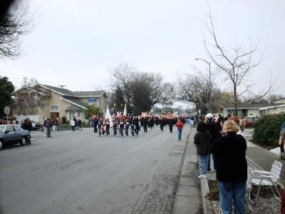 | 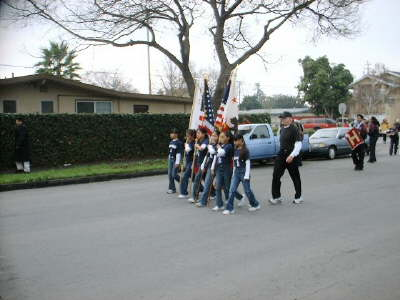 |
| 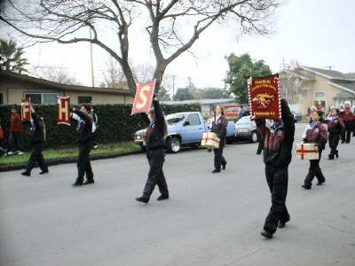 | 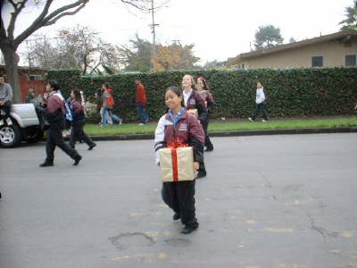 |
| 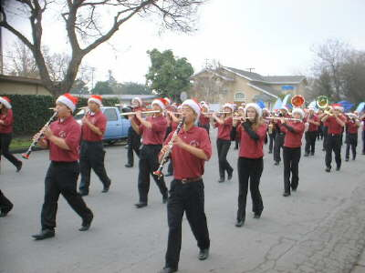 | 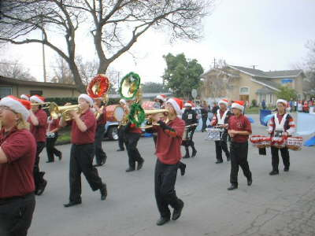 |
| 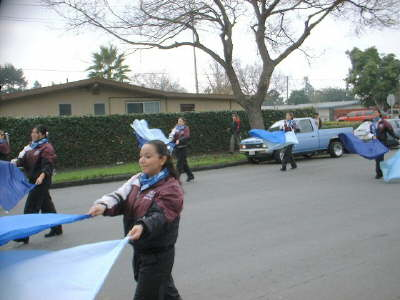 | 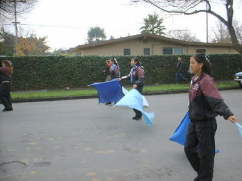 |
| 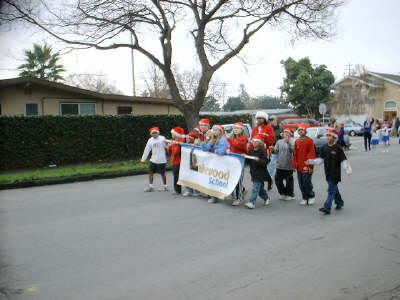 | 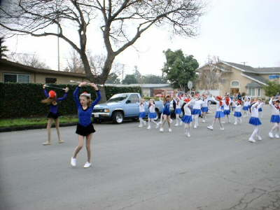 |
| 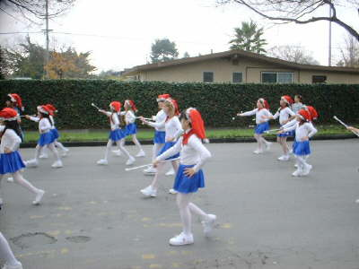 | 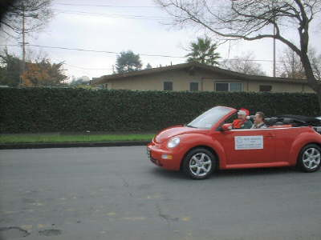 |
| 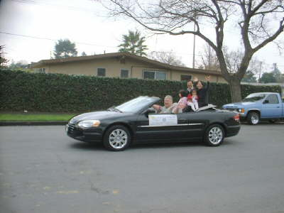 | 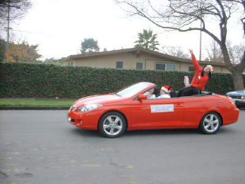 |
| 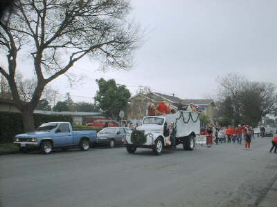 | 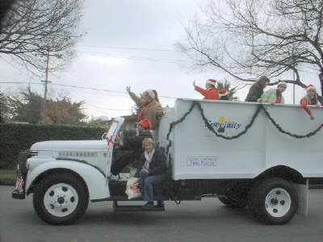 |
| 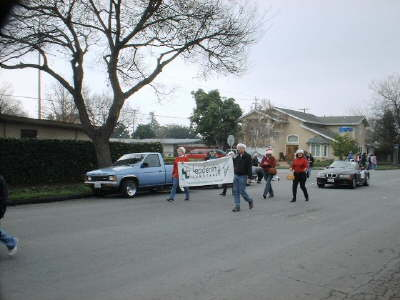 | 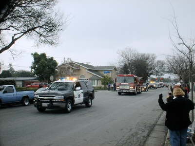 |
| 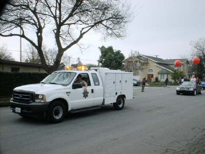 | 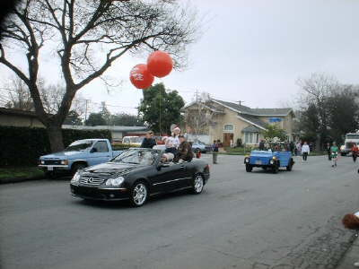 |
| 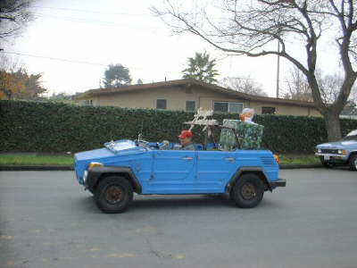 | 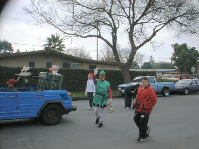 |
| 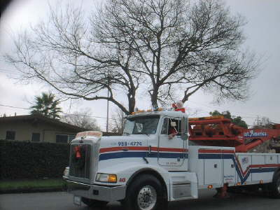 | |

### 2003 Holiday Parade

Photographs taken on Sandia Avenue near Burntwood Court by Brian Smithson (December 2003).

| Photo | Photo |
| :---: | :---: |
| 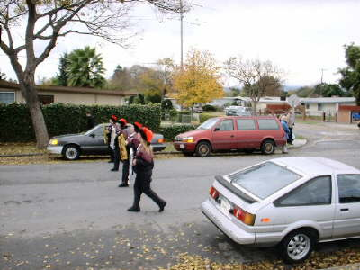 | 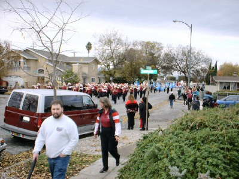 |
| 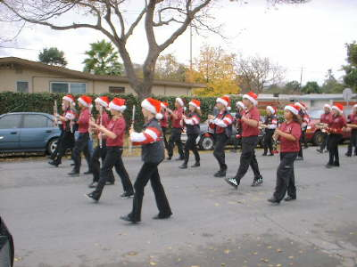 | 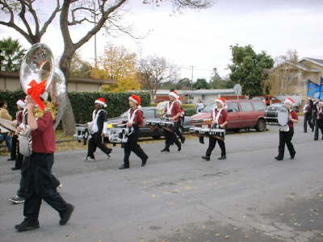 |
| 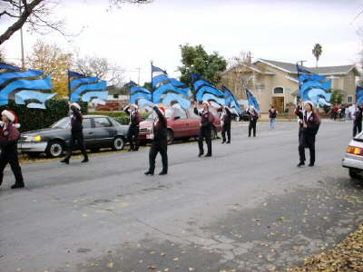 | 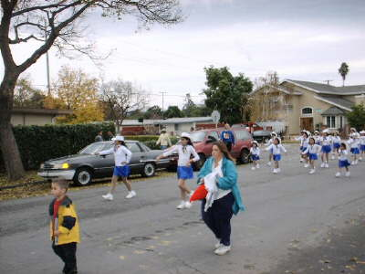 |
| 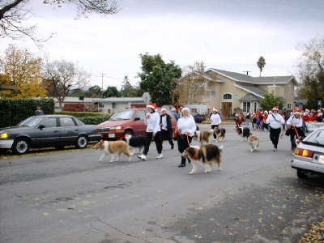 | 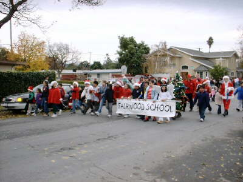 |
| 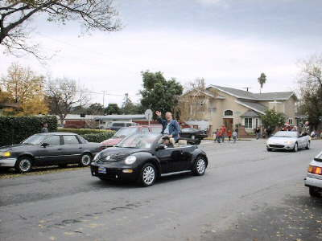 | 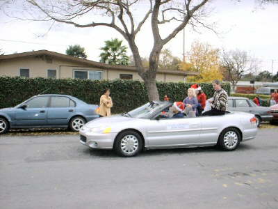 |
| 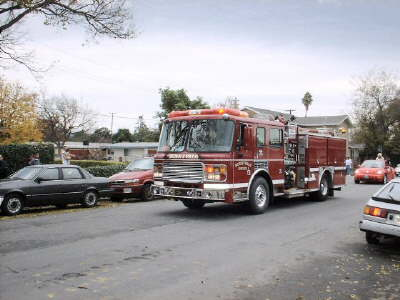 | 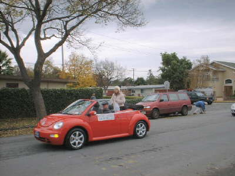 |
| 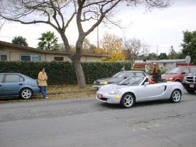 | 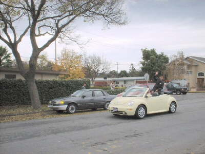 |
| 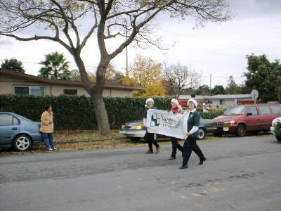 | 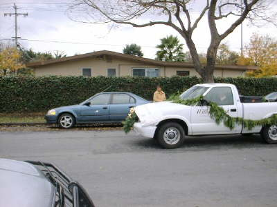 |
| 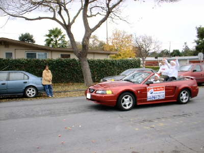 | 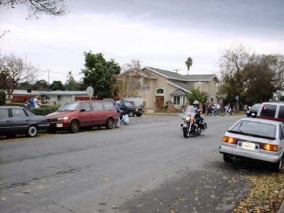 |
| 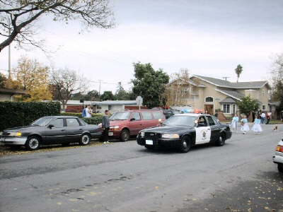 | 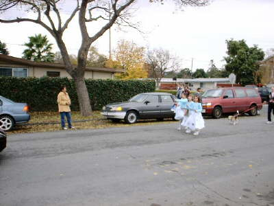 |
| 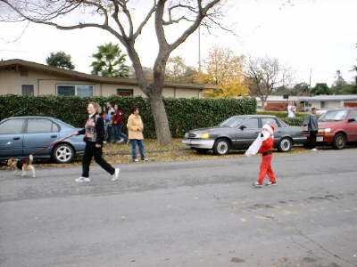 | |

### 2001 Holiday Parade

Photographs taken along the parade route by Brian Smithson (December 2001).

| Photo | Photo |
| :---: | :---: |
| 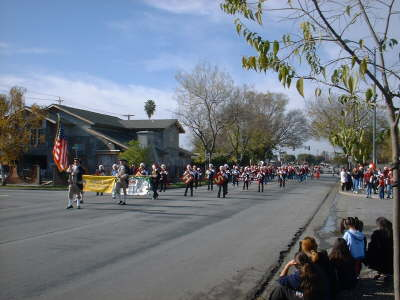 | 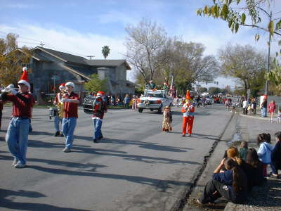 |
| 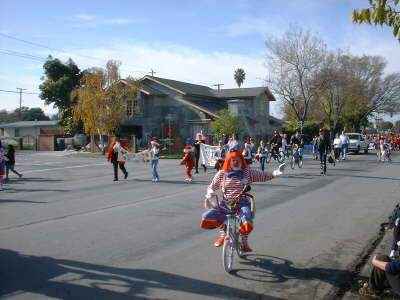 | 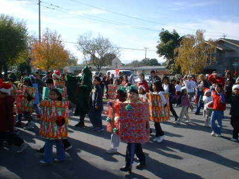 |
| 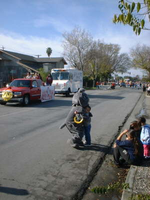 | 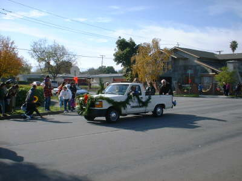 |
|  |  |
|  |  |
|  |  |
|  | |

---

## Holiday Lighting Contest Galleries

Honoring exterior illumination and decorative holiday displays across the four development units of Lakewood Village.

### 2005 Holiday Lighting Contest

- **Grand Prize Winner:** 750 Lakemuir Drive
- **Fairwood Side Winners (East):** 1313 Socorro Drive, 1285 Manzano Drive
- **Lakewood Side Winners (West):** 755 Lakewood Drive, 302 Hiddenlake Drive
- **Special Mention:** 666 Lakefair Drive
- **Honorable Mentions:** 829 & 250 Lakemuir, 263 Twinlake, 235 Velvetlake, 271 & 770 Lakewood, 307 & 318 Greenlake, 670 & 747 Lakefair, 766 Lakebird, 1138 Stonylake, 1117 & 1147 Palamos, 1381 Socorro, 1184 Breezewood, 1192 & 1176 Redrock Ct., 1222 Oakcreek, 934 Blazingwood, 1194 Fairwood, 1315 Sandia, 1284 Prescott, 1164 Pecos, and 1071/1073 Lakedale.

| Contest Trophy Award |
| :---: |
|  *Annual Lakewood Village Holiday Lighting Contest award trophy* |

### 2004 Holiday Lighting Contest

- **Grand Prize Winner:** 666 Lakefair Drive *(Featured in a front-page cover feature in the Sunnyvale Sun newspaper)*
- **Unit I (Winner):** 1244 Socorro | *Honorable Mention:* 1382 Socorro
- **Unit II (Winner):** 1126 Havenwood | *Honorable Mentions:* 1266 Ortiz, 1176 Redrock
- **Unit III (Winner):** 750 Lakemuir | *Honorable Mention:* 778 Lakehaven
- **Unit IV (Winner):** 1295 Meadowlake | *Honorable Mention:* 1071-1073 Lakedale

| 1071-1073 Lakedale Display | 1071-1073 Lakedale Illuminated |
| :---: | :---: |
|  *Unit IV Honorable Mention* |  *Exterior illuminated display* |

### 2003 Holiday Lighting Contest

Photos courtesy of Ursula Syrova and Brian Smithson.

- **Grand Winner:** 1285 Manzano Drive *(Joseph Levy)*
- **Unit I Winner:** 1315 Sandia Avenue *(Mark Sabala)*
- **Unit II Winner:** 710 Jadelake Drive *(Boudewijn and Jean Zwijsen)*
- **Unit III Winner:** 333 Greenlake Drive *(Ofelia and Roctelio Agbulos)*

| Grand Winner: 1285 Manzano | Grand Winner: 1285 Manzano |
| :---: | :---: |
|  *Joseph Levy residence, 1285 Manzano* |  *Illuminated rooftop and lawn display* |
|  *Porch and eaves lighting details* |  *Full front garden lighting* |
|  *Courtyard illumination* |  *Front walkway perspective* |

### 2002 Holiday Lighting Contest

- **Unit I Winner:** 1369 Socorro Avenue
- **Unit II Winner:** 750 Lakemuir Drive
- **Unit III Winner:** 666 Lakefair Drive
- **Unit IV Winner:** 1287 Prescott Avenue

| 666 Lakefair (Unit III) | 666 Lakefair (Unit III) |
| :---: | :---: |
|  *666 Lakefair Drive* |  *666 Lakefair Drive illuminated* |
|  *750 Lakemuir Drive (Unit II)* |  *750 Lakemuir Drive (Unit II)* |
|  *1287 Prescott Avenue (Unit IV)* |  *1287 Prescott Avenue (Unit IV)* |

---

## Annual Summer Picnic Galleries

Community picnics held on the shaded lawns of Lakewood Park adjacent to the Lakewood Park Building.

### 2002 Annual Picnic (September 14, 2002)

Photographs taken by Elena Anderson during the community barbecue and games at Lakewood Park.

| Photo | Photo |
| :---: | :---: |
|  |  |
|  |  |
|  |  |
|  |  |
|  |  |
|  |  |
|  |  |
|  |  |
|  |  |

### 2001 Annual Picnic

Photographs taken by Scott Morten of the City of Sunnyvale during the Lakewood Village Picnic at Lakewood Park.

| Photo | Photo |
| :---: | :---: |
|  |  |
|  |  |
|  |  |
|  |  |
|  |  |
|  |  |
|  |  |
|  |  |
|  |  |
|  |  |
|  | |

---

## 2003 Youth Writing Contest

In the spring of 2003, the LVNA and *The Villager* sponsored a creative writing contest open to all neighborhood youth from Kindergarten through 12th grade. The prompt was:

> **"If I was in charge of Lakewood Village..."**

The contest was made possible through generous prize contributions from local residents. Winning entries were selected across four school grade bands and honored in *The Villager*.

### Contest Award Winners

| Award | Grade Category | Student Author |
| :--- | :--- | :--- |
| **1st Prize** | 9th-12th Grade | Michael M. |
| **1st Prize** | 6th-8th Grade | Deirdra P. |
| **1st Prize** | 3rd-5th Grade | Ryan D. |
| **1st Prize** | Kindergarten-2nd Grade | Madhuchanda B. |
| **2nd Prize** | 6th-8th Grade | Bryant D. |
| **2nd Prize** | Kindergarten-2nd Grade | Leila C. |
| **2nd Prize** | 9th-12th Grade | Aneta P. |
| **2nd Prize** | 3rd-5th Grade | Max J. |
| **3rd Prize** | Kindergarten-2nd Grade | Emily D. |
| **3rd Prize** | 9th-12th Grade | Elisa W. |
| **3rd Prize** | 6th-8th Grade | Monica J. |
| **4th Prize** | 6th-8th Grade | Guadalupe A. |
| **4th Prize** | 9th-12th Grade | Alyssa M. |
| **Honorable Mention** | 6th-8th Grade | Jared D. |
| **Honorable Mention** | 9th-12th Grade | Jennifer D. |
| **Most Creative Expression** | 6th-8th Grade | Jared D. |

### Preserved Youth Essays

???+ note "1st Prize (9th-12th): Michael M. - *The King of Town*"
    The King of Town

    In this world of uncertainty, there should be places we can look to for
    comfort and support.
    One of these should be our neighborhood. A neighborhood should be more than people living in a particular district or area. It is the relationship between people. It is also the activities and playgrounds that children can enjoy. We should always be looking to make improvements. If I were in charge of Lakewood Village, there are specific areas I would attempt to change.

    When I was little, I was involved in Lakewood little league baseball.
    Aside from screaming parents, cursing teammates who threatened me with balls and bats, it was great times! Luckily, my brothers have had much better experiences than I, and their teams and coaches have been great. But occasionally, when watching a game, I will still see overzealous parents and coaches. If I was in charge of Lakewood I would make the parents supportive of the kids, coaches, and umpires. It is impossible to change human nature, but I would encourage civility by parents and coaches in child sports.

    Where have all the great parks gone?
    I remember growing up, and going to incredible playgrounds. Now, they have been replaced by new, boring, ill-conceived structures. Perhaps this is due to injuries in the past, but the effort should be made to be more creative. Safe, but fun playgrounds can still be made. I would have more inventive parks. Also, I would create a new exercise area, and try to make exercising more appealing and fun.

    Some things we can change, and others we can only dream about, but it is great that we have the neighborhood that we do, and we should all work to improve it, and keep it strong.

???+ note "1st Prize (6th-8th): Deirdra P. - *Park Benches & Nature*"
    If I was in charge of Lakewood Village, I would put more benches in the park so that people
    could watch the beautiful sunset melt behind the hills. For the less fortunate that stay around the shopping center, I would build a winter shelter, because rain tends to get tough around that time. To prevent the animals from getting
    themselves hurt, I would want animal contol to cruise around the neighborhood once a week to capture the poor abandoned animals.

    The shopping center has evrerything you need to prepare dinner, buy a snack, or get a haircut for a job
    interveiw the newxt day.
    ButnI think it a litte more kid in it. Like a kid place where they can use a computer or read a book. Lakewood is a heart-warming community that's clean, has thoughtful neighbors, and I have too many ideas for such a place!

???+ note "1st Prize (3rd-5th): Ryan D. - *Ideas for Improving Lakewood Village*"
    Ideas for Improving Lakewood Village

    If I was in charge of Lakewood Village I would
    shut down the horseshoe court since hardly anyone uses it and convert it into an archery range. A few bales of hay shouldn't cost very much and they would last a long time.

    Targets are also cheap and could be replaced when necessary. It
    might even be possible to keep the horseshoe set up and just put the bales of hay at one end so folks could choose either game. Of course everyone would have to bring their own bows and arrows just like they have to do now for the horseshoe
    setup; unless they could somehow be provided by the park and issued out to those who reserve a time slot.

    Another thing I would do is install a nickel arcade game setup and use the

    money to pay for the equipment and to eventually
    fund other projects.

    Another money maker idea might be to start a weekly bingo game in the recreation room. This would bring in various age groups from the community and would create a friendlier atmosphere in Lakewood Village.

    There could be a volunteer list to host the game each week to help share that responsibility.

???+ note "1st Prize (K-2nd): Madhuchanda B. - *Upgrading Our Schools*"
    If I was in charge of Lakewood Village, I would upgrade school because it's where our
    country's future depends. I would secure street with cameras at every traffic light. I would have meeting every alternate month and I will ask if anyone is having problems and we will solve it together. Every six months there will
    science fairs to encourage creativity among children and, games, sports, and picnics to make the community friendly.

??? note "2nd Prize (6th-8th): Bryant D. - *Changing Lakewood Village*"
    Changing Lakewood Village

    Oh, how I adore Lakewood Village! This place has nurtured
    me from childhood to now. Since I have the opportunity to say what I want if I was in charge, Id finally feel power!

    Anyway, Id change the recreational activities of our neighborhood to something more exhilarating! Sure, basketball
    and soccer is fun, but we need to know and play sports like rugby and badminton! Itll make us more unique! We may be the city that knows more sports in our time!

    Litter is gross! Our place would be brilliant if we freshen up, but
    there is one setback. There are people that just throw their trash on the ground! Why cant they just find a trash can and put it in there? This will be my top priority if I was in charge!

    With these thoughts in mind, I will make
    Lakewood Village into a utopia!

??? note "2nd Prize (K-2nd): Leila C. - *Pools & Playgrounds*"
    If I were in charge of Lakewood Village, I would open the pool in spring and summer, and
    build a new playground. I would expand Lakewood Park and have more clubs, camps, and events. The shopping center should have an American restaurant. Besides that, I think Lakewood Village is perfect!

??? note "2nd Prize (9th-12th): Aneta P. - *Park Safety & Cleanliness*"
    If I were in charge of Lakewood Village, I would address the lack of parking and safety
    around Lakewood Park because it is the hub, not the downfall, of the Village.

    Too many times I have passed Lakewood Park, found myself stuck in the traffic of party-goers in their cars and had no space to park my own car near my
    home. We cannot prevent all events from being held in the park, so the solution is to create more parking. A 20 space lot between the fence and picnic tables where the dumpster currently is, and expanding the lot next to the pool
    would alleviate the problem. People attending parties, baseball games and the pool would all be grateful.

    Crucial items that are missing in the community are two stop signs on the intersection of Silverlake and Lakedale next to Lakewood
    Park. Children are constantly crossing Silverlake from the park, but often large, parked cars block drivers from seeing them. Some drivers also enjoy speeding on such a long, uninterrupted street. We cannot wait until a
    tragic accident finally awakens us. Stop signs would allow pedestrians to cross safely into the park and discourage speeding. A bonus would be the much-wanted increased police patrols because they would need to enforce the new
    signs.

    If the Village does increase parking and adds a stop sign, the costs may prompt some people to want to cancel the annual Holiday Parade.
    I think the parade would actually be beneficial to us because revenue could be raised at the picnic after the parade. By charging $5 per adult and $3 per child (ages 4-12) and having the City chip in, we would eventually raise enough money to pay off these new and much needed additions.

??? note "2nd Prize (3rd-5th): Max J. - *Neighborhood Flowers & Unity*"
    If I were running Lakewood Village I would put in more flowers so the fragrance would stand
    out. I would not allow racism so that we could all be friends. I would add more buildings to the schools so that our teachers had room for extra programs. Then we would get more education. Even though we need to add stuff, Lakewood
    Village it is still a great place to live because it is near everything.

??? note "3rd Prize (K-2nd): Emily D. - *Wading Pool for Kids*"
    If I was in charge of Lakewood Village I would make a wading pool for little kids like
    myself so we can cool off our feet on a hot summer day and have fun splashing around. A water slide would be great too, but if that costs too much then maybe a few mist sprayers could be installed to help cool everyone off. A mist sprayer in
    the sand area would help me make great sand castles.

    Also poney rides a couple of times each summer would be fun. Or maybe a Barbie Club so all the little girls my age could come together to share our Barbie toys and have fun playing
    with them.

    I love Lakewood Park. I have great fun swinging on the swings and playing on all of the other great stuff.

??? note "3rd Prize (9th-12th): Elisa W. - *Quiet Neighborhood Vision*"
    Picture an overall great neighborhood. It's usually quiet, peaceful, the houses have
    green lawns and fresh coats of paint. There's a park, a school, local stores, even gas stations.
    Now think that amongst the picturesque neighborhood there is an intruder- a house with a well seeded weed garden, a record-setting collection of paint chips on the ground, a cement yard, and broken down cars permanently parked in the front yard. Our common sense and pride for our community forces us to ask, "How can we fix this?!"

    Not alot of people realize that there are actually municipal codes that were made to make sure those things don't happen.
    However, there are always places and things that somehow are igonored or slip through the cracks. If i were in charge, one of the first things I'd do would be to instate stricter municipal cod enforcement. Every month, municipal code officers would patrol Lakewood Village, distributing notices and taking action as needed to get everyone up to code.

    Cars are another big problem. Four-way intersections all through Lakewood Village are an accident waiting to happen.
    Four-way stop signs at all intersections would slow down drivers that go dangerously fast, so that Lakewood Village can be safe for pedestrians as well as other drivers. Backing out of your own driveway can be a hazard also, because cars are often parked so close to your driveway you can't see around them. I think a new municipal code should state that cars cannot be parked closer than six feet to any driveway entrance.

    People should show pride and respect for their community and their neighbors. Keep you house clean and well-kept. Drive carefully and within the speed limit. We can make Lakewood Village a better place for everyone to live.

??? note "3rd Prize (6th-8th): Monica J. - *Preserving Our Great Village*"
    If I was in charge of Lakewood Village, hardly anything would change because our village is
    so great. Almost everyone wants their yards to look pretty. To run the parks I would keep it as it is because people can go there anytime they want and spend as much time as they want there. One thing we can all do is go around and ask
    neighbors to please pick up trash around their house so that our village stays clean. I like that Fairwood School and Lakewood School play basketball games against each other now.
    Its fun and I wish we played more. Lakewood Village is such a great place to live because everyone lives close to each other and we are all like family, helping one another, saying hello everyday, and things like that. I hope that in the future Lakewood Village will stay as nice as it is.

??? note "4th Prize (6th-8th): Guadalupe A. - *A Neighborhood for Everyone*"
    If I was in charge of Lakewood Village, I would do lots of things. So if you want to know
    what I would do, grad on to your seats. This is going to be quite a paper.

    I would start by making people move thier cars when the street sweeper comes by. Because nobody really seems to care. That means our neighbor hood is still
    going to be dirty. What I would do, is fine the people who don't move thier car.

    Another thing I would do is make everyone cut thier grass.Because if you look around, not everybody cuts thier grass. That just makes our neighbor
    hood look ugly. So to make people cut thier grass, I would knock on thier door and tell them to cut it. And next time you go and it is not cut, fine them.

    So that is about it. Hope you liked it.

??? note "4th Prize (9th-12th): Alyssa M. - *Community Pride & Improvements*"
    If I was in charge of Lakewood Village I would definitely change some things. I've lived in
    the same place for the past 14 years and I have never really known anyone besides my immediate neighbors. I've always watched the movies where the kids play outside all the time and everyone knows eachother and in the past years I've noticed
    that that isn't my neighborhood. I think a thing that would bring everyone together would be to have block parties. On holidays everyone should make a dish come outside and meet their neighbors. I think if we had those growing up I would know
    more of the people that surround me.

    Being a teenager I was very happy when I found out there was going to be a movie theater built. I always used to go to Mountain View or the Sunnyvale mall. I always imagined it to be very convenient
    to live next to jamba juice, and Ben n; Jerry's and ACM. But never did I think that these attractions would bring so much traffic and so many bad drivers to our streets. I live on the very beggining (Or end) or Torrance and me and my little
    brother always used to play outside. Now I find it very hard to play basketball outside with the speed racers cutting trough our street to catch their movie. I've thought about things that could help this situation and I think I've come up
    with a winner. We should put speed bumps along the back street. This way it forces people to slow down. I don't think I'm alone when I speak about this issue. Sometimes I sit outside and watch the cars as they dash past our residential area.
    They don't care about our peaceful streets they only care about getting to their movie on time. If I was in charge I would definitely install speed bumps. Besides for my few complaints and the fact that my neighbors always park in front of my
    house I have been very happy living here. It is a safe place and I've learned to love Lakewood village.

??? note "Honorable Mention (6th-8th): Jared D. - *Sunnyvale - City of Hip-Hop*"
    SUNNYVALE - CITY OF HIPHOP

    This is what i'd like to see happen if I were in charge of
    Lakewood Village....

    VERSE ONE:

    wak'n up 6 am,

    to X-tian hiphop on FM,

    eat'n cereal,

    record what I written,

    get to the park.

    and set the stage, and start ripp'n,

    break beat B-boys & girls,

    the hiphop sound hitt'n,

    your mind body and soul,

    gett'n into it,

    God's tak'n control,

    while you shak'n it,

    I jump on to the stage,

    rapp'n how I feel,

    Im an MC,

    and I'm keep'n it real...

    HOOK:

    SUNNY, SUNNYVALE,

    Doing hiphop instead of jail,

    SUNNY, SUNNYVALE,

    Keep it positive, we won't fail. 2x

    VERSE TWO:

    got the city jump'n,

    not sell'n drugs, and,

    but being cool,

    and really com'n, round,

    thats why we bound,

    to the sound,

    clean'n up this town,

    when we break it down,

    freestyle concerts,

    everyone com'n in long spurts,

    keep'n it clean,

    not to hurt,

    but respecting,

    not rejecting,

    even if that ain't

    what your style be...

    -HOOK repeated-

    CALI, CALIFORNIA,

    In the city of Sunnyvale,

    CALI, CALIFORNIA,

    Keep it positive, we won't fail,

    CALI, CALIFORNIA,

    In the city of Sunnyvale,

    CALI, CALIFORNIA,

    The City of
    Hiphop, the city of Hiphop...

??? note "Honorable Mention (9th-12th): Jennifer D. - *Lakewood Village: Today is Now*"
    Lakewood Village: Today is now.

    I have been living in Lakewood Village all my life. I
    have always enjoyed how peaceful and tranquil this place can be. I think its nice and refreshing, but once in a while everything and monotonous. There arent many big events that happen around here. Sometimes I want this place to have
    showings of movies in the park on an autumn night or plain block parties. Wouldnt those be oodles of fun? I would think so. Those are just a few of my fresh ideas.

    Lakewood Park is a great place to unwind when you need some air, get
    inspiration, or even just some time to think. I am very fond on strolling in the park because it is conveniently placed across the street from my house. Lakewood Park is an awesome place to do whatever your heart feels content with. Just
    recently, I took a walk with my mom, brother and sister. It has been a while since Ive done that. We stopped by Lakewood Elementary School to beat my brother and sister at basketball (it didnt go as planned), and just to play around. Well,
    I observed that the schools playground was weak, small, puny, rusty, and other words that will be synonymous to those words. How can these children have fun on these poor excuses for a playgrounWriting Contest.ems d? There is no variety for
    these kids. Their playground is lacking! I went to that school and recesses were boring because after a little fun on that playground, I got bored and lost interest. They are risky to play on. The ground is uneven, and the bars are chipped.
    If I were in charge of Lakewood Village, Id update the school and give these kids something more. These little kiddies would find it most enlightening. More fun and activity will stimulate great knowledge. If this can spark happiness for a
    few kids, I would be ecstatic to do more for humanity. Children can be little Einsteins in the making.As we continued our journey, we passed the swimming pool, in which I have adored as I grew up for various reasons. I think the pool is a
    great spot to exercise and cool down. We continued to the tennis and basketball courts, in which I think, are working well. As my family and I looped around to get back home, I noticed that the park was vast and open. It was nice. Another
    thing I noticed was how the picnic areas looked too aged. I would like to renovate some areas of the village to make it safer and appealing to everyone. If we pull ideas from fellow citizens of Lakewood, we could mix old school Lakewood with
    new school ideas to make a retro-styled, modern Lakewood Village. That is something to look forward to.

??? note "Most Creative Expression (6th-8th): Jared D. - *Sunnyvale - City of Hip-Hop (Creative Award)*"
    SUNNYVALE - CITY OF HIPHOP

    This is what i'd like to see happen if I were in charge of
    Lakewood Village....

    VERSE ONE:

    wak'n up 6 am,

    to X-tian hiphop on FM,

    eat'n cereal,

    record what I written,

    get to the park.

    and set the stage, and start ripp'n,

    break beat B-boys & girls,

    the hiphop sound hitt'n,

    your mind body and soul,

    gett'n into it,

    God's tak'n control,

    while you shak'n it,

    I jump on to the stage,

    rapp'n how I feel,

    Im an MC,

    and I'm keep'n it real...

    HOOK:

    SUNNY, SUNNYVALE,

    Doing hiphop instead of jail,

    SUNNY, SUNNYVALE,

    Keep it positive, we won't fail. 2x

    VERSE TWO:

    got the city jump'n,

    not sell'n drugs, and,

    but being cool,

    and really com'n, round,

    thats why we bound,

    to the sound,

    clean'n up this town,

    when we break it down,

    freestyle concerts,

    everyone com'n in long spurts,

    keep'n it clean,

    not to hurt,

    but respecting,

    not rejecting,

    even if that ain't

    what your style be...

    -HOOK repeated-

    CALI, CALIFORNIA,

    In the city of Sunnyvale,

    CALI, CALIFORNIA,

    Keep it positive, we won't fail,

    CALI, CALIFORNIA,

    In the city of Sunnyvale,

    CALI, CALIFORNIA,

    The City of
    Hiphop, the city of Hiphop...

---

## Community Honors and Athletic Achievements

Special recognitions and competitive accomplishments by Lakewood Village residents and youth sports teams.

### 2001 AIA Architecture Award ("Visions of the Valley")

In October 2001, the Santa Clara Valley chapter of the American Institute of Architects (AIA) held their biennial *Visions of the Valley* design competition. 

Among the award-winning designs was a remodeled Lakewood Village home: the **Smithson Residence** at Burntwood Court and Sandia Avenue, designed by architect D. Guy Ayers. It was one of only two single-family residences honored by the AIA chapter that year.

| The Smithson Residence |
| :---: |
|  *Smithson Residence, 2001 AIA Santa Clara Valley Design Award Winner* |

#### Architectural Drawings & Construction Gallery

| Photo | Photo |
| :---: | :---: |
|  *Elevation drawings from all four facades* |  *Burntwood Court driveway and perforated aluminum panels* |
|  *Street elevation with integrated masonry wall* |  *Sandia Avenue street frontage* |
|  *Closer view from Sandia Avenue* |  *Section view looking north* |
|  *Entryway, exposed spiral HVAC duct, and skylight* |  *Rear courtyard and second-story office* |
|  *Front entrance deck at night* |  *First floor and lot plan* |
|  *Dual-sided fireplace serving home office and bedroom* |  *Back patio lighting at night* |
|  *Structural I-beam and clerestory window detail* |  *Second floor layout* |
|  *Courtyard and sewing studio windows* |  *Two-story section view looking east* |
|  *Architectural stair construction details* |  *Custom central staircase* |
|  *Natural light patterns from stairwell skylight* |  *Shear-strength seismic steel bracing* |
|  *Corner window cross-bracing* |  *Custom handrail and landing detail* |

### 2004 Sunnyvale Knights Regional Champions

On November 26, 2004, the **Sunnyvale Knights Junior Pee Wee cheerleaders** (ages 8 to 11), representing northern Sunnyvale, captured First Place in their division at the California Western Regional Competition in Reno, Nevada. 

The regional victory earned the squad a coveted berth at the US National Cheerleading Competition in Florida, marking the first time in six years that the division qualified for national championship competition.

| Junior Pee Wee Cheerleaders | Regional Championship Team |
| :---: | :---: |
|  *Sunnyvale Knights Junior Pee Wee squad* |  *First place trophy winners at California Western Regional in Reno, NV* |
