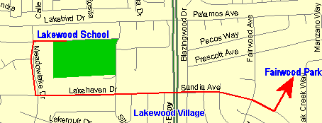
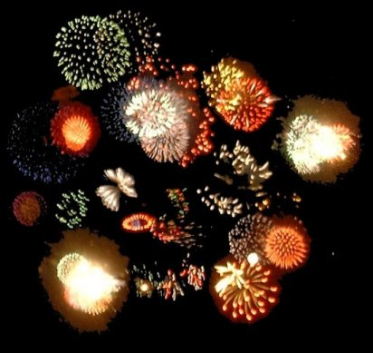

# Historical Neighborhood Traditions & Annual Events

!!! note "Historical Archive Snapshot"
    This page documents the recurring civic traditions, neighborhood parades, holiday contests, and community gatherings organized by the Lakewood Village Residents Association (LVRA) and Lakewood Village Neighborhood Association (LVNA) from 1958 through the 2000s.
    
    For photographs, award winners, and event albums from these gatherings, visit the companion archive: **[Community Event Photo Galleries (2001-2005)](Events/events.md)**.

[📸 **View Historical Event Photo Galleries (2001-2005)**](Events/events.md){ .md-button .md-button--primary }

### Jump to Tradition

- [The Annual Holiday Parade](#the-annual-holiday-parade)
- [The Holiday Lighting Contest](#the-holiday-lighting-contest)
- [Annual Summer Picnic](#annual-lakewood-village-picnic)
- [Dumpster Days Cleanups](#dumpster-days-neighborhood-cleanups)
- [Great America Fireworks](#great-america-fireworks-displays)
- [Neighborhood Seasonal Cadence & Calendar](#neighborhood-seasonal-cadence-and-calendar)

---

## The Annual Holiday Parade

The Lakewood Village Holiday Parade was one of the neighborhood's oldest, proudest, and most enduring civic traditions. First organized by the LVRA in December 1959 during the tract's second holiday season, the parade was maintained by the LVNA for decades and stood as the only neighborhood-organized holiday parade in the City of Sunnyvale.

| Lakewood Village Holiday Parade Banner |
| :---: |
|  *Historic Lakewood Village Holiday Parade banner* |

### Parade Route and Organization

Held annually on the second Saturday of December, the parade was planned by the LVNA Board and staged with the assistance of 15 to 25 neighborhood volunteers:

- **Staging & Assembly:** Participants assembled at Lakewood Elementary School (10:00 AM) on the west side of Lawrence Expressway.
- **The One-Mile March:** Stepping off promptly at 11:00 AM, the procession traveled east along Lakehaven Drive, crossed Lawrence Expressway under coordinated traffic control from Sunnyvale Public Safety, continued east on Sandia Avenue, and concluded at Fairwood Elementary School.
- **Fairwood Park Celebration:** Following the parade, neighbors gathered at Fairwood Park for complimentary hot chocolate, hot spiced cider, and holiday cookies.

### Community Participants

The parade brought together civic and student groups from across northern Sunnyvale, including:

- **Marching Bands & Color Guard:** The Fremont High School Marching Band and Color Guard led the procession with holiday musical arrangements.
- **Local Schools & Youth Groups:** Students, faculty, and scout troops from Lakewood Elementary, Fairwood Elementary, and Columbia Middle School.
- **Civic Leaders:** Sunnyvale City Council members, department heads, and Sunnyvale Public Safety motorcycle officers.
- **Santa Claus:** The traditional grand finale, riding atop a Sunnyvale fire truck to greet neighborhood children.

---

## The Holiday Lighting Contest

Established in December 1958, the Lakewood Village Holiday Lighting Contest was an annual competition honoring the best exterior holiday decorations, roof displays, and lighting arrangements in northern Sunnyvale.

Judged by an LVNA volunteer panel touring the neighborhood on a designated December evening, the contest awarded honors across each of the subdivision's four development units:

- **Unit I (East):** Sandia Avenue to Wildwood Avenue.
- **Unit II (West):** Lakehaven Drive to Lakewood Drive.
- **Unit III (West):** Lakehaven Drive to Lakebird Drive.
- **Unit IV (East):** Palamos Avenue to Sandia Avenue.

In addition to individual unit winners, the judges awarded an overall **Grand Prize Winner** and multiple **Honorable Mentions**. Formal certificates and recognition honors were traditionally bestowed at the January LVNA general meeting at the Lakewood Park Building.

### Regional Acclaim

Due to the widespread participation of residents, Lakewood Village was renowned throughout the South Bay for having one of the densest concentrations of holiday lighting in Northern California. The neighborhood was featured in the published book *Holiday Lights! Brilliant Displays to Inspire Your Christmas Celebration*, recognized as one of only four must-see residential displays in the entire San Francisco Bay Area.

---

## Annual Lakewood Village Picnic

Held each late summer at **Lakewood Park**, the Annual Picnic served as the neighborhood's signature warm-weather social gathering. 

Sponsored by the LVNA and often supported by the City of Sunnyvale's Neighborhood Preservation division, the picnic featured:

- **Community Barbecue:** Grilled hot dogs, hamburgers, refreshments, and potluck side dishes shared by neighbors.
- **Children's Games & Contests:** Three-legged races, water balloon tosses, face painting, and relay games on the Lakewood Park lawns.
- **Civic Engagement:** Informational booths staffed by City of Sunnyvale staff, fire department personnel, and local community service organizations.
- **Neighbor Connections:** An opportunity for residents from both the Lakewood (west) and Fairwood (east) sides of Lawrence Expressway to socialize.

---

## Dumpster Days & Neighborhood Cleanups

Each June, the LVNA coordinated with the City of Sunnyvale's Department of Public Works to host **Dumpster Days**, a community cleanup initiative helping residents keep their properties and neighborhood clean.

- **Drop-Off Stations:** Heavy-duty, industrial-sized refuse dumpsters were strategically placed at key intersections throughout the four units.
- **Oversized Disposal:** Allowed residents to discard bulky household items, tree trimmings, and furniture that exceeded standard curbside collection limits.
- **Tire Recycling:** A dedicated dumpster was provided each year specifically for the proper recycling and disposal of automobile tires.
- **Volunteer Monitors:** Neighborhood volunteers ("Dumpster Monitors") monitored each location to ensure safety and prevent unauthorized commercial or hazardous dumping.

---

## Great America Fireworks Displays

Beginning with the opening of Marriott's (later Paramount's) Great America theme park in 1976, fireworks displays became an integral part of summer life in Lakewood Village.

| Great America Fireworks from Lakewood Village |
| :---: |
|  *Photo collage taken on July 4th, 2003, from a Lakewood Village second-story window.* |

### Attraction and Community Tradition

Located just across Highway 237 in neighboring Santa Clara, the park launched major pyrotechnic shows on weekend nights, opening weekends, and major holidays. 

For residents-particularly those living in Units II and IV with northern exposures-the shows were a treasured neighborhood perk. Families routinely gathered in backyards, leaned out second-story windows, or set up lawn chairs in front yards to watch the fireworks overhead.

### Neighborhood Traffic Management

The displays also brought massive traffic surges into northern Sunnyvale. To protect residential streets from gridlock and ensure emergency vehicle access:

- Sunnyvale Public Safety instituted special traffic controls during evening displays.
- Residential entrances into Lakewood Village were restricted to local residents and their guests.
- Highway 101 freeway off-ramps at Lawrence Expressway were temporarily closed immediately following major holiday shows to manage departing crowds.

---

## Neighborhood Seasonal Cadence and Calendar

Historically, Lakewood Village operated on a predictable seasonal cadence of civic events, community cleanups, and social gatherings organized by the LVNA and neighborhood volunteers:

### Spring (March - May)

- **LVNA Annual Board Elections (March):** General membership meeting held on the second Wednesday of March to nominate and elect executive board officers, establish annual committees, and set neighborhood advocacy goals for the year.
- **Neighborhood Enhancement & Dumpster Days (April/May):** Coordinated in partnership with the City of Sunnyvale, large trash dumpsters were placed around the neighborhood to help residents dispose of large junk and clean up yards.

### Summer (July - August)

- **Annual Lakewood Village Picnic (July/August):** Flagship community barbecue gathering held at Lakewood Park. Featured grilled burgers and hot dogs, potluck salads and desserts, games for children, and visits from Sunnyvale Public Safety fire engines.

### Fall (September - November)

- **Neighborhood-Wide Garage Sales (September/October):** Multi-block yard sales organized across the Lakewood and Fairwood sides, coordinated through notices in *The Villager* to draw bargain hunters from across northern Sunnyvale.
- **Back-to-School Initiatives:** Special coverage and articles in *The Villager* highlighting faculty, academic programs, and school events at Lakewood Elementary, Fairwood Elementary, and Columbia Middle School.

### Winter (December)

- **Annual Holiday Parade:** Nighttime and morning procession of decorated cars, trucks, golf carts, and bicycles winding through neighborhood streets with Santa Claus.
- **Holiday Lighting Contest:** Neighborhood-wide judging of exterior holiday light displays across both the Lakewood and Fairwood sides, with award winners announced in the January issue of *The Villager*.

### Year-Round Monthly Rhythm

- **LVNA General Meetings:** Held on the second Wednesday of each month at 7:00 PM at the Lakewood Park Building or school multi-purpose rooms.
- ***The Villager* Publication & Delivery:** Printed and hand-delivered door-to-door by volunteer block walkers at the beginning of each month across all 1,600+ homes.
