# Lakewood Village: 50-Year Neighborhood History & Development

!!! note "Neighborhood History Archive"
    This page documents the 50-year evolution of Lakewood Village in northern Sunnyvale, California. From agricultural orchards and a post-WWII general aviation airfield to its 1950s subdivision construction and modern community milestones, this comprehensive timeline preserves neighborhood records collected by the Lakewood Village Neighborhood Association (LVNA).
    
    For the archived guide detailing neighborhood parks, schools, shopping, and transit as documented during the 2000s, visit the **[Historical Community Guide](../lv.md)**.

[🏡 **Explore Historical Community Guide & Neighborhood Amenities**](../lv.md){ .md-button .md-button--primary }

### Jump to Historical Era

- [Building Lakewood Village](#building-lakewood-village)
- [Subdivision Parcel & Lot Layout](#subdivision-parcel-and-lot-layout)
- [Before 1950: Orchards & Airport](#before-1950-agricultural-orchards-and-airport)
- [The 1950s: Subdivision Construction](#the-1950s-subdivision-construction-and-founding)
- [The 1960s: Suburban Growth](#the-1960s-suburban-growth-and-maturation)
- [The 1970s: Infrastructure & Sports](#the-1970s-infrastructure-and-community-life)
- [The 1980s: Silicon Valley Transition](#the-1980s-silicon-valley-transition)
- [The 1990s: Environmental Monitoring & Rebirth](#the-1990s-environmental-monitoring-and-rebirth)
- [Physical Evolution & USGS Cartography (1970s-1990s)](#physical-evolution-and-usgs-cartography-1970s-1990s)
- [The 2000s: 50th Anniversary & Preservation](#the-2000s-50th-anniversary-and-preservation)
- [The Modern Era: 2010s to 2026](#the-modern-era-civic-investment-and-environmental-stewardship-2010s-2026)
- [Demographics & Historical Census Records](#demographics-and-historical-census-records)
- [Local History Bibliography & References](#local-history-bibliography-and-references)

---

## Building Lakewood Village

Construction of Lakewood Village began in 1955 and continued through 1958. Built by the Branden Construction Company, the tract fulfilled intense post-WWII demand for family housing as the Santa Clara Valley transformed from the "Valley of Heart's Delight" into Silicon Valley.

| Lakewood Village Subdivision Development Units |
| :---: |
| 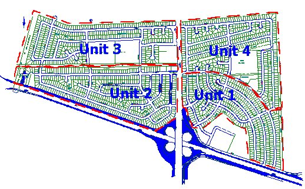 *Map of Lakewood Village development units 1 through 4 (1955-1958)* |

The neighborhood was developed in four distinct phases, known as "units":

- **Unit 1:** Sandia Avenue to Wildwood Avenue, east of Lawrence Expressway.
- **Unit 2:** Lakehaven Drive to Lakewood Drive, west of Lawrence Expressway.
- **Unit 3:** Lakehaven Drive to Lakebird Drive, west of Lawrence Expressway.
- **Unit 4:** Palamos Avenue to Sandia Avenue, east of Lawrence Expressway.

### Subdivision Parcel and Lot Layout

The tract was surveyed into approximately 1,625 single-family residential lots with curvilinear streets designed to slow vehicle traffic:

| Subdivision Lot & Parcel Map |
| :---: |
| [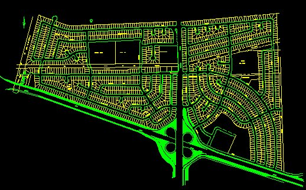](../../Resources/Maps/Lot/lotmap-extent.jpg){ .glightbox } *Subdivision parcel and property boundaries across all four development units (click to view full resolution)* |

- **AutoCAD Vector Drawing:** [Download LAKEWOOD.DWG](../../Resources/Maps/Lot/LAKEWOOD.DWG) - The complete AutoCAD DWG vector map of subdivision boundaries and individual parcel lines.

### Mid-Century Architectural Models

Most original homes were three-bedroom, two-bath single-family houses built with distinctive mid-century lines. Below are original architectural plans and features promoted by the builders:

| The Biscayne Model | The Nassau Model | Home Features & Options |
| :---: | :---: | :---: |
| [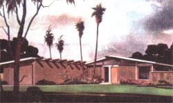](biscayne.jpg){ .glightbox } **The Biscayne** | [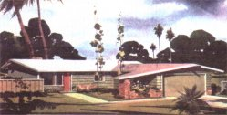](nassau.jpg){ .glightbox } **The Nassau** | [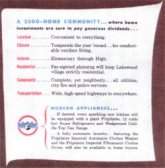](features.jpg){ .glightbox } **Architectural Features** |

---

## Before 1950: Agricultural Orchards and Airport

Like most of the Santa Clara Valley, the land now occupied by Lakewood Village was agricultural farmland and fruit orchards prior to 1950. The City of Sunnyvale was concentrated around what is today Murphy Avenue in downtown, and the Lakewood Village territory was unincorporated county land.

| 1906 Sunnyvale Projection Map |
| :---: |
| [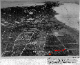](Before_1950/1906_sunnyvale.gif){ .glightbox } *Projection of Sunnyvale as it existed in 1906. Lakewood Village land was rural county farmland northeast of the town center (click to view full map).* |

### Santa Clara Valley Airport (1945-1955)

Just after World War II, a group of ten private investors led by aviator Harold Willson (son of Frank Chapman Willson, a prominent local orchardist renowned for "Willson's Wonder Walnuts") purchased 128 acres in what is now the Fairwood side of Lakewood Village for $70,400 in 1946 to establish the **Santa Clara Valley Airport**. Driven by the inconvenience of commuting to Palo Alto to fly their personal planes (such as Willson's Globe Swift), the group constructed a 2,100-foot paved runway, an administrative flight office, a mechanics' shop, and a 60-by-80-foot maintenance hangar capable of housing ten aircraft.

The airfield served regional private aviators, flight training operations, and social gatherings for pilots until operations concluded after two years and seventeen days. The hangar structures were subsequently dismantled and relocated to Hayward Airport and San Jose Municipal. The land was leased until 1956, when it was purchased for almost $400,000 by Branden Construction Company to begin building Lakewood Village.

#### Archival Master Photographs (Sunnyvale Historical Society Collection)

| Historical Airfield Footprint & Subdivision Overlay | 1940s Santa Clara Valley Airport Aerial |
| :---: | :---: |
| [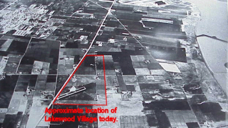](../../Resources/Maps/Historical/historical-view.gif){ .glightbox } *1940s aerial photograph with Santa Clara Valley Airport and future Lakewood Village perimeter outlined in red* | [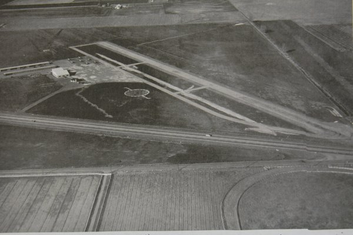](Before_1950/Airport/scv_airport_aerial_1940s.jpg){ .glightbox } *Archival aerial photograph of the active runway, hangars, and agricultural orchards (Sunnyvale Historical Society)* |

| Harold Willson Beside Aircraft | Early Northern Sunnyvale Aerial (Bayshore & Lawrence) |
| :---: | :---: |
| [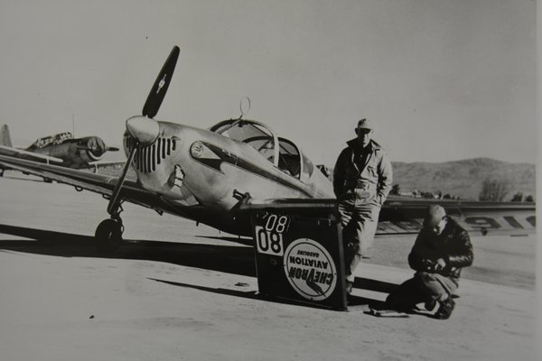](Before_1950/Airport/harold_willson_aircraft.jpg){ .glightbox } *Airfield founder Harold Willson standing beside his Globe Swift plane (Sunnyvale Historical Society)* | [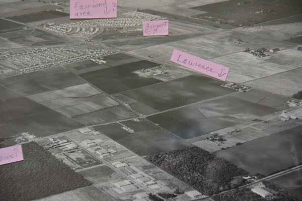](Before_1950/Airport/northern_sunnyvale_aerial_early.jpg){ .glightbox } *High-altitude aerial view of northern Sunnyvale prior to suburban tract development (Sunnyvale Historical Society)* |

| Early Sunnyvale Road Map (Bayshore / US-101 Era) |
| :---: |
| [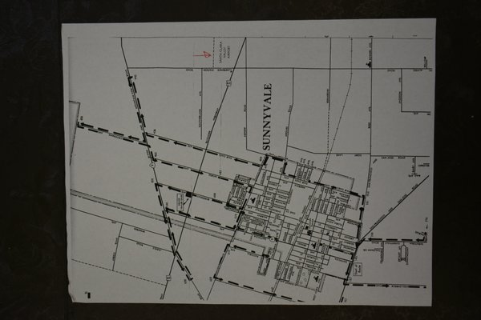](Before_1950/Airport/vintage_sunnyvale_map.jpg){ .glightbox } *Mid-century road map of Sunnyvale showing Bayshore Freeway and future tract corridors (Sunnyvale Historical Society)* |

#### Vintage Airfield Snapshots (1950s Photographic Record)

| Runway & Maintenance Hangar | Airfield Operations & Aircraft |
| :---: | :---: |
| 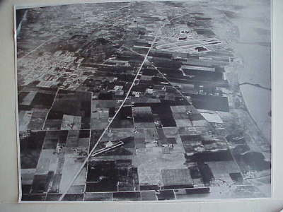 *Mechanic hangar and aircraft service line* | 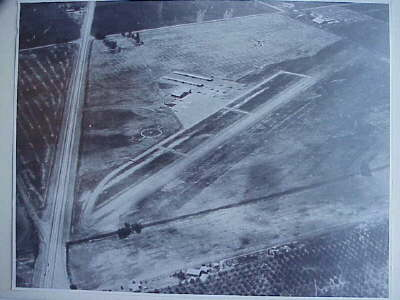 *Flight line at the Santa Clara Valley Airport* |
| 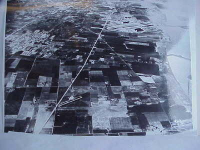 *Graded runway on what is now Fairwood Avenue* | 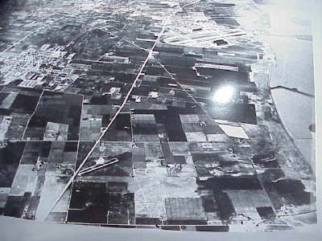 *Private planes tied down along the airfield* |
| 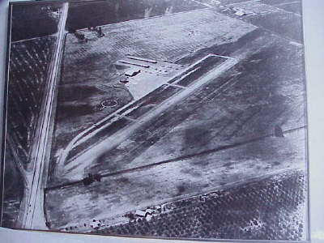 *Flight office and pilot lounge* | 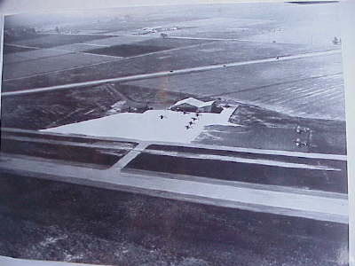 *Maintenance shop interior* |
| 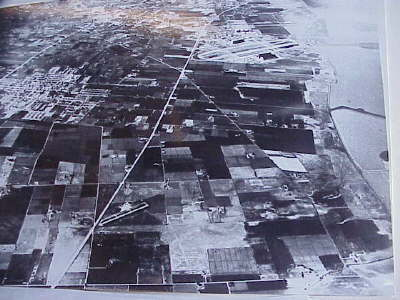 *Private aircraft preparing for takeoff* | 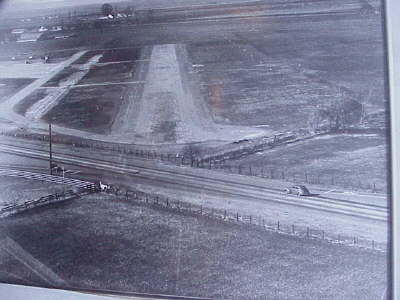 *Surrounding orchards bordering the airfield boundary* |

---

## The 1950s: Subdivision Construction and Founding

The 1950s brought explosive suburban growth to Sunnyvale. To prevent San Jose and other neighboring communities from claiming boundary lands, Sunnyvale aggressively annexed northern parcels, including the airport acreage at Lawrence Station Road and Bayshore Highway (Highway 101).

### Original Sales & Marketing Materials

| Sales Brochure | Highway Billboard | Curvilinear General Plan |
| :---: | :---: | :---: |
| [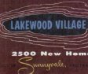](The_1950s/brochure.pdf) [**Original Sales Brochure (PDF)**](The_1950s/brochure.pdf) | [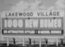](The_1950s/lakewood_billboard.jpg){ .glightbox } [**1955 Highway Billboard**](The_1950s/lakewood_billboard.jpg) | [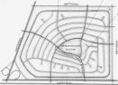](The_1950s/neighborhood-plan.jpg){ .glightbox } [**1957 City General Plan**](The_1950s/neighborhood-plan.jpg) |

| 1955 Newspaper Ad | 1955 Sunnyvale Map | Fairwood-Side Construction |
| :---: | :---: | :---: |
| [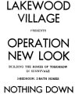](The_1950s/classified-ad.jpg){ .glightbox } [**1955 Standard Classified Ad**](The_1950s/classified-ad.jpg) | [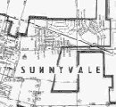](The_1950s/1955-sunnyvale.jpg){ .glightbox } [**1955 City Map (Units 1 & 2)**](The_1950s/1955-sunnyvale.jpg) |  **Oak Creek & Sandia (1959)** |

#### Early Neighborhood Construction (1956-1959)

| Oak Creek Way (1956) | Fairwood Avenue (1957) | Methodist Church (1959) |
| :---: | :---: | :---: |
| [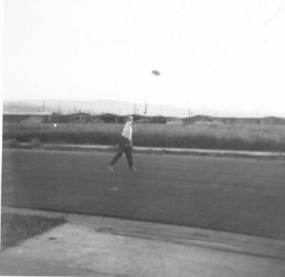](../../db_oak_creek_april_19563.jpg){ .glightbox } *Oak Creek Way in April 1956* | [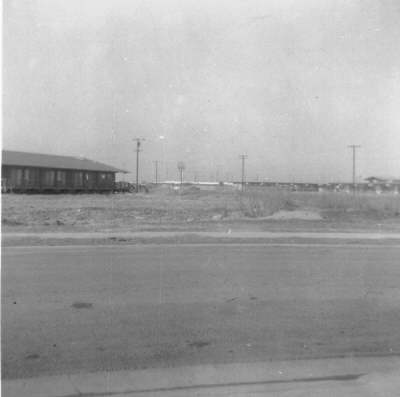](../../db_oak_creek_fairwood_behind_may_19573.jpg){ .glightbox } *Oak Creek Way with Fairwood Avenue (May 1957)* | [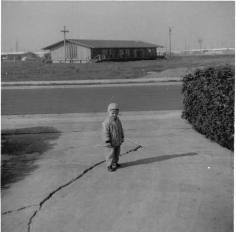](../../db_methodist_church_sandia_fairwood_19593.jpg){ .glightbox } *Lakewood Methodist Church on Sandia (1959)* |

| Oak Creek & Sandia (1959) | Highway 237 Boundary (1957) |
| :---: | :---: |
| [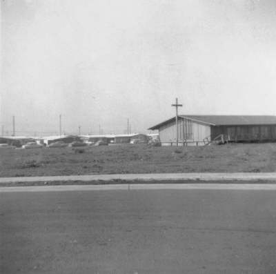](../../db_oak_creek_sandia_19593.jpg){ .glightbox } *Corner of Oak Creek Way and Sandia Avenue (1959)* | [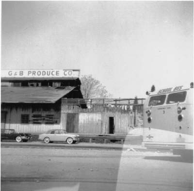](../../db_th_something__way_237_19573.jpg){ .glightbox } *Subdivision construction bordering Highway 237 (1957)* |

### 1950s Chronological Timeline

| Year | Month | Event / Milestone |
| :---: | :--- | :--- |
| **1954** | February | Sunnyvale launches a plan to annex 129 acres from the County, including the Santa Clara Valley Airport site at Lawrence Station Road and Bayshore Highway. |
| | August | Airport area is officially rezoned for "planned community" suburban development. |
| | November | Developer submits tract plans for 350 single-family homes at the northwest corner of Lawrence and Bayshore. |
| | December | Developer submits tract plans for 409 homes and a 304-room motel at the northeast corner. |
| **1955** | February | Sunnyvale annexes 150 acres at the northeast corner of Lawrence and Bayshore, completing City ownership of all four intersection corners. |
| | June | Branden Construction Company is issued building permits for the first 105 homes in the Lakewood Village tract; applies for 155 more one month later. |
| | August | First classified advertisements for Lakewood Village homes appear in the *Sunnyvale Standard* newspaper. |
| | December | **The Christmas Flood of 1955:** Following 13 drought years and aggressive cloud-seeding, continuous rain floods lowlands across northern Sunnyvale, prompting levee improvements. |
| **1956** | March | General Motors purchases 200 acres at Oakmead and Lawrence from Southern Pacific Railroad, later opting to locate its assembly plant in Fremont. |
| **1957** | November | Lockheed purchases 275 acres in northern Sunnyvale to establish the Lockheed Missiles and Space facility. |
| **1958** | January | **Lakewood Village Residents Association (LVRA) is formed** by founding neighborhood homeowners. |
| | February | LVRA Social Committee forms, organizing bake sales, rummage sales, and early newsletter distribution. City proposes Lakewood Park facilities. |
| | March | Weekly municipal street sweeping begins across the neighborhood. |
| | May | **Volume 1, Issue 1 of The Villager** is published and delivered door-to-door to all residents. |
| | July | The first annual Lakewood Village Picnic is held at Blackberry Farms (before neighborhood park dedication). Safety fence planned along Calabazas Creek. |
| | October | Ground is broken for Lakewood Methodist Church on Sandia Avenue; Teenage LVRA chapter formed. |
| | November | Commercial plans announced for Dick's Lakewood Center shopping plaza; LVRA petitions City for a neighborhood fire station. |
| **1959** | March | Lakewood Elementary School is completed and opened for students. Lakewood Shell service station opens. |
| | April | Groundbreaking held for Dick's Supermarket in Lakewood Shopping Center. |
| | June | LVRA incorporates as an official California nonprofit organization. Lakewood Methodist Church officially opens. |
| | October | Dick's Supermarket opens for business. |
| | December | First annual Lakewood Village Holiday Lighting Contest and Holiday Parade are held. |

---

## The 1960s: Suburban Growth and Maturation

| Year | Month | Event / Milestone |
| :---: | :--- | :--- |
| **1960** | January | The "Grog and Vittle Shoppe" opens, later operating for over 40 years as the "Lakewood Lounge." |
| | June | Foundation poured for Lakewood Baptist Church on Lakewood Drive. Dick's Lakewood Center fills with Delta Drug, Mary's Bakery, dry cleaners, and hardware store. |
| | December | Lakewood Village Merchants Association is established. |
| **1961** | June | Our Lady of Peace parish is established just east of the neighborhood in Santa Clara. |
| | October | LVRA launches successful community petition for Fire Station #6 construction. |
| **1962** | February | Bayside School opens as Lakewood's third neighborhood educational facility. |
| | May | City Council approves construction of Fire Station #6 on Lawrence Station Road. |
| **1963** | May | Sunnyvale Fire Station #6 dedicated and placed in active service. |
| **1964** | September | **Lakewood Park Dedicated:** 14-acre community park opens with a "Space Age" theme, modern playground, and community park building. |
| **1965** | April | Fairwood Elementary School opens to relieve enrollment pressure on Lakewood Elementary. |
| **1966** | May | Western Days community festival and Fairwood Library branch opened. |
| **1968** | November | LVRA hosts Sunnyvale Mayor, traffic engineers, and Assembly candidates at general meetings. |
| **1969** | September | San Jose Mercury publishes feature article highlighting Lakewood Village civic improvement and volunteer initiatives. |

---

## The 1970s: Infrastructure and Community Life

During the 1970s, Lakewood Village focused on neighborhood safety, youth sports leagues, and defending residential quality against encroaching highway traffic and industrial expansion.

### 1975 Lakewood Youth Baseball

| 1975 Team Photograph | 1975 Roster & Schedule |
| :---: | :---: |
| [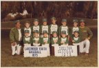](1970s/1975-baseball-team.jpg){ .glightbox } [**1975 Team Photo (High-Res)**](1970s/1975-baseball-team.jpg) | [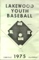](1970s/1975-baseball.pdf) [**1975 Roster & Schedule (PDF)**](1970s/1975-baseball.pdf) |

### 1970s Chronological Timeline

| Year | Month | Event / Milestone |
| :---: | :--- | :--- |
| **1970** | March | Sunnyvale Public Library Bookmobile service begins with regular stops at Lakewood Park and the Methodist Church. |
| | October | LVRA hosts community "Spook House" Halloween attraction for neighborhood youth. |
| **1971** | March | Annual Easter Parade from Fairwood School to Lakewood Park culminates in Easter Egg hunt. |
| | May | **Slaughterhouse Proposal Defeated:** A 3-day grassroots mobilization of 350 residents halts a proposed industrial slaughterhouse near the neighborhood. |
| | June | Maintenance issues on Hetch-Hetchy right-of-way spur neighborhood landscaping advocacy. |
| **1975** | April | Lakewood Youth Baseball and Little League season launches across neighborhood diamonds. |
| **1978** | August | County begins planning Lawrence Expressway sound walls to reduce highway noise for adjacent Lakewood homes. |

---

## The 1980s: Silicon Valley Transition

As personal computing and aerospace transformed the surrounding valley, northern Sunnyvale faced increasing commuter traffic. The neighborhood advocated for traffic calming and civic improvements.

| Year | Month | Event / Milestone |
| :---: | :--- | :--- |
| **1984** | June | Santa Clara County Transportation Agency begins engineering studies for light rail transit along the Tasman corridor. |
| **1988** | January | City of Sunnyvale launches its Neighborhood Preservation Program, initially piloting in Lakewood Village, Raynor Park, Orchard Gardens, and Morse Madrone. |
| **1989** | October | **Loma Prieta Earthquake:** Lakewood Village experiences ground shaking; mid-century single-story wood frame construction demonstrates strong seismic resilience with minimal structural damage. |

---

## The 1990s: Environmental Monitoring and Rebirth

The 1990s saw the official revival of the neighborhood association under the modern LVNA banner and increased focus on regional environmental oversight.

| Year | Month | Event / Milestone |
| :---: | :--- | :--- |
| **1991** | October | **Lakewood Village Neighborhood Association (LVNA) is established**, revitalizing the community advocacy traditions of the founding 1958 LVRA. |
| **1992** | April | **Partners Improvement Program:** Six-month cooperative effort between City crews and residents plants 150 new street trees, clears rubbish, replaces street lights, and repairs sidewalks. |
| | June | Regional environmental testing finds an industrial solvent groundwater plume from semiconductor facilities terminating at Lakefair Drive at 40-55 feet depth; monitoring confirms no vapor intrusion into residential water. |
| | November | Sunnyvale City Council approves master improvement plan for Fairwood Park and adjoining Hetch-Hetchy greenbelt. |
| **1993** | May | Over 150 volunteer artists create a community mural for Lakewood Village. |
| | July | Giovanni's Pizzeria opens in Dick's Lakewood Shopping Center. |
| **1994** | July | Moffett Naval Air Station formally transfers to NASA Ames Research Center; neighborhood monitors airfield flight operations and civilian redevelopment. |
| **1998** | September | First neighborhood Dumpster Day cleanups organized to assist homeowners with large-item disposal. |

---

## Physical Evolution and USGS Cartography (1970s-1990s)

Between 1970 and 1995, northern Sunnyvale transitioned rapidly from a quiet suburban community into the technological center of Silicon Valley. USGS aerial photography and topographical surveys preserve this physical evolution:

| Satellite Aerial Perspective (1993 USGS) | USGS Topographical Elevation Map |
| :---: | :---: |
| 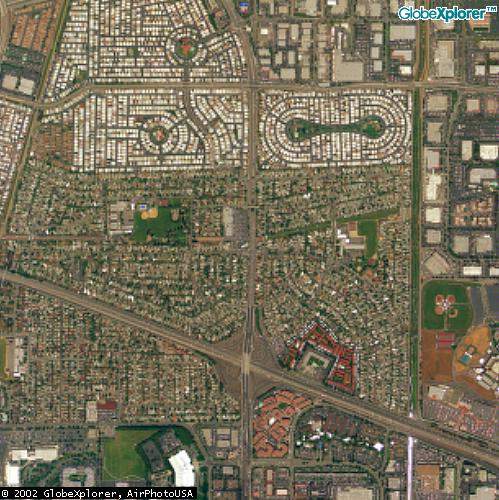 *USGS high-altitude satellite imagery of Lakewood Village (1993)* | 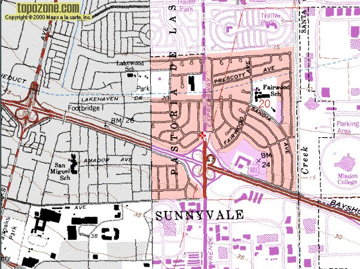 *USGS topographical elevation quadrangle of northern Sunnyvale* |

- **Satellite Perspective (1993):** Shows the completed single-family footprint of Lakewood Village, surrounded by the expanding high-tech light industrial campuses along Tasman Drive and the historic Lawrence Expressway cloverleaf interchange at Highway 101.
- **Topographical Map (1978 Survey):** Documents natural surface elevations and municipal drainage corridors toward the San Francisco Bay salt ponds and Calabazas Creek.

---

## The 2000s: 50th Anniversary and Preservation

| Year | Month | Event / Milestone |
| :---: | :--- | :--- |
| **2001** | March | Newly landscaped Hetch-Hetchy right-of-way opens for neighborhood recreation. |
| | October | Remodeled Lakewood Village home receives a prestigious design award from the American Institute of Architects (AIA). |
| | November | Former LVNA President Frederik Fowler is elected Mayor of Sunnyvale. |
| **2002** | June | City and LVNA launch Neighborhood Improvement Pilot Program. Hetch-Hetchy greenbelt is dedicated as **The John W. Christian Greenbelt**, honoring neighborhood leader and Sunnyvale Parks & Recreation Director John W. Christian. |
| | September | Resident webmaster Brian Smithson launches **LVNA.NET**, beginning a six-year campaign to scan vintage newsletters and photograph community milestones. |
| **2003** | March | County and City complete intersection and signalization improvements on Lawrence Expressway at Lakehaven. |
| **2004** | September | Lakewood Park Building rededication following historic interior and window renovations. |
| **2005** | August | **Lakewood Village 50th Anniversary (1955-2005):** Community celebrates five decades with historical retrospectives in *The Villager* and special anniversary picnic. |
| **2007** | January | Fairwood Elementary School celebrates its 50th anniversary. |

### Civic Profile: John W. Christian (1946–1996) and the Greenbelt

In June 2002, the City of Sunnyvale and the LVNA formally dedicated the landscaped Hetch-Hetchy aqueduct right-of-way as **The John W. Christian Greenbelt**. The corridor honors John W. Christian, a dedicated Sunnyvale resident, youth booster, and the City's transformative Director of Parks and Recreation from 1988 until his death from prostate cancer in 1996 at age 50.

During his eight-year tenure leading Sunnyvale's Parks and Recreation Department, Christian directed over 100 staff members and pioneered progressive open space programs that gained statewide acclaim. He spearheaded the design and 1994 opening of **Sunnyvale Baylands Park** (converting 177 acres of raw bayside land into 72 developed park acres and 105 acres of protected seasonal wetlands), championed the $3.5 million **Columbia Neighborhood Center** to serve youth and families in North Sunnyvale, and received the City's Distinguished Citizen of the Year Award. His dedication to community parks left a lasting civic legacy across Sunnyvale and Lakewood Village.

- [📄 San Jose Mercury News: "Sunnyvale Official Remembered" Feature (PDF)](John_W_Christian/JC%20News%204.pdf)
- [📄 San Jose Mercury News: John W. Christian Obituary & Civic Tributes (PDF)](John_W_Christian/JC%20News%2012.pdf)

---

## The Modern Era: Civic Investment and Environmental Stewardship (2010s-2026)

Recent decades have brought major public investments, civic milestones, and community-led stewardship initiatives to Lakewood Village:

| Year | Month | Event / Milestone |
| :---: | :--- | :--- |
| **2021** | June | Sunnyvale Historical Society publishes comprehensive pre-history and development research on Lakewood Village in *The Villager*. |
| | August | Sunnyvale City Council initiates municipal redistricting; District 6 is established representing Lakewood Village. |
| **2023** | June | Community members and LVNA launch the **Sunnyvale Equity in Education (SEE)** advocacy campaign, petitioning the Fremont Union High School District (FUHSD) for equitable high school access and North Sunnyvale facilities. |
| **2024** | September | **Lakewood Branch Library Groundbreaking:** On September 5, 2024, civic leaders break ground on the new permanent Lakewood Branch Library and Learning Center at Lakewood Park, scheduled for opening in 2026. |
| | October | **501(c)(3) Nonprofit Status:** LVNA officially incorporates as a recognized 501(c)(3) charitable nonprofit organization. |
| **2024–2025** | Ongoing | **Calabazas Creek Adopt-A-Creek Stewardship:** Continuing a six-decade tradition of flood control advocacy and ecological stewardship, neighborhood volunteers partner with Valley Water (Santa Clara Valley Water District) for regular creek cleanup and restoration events. |

### Modern Community Milestones

| Lakewood Branch Library Groundbreaking (Sept 5, 2024) | Calabazas Creek Adopt-A-Creek Volunteer Cleanup |
| :---: | :---: |
| [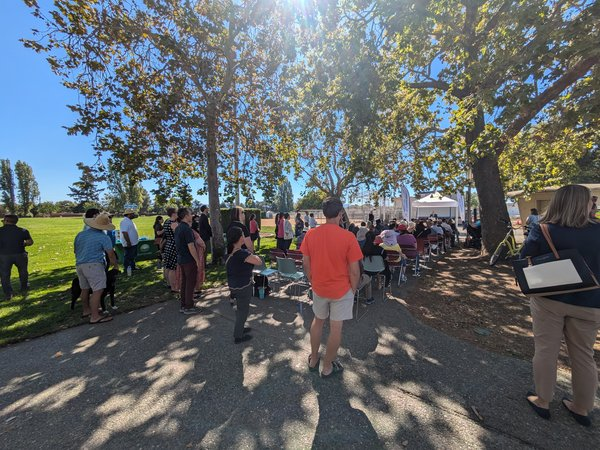](Modern/lakewood_library_groundbreaking_2024.jpg){ .glightbox } *Sunnyvale Mayor Larry Klein, SSD Superintendent Dr. Michael Gallagher, FUHSD Superintendent Graham Clark, and City Manager Tim Kirby at the official library groundbreaking ceremony* | [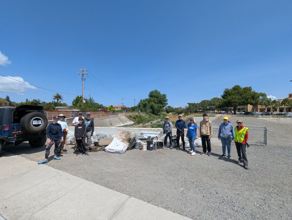](Modern/calabazas_creek_cleanup_2025.jpg){ .glightbox } *Neighborhood volunteers conducting stream cleanup and environmental restoration along Calabazas Creek in partnership with Valley Water* |

---

## Demographics and Historical Census Records

US Census Bureau records from 1970 through 2000 illustrate the evolution of Lakewood Village from a homogenous post-WWII suburb into one of the most culturally diverse neighborhoods in northern Sunnyvale.

### Multi-Decade Demographic Trends (1970-1990)

| Population & Household Growth | Ethnic Diversity Trends | Income Evolution |
| :---: | :---: | :---: |
| [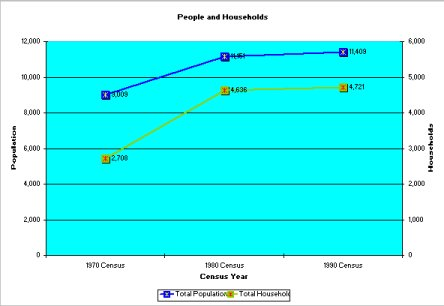](HistoryStub/Census_Data/708090-population-households.jpg){ .glightbox } *Total population and household counts (1970-1990)* | [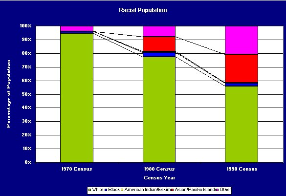](HistoryStub/Census_Data/708090-race.jpg){ .glightbox } *Racial and ethnic composition trends* | [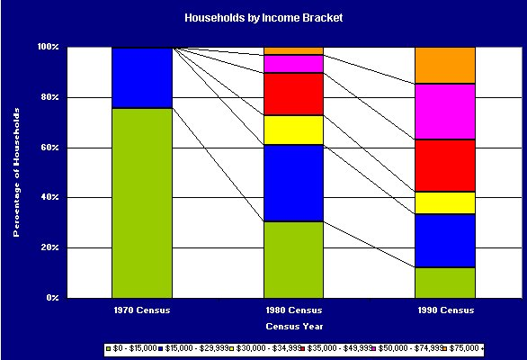](HistoryStub/Census_Data/708090-income.jpg){ .glightbox } *Median household income growth* |

| Age Cohort Distribution (1970-1990) | Hispanic Origin Evolution (1970-1990) |
| :---: | :---: |
| [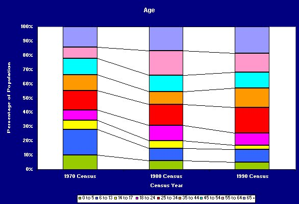](HistoryStub/Census_Data/708090-age.jpg){ .glightbox } *Age cohort shifts showing maturation of original suburban families* | [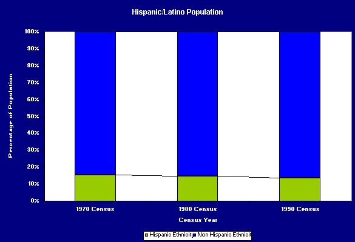](HistoryStub/Census_Data/708090-latino.jpg){ .glightbox } *Multi-decade growth in Hispanic and Latino heritage* |

### 1990 vs. 2000 Census Profile Comparison

| Metric | 1990 Census | 2000 Census | Change / Trend |
| :--- | :---: | :---: | :--- |
| **Total Housing Units** | 1,625 | 1,632 | Stable single-family tract footprint (+0.4%) |
| **Homeowner Occupancy** | 76.2% | 72.8% | Strong owner-occupancy base with steady rental market |
| **Average Household Size** | 3.12 persons | 3.48 persons | Growth in multi-generational family households |
| **Median Home Value** | $228,500 | $475,000 | +108% appreciation reflecting Silicon Valley demand |
| **Median Household Income** | $48,200 | $78,600 | +63% economic expansion |

#### Decennial Comparative Charts (1990 vs. 2000)

| Population Growth | Racial & Ethnic Diversity Shift |
| :---: | :---: |
| [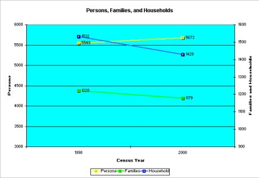](HistoryStub/Census_Data/1990-2000-population.jpg){ .glightbox } *1990 vs. 2000 total resident population* | [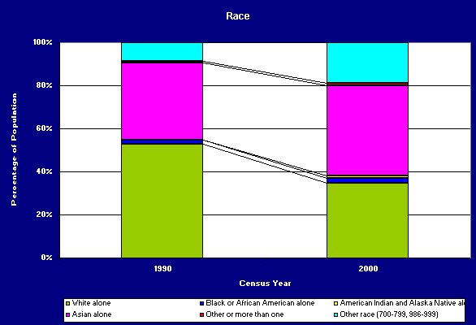](HistoryStub/Census_Data/1990-2000-race.jpg){ .glightbox } *Shifts in racial and ethnic diversity* |

| Average Household Size | Latino Heritage Growth |
| :---: | :---: |
| [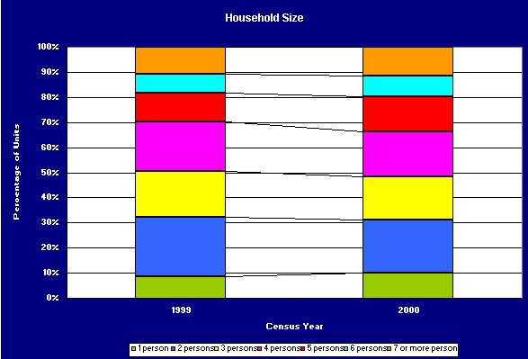](HistoryStub/Census_Data/1990-2000-household-size.jpg){ .glightbox } *Distribution of household sizes* | [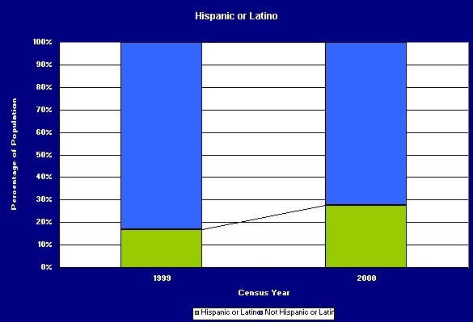](HistoryStub/Census_Data/1990-2000-latino.jpg){ .glightbox } *Latino population comparison* |

| Housing Occupancy Rates | Homeownership vs. Rental |
| :---: | :---: |
| [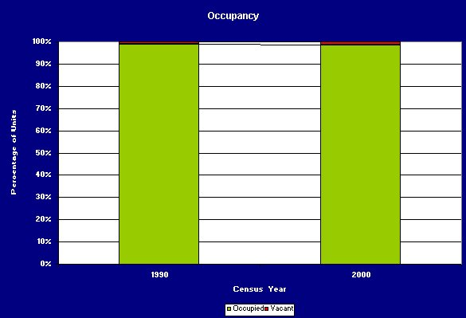](HistoryStub/Census_Data/1990-2000-occupancy.jpg){ .glightbox } *Occupied vs. vacant housing units* | [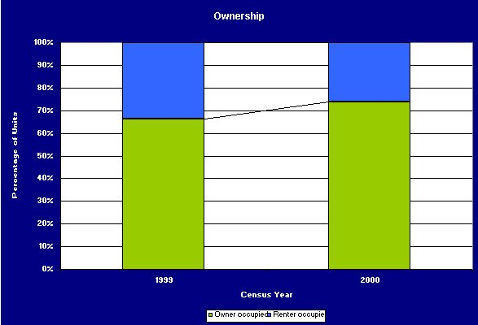](HistoryStub/Census_Data/1990-2000-ownership.jpg){ .glightbox } *Owner-occupied vs. renter-occupied units* |

| Age Distribution Shift |
| :---: |
| [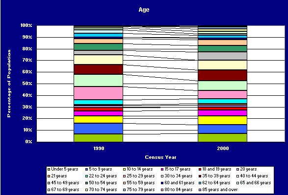](HistoryStub/Census_Data/1990-2000-age.jpg){ .glightbox } *Comparison of resident age distributions (1990 vs. 2000)* |

### 1990 Economic & Workforce Profile

Detailed 1990 decennial census records document Lakewood Village during the height of Silicon Valley's defense, semiconductor, and personal computer revolution:

| Household Income Distribution | Home Values & Contract Rent |
| :---: | :---: |
| [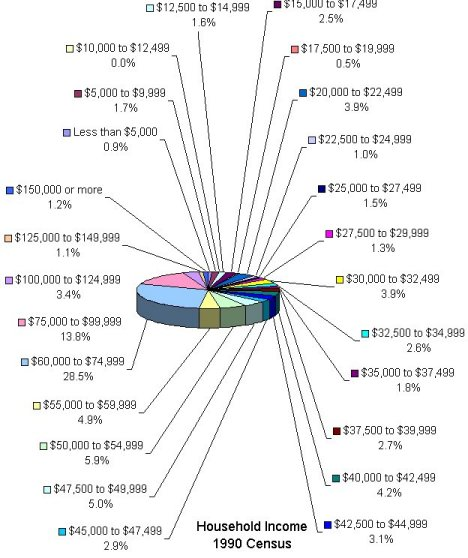](1990_s/1990-income.jpg){ .glightbox } *1990 household income brackets* | [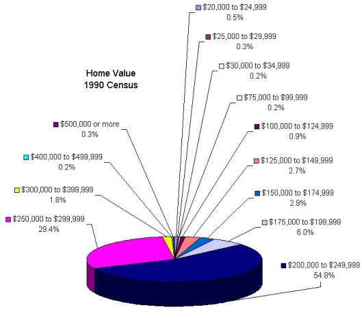](1990_s/1990-home-value.jpg){ .glightbox } *Single-family home market valuations* |

| Employment Industry Breakdown | Occupations of Residents |
| :---: | :---: |
| [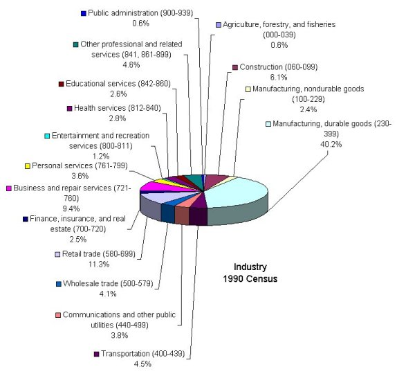](1990_s/1990-industry.jpg){ .glightbox } *Employment by industry (aerospace, electronics, manufacturing)* | { .glightbox } *Occupational classifications of tract residents* |

| Educational Attainment | Primary Language Spoken at Home |
| :---: | :---: |
| { .glightbox } *Adult educational attainment levels* | { .glightbox } *Languages spoken in neighborhood households* |

| Commute Travel Modes | Commute Travel Times |
| :---: | :---: |
| { .glightbox } *Transportation modes to work* | { .glightbox } *Commuting travel time in minutes* |

| Monthly Contract Rent | Housing Occupancy & Tenure |
| :---: | :---: |
| { .glightbox } *1990 monthly contract rent distribution* | { .glightbox } *1990 occupied vs. vacant housing units* |

| School Enrollment by Level | Workers per Family Household |
| :---: | :---: |
| { .glightbox } *Neighborhood student school enrollment* | { .glightbox } *Distribution of workers per family household* |

### 2000 Census Geographic Hierarchy & Tract Boundaries

For federal census administration, Lakewood Village was geographically divided into two primary census tracts along the Lawrence Expressway corridor:

- **Lakewood Side (West):** Census Tract **5048.06** (Unit 2 and Unit 4).
- **Fairwood Side (East):** Census Tract **5048.02** (Unit 1 and Unit 3).

| Census Tract Boundaries | Census Geographic Hierarchy |
| :---: | :---: |
|  *US Census Tract boundaries covering Lakewood Village* |  *Census Tract and Block Group geographic hierarchy* |

- **Unit 1:** Census Tract 5048.02, Block Group 3
- **Unit 2:** Census Tract 5048.06, Block Group 2
- **Unit 3:** Census Tract 5048.02, Block Group 2
- **Unit 4:** Census Tract 5048.06, Block Group 1

Historical spreadsheet archives from this research are preserved in [1970-1990 Census Trends (XLS)](708090-census-trend.xls) and [1990-2000 Census Data (XLS)](1990_2000_data.xls).

---

## Local History Bibliography and References

The following works document the agricultural origins of the Santa Clara Valley, the civic growth of Sunnyvale, and the post-WWII suburban development that created Lakewood Village:

| Title & Topic | Author & Scope |
| :--- | :--- |
| **Sunnyvale: From the City of Destiny to the Heart of the Silicon Valley** | Mary Jo Ignoffo (1988). Authoritative history of Sunnyvale from Ohlone settlements and Spanish ranchos through agricultural canning and high-tech defense industries. Preserved in the California Collection at the Sunnyvale Public Library. |
| **The Valley of Heart's Delight** | Historical retrospective documenting the fruit orchards, packing houses, and agricultural heritage of the Santa Clara Valley before suburban tract construction. |
| **South Bay Trails & Peninsula Trails** | Jean Rusmore et al. Guidebooks detailing open space preserves, bayfront marshlands, and trail systems surrounding northern Sunnyvale and the San Francisco Bay. |
