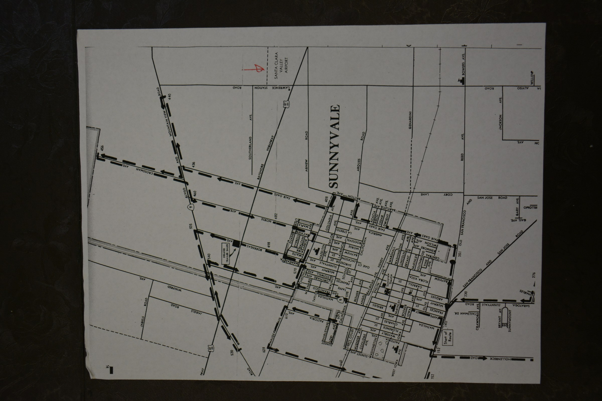
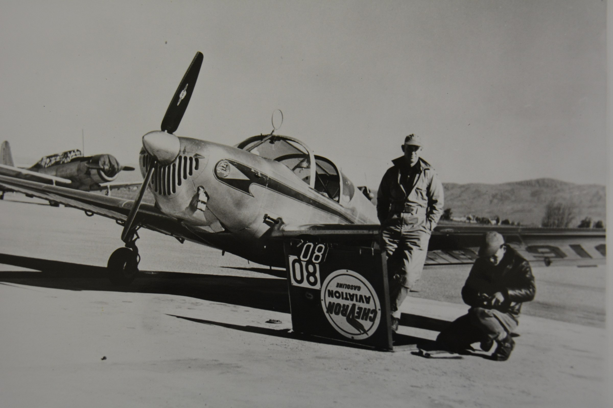
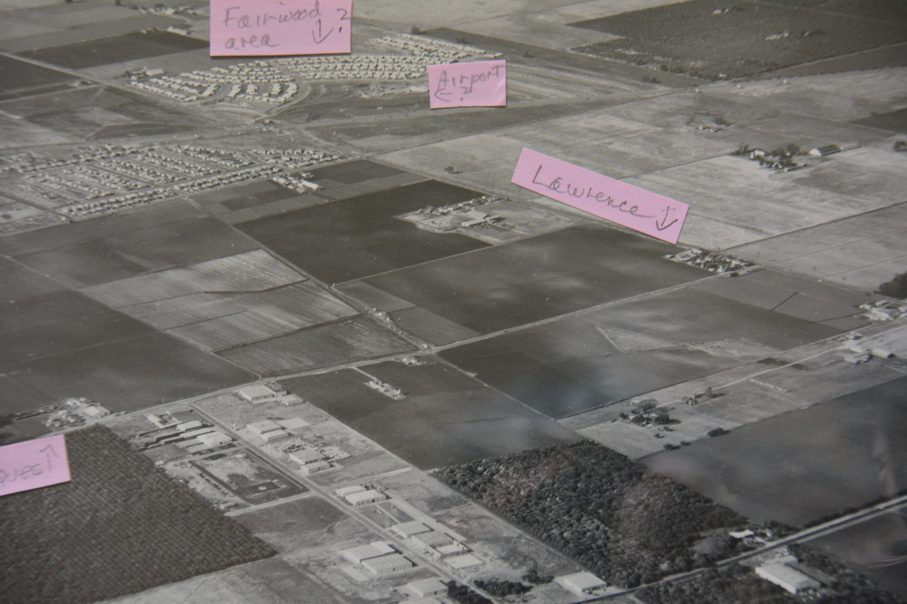
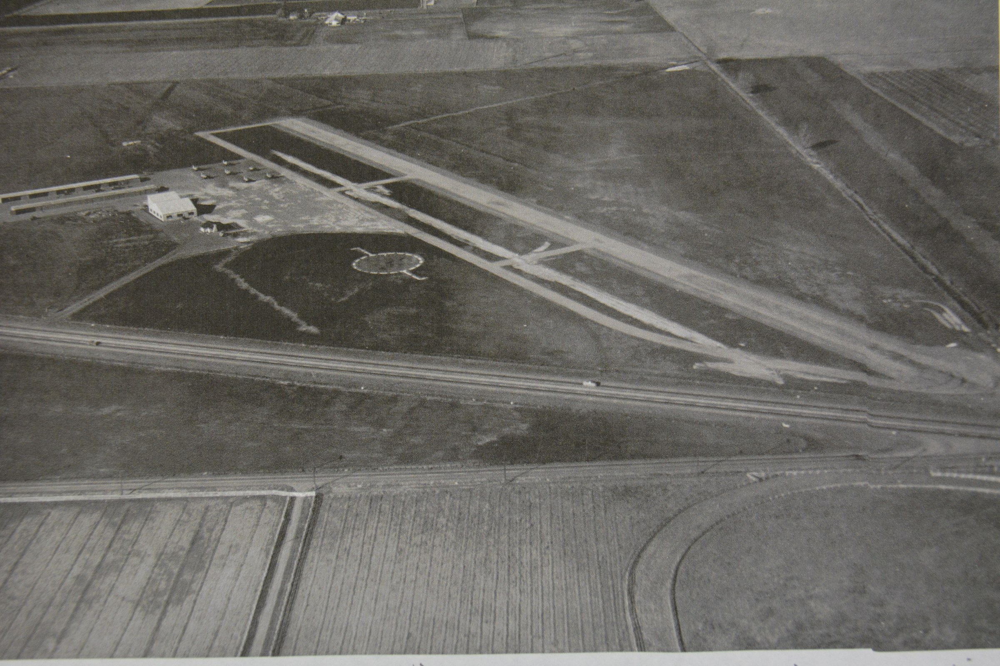
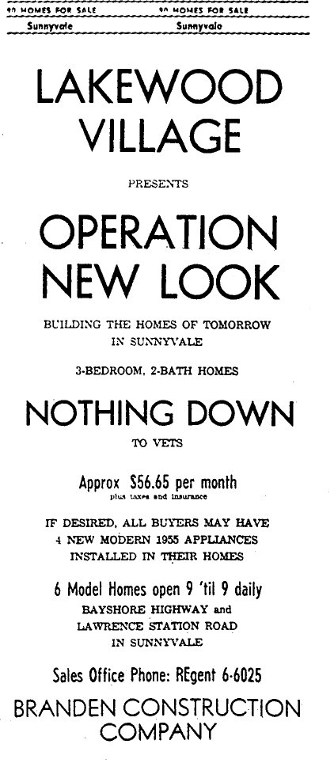
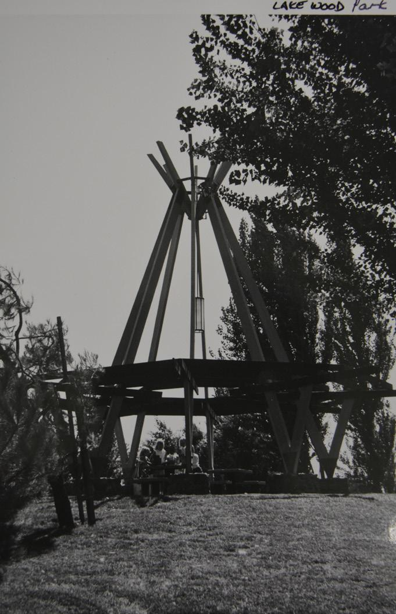
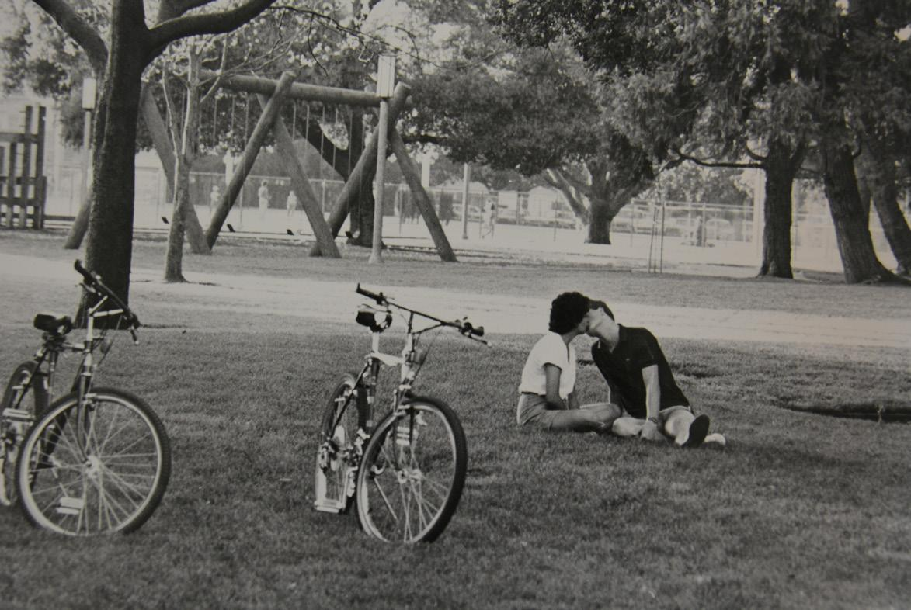

# The History of Lakewood Village

**By Katharina Woodman, Sunnyvale Historical Society**

*Originally researched and written for [The Villager](../../Villager/villager.md) as a two-part historical feature in [June 2021](../../Villager/Issues/2021-06.md) and [September 2021](../../Villager/Issues/2021-09.md); reprinted in [December 2023](../../Villager/Issues/2023-12.md) and [June 2024](../../Villager/Issues/2024-06.md).*

---

!!! note "About This History"
    *Thank you to Katharina Woodman at the Sunnyvale Historical Society, who kindly researched and wrote this two-part history for The Villager. It is preserved below in its complete, original text, accompanied by the archival photos and maps published alongside her articles from the Historical Society collections.*

---

## Part 1: Lakewood... Before There Was Lakewood

*(First published in The Villager, June 2021)*

Before there was Lakewood…

…there were thousands of years of Ohlone history, followed by immigrants from various parts of the world. Accounts of the Ohlone culture conjure up a bucolic landscape of rolling grasslands, perfect for hunting and gathering. The people collected tule reeds from the Bay shore to dry and make ropes to fashion into building materials for their huts and canoes. Their lives were changed forever by the arrival of Spanish explorers and missionaries. After an almost century-long occupation by Spaniards and Californios, Mexican rancheros, the land where Lakewood now boasts single-family homes came into the hands of an Irishman, Martin Murphy Jr.

Martin and his large family had been members of the first immigrant trek who successfully brought wagons across the Sierra Nevada in 1844/45. He first settled close to Sutter’s Fort, but when Martin saw the Santa Clara Valley on a trip to purchase cattle, he instantly fell in love with it. He and his wife, Mary, decided that this would be the place to end their wanderings and settle down for good. Martin was in luck, because the year was 1849, when California was about to join the United States, causing a big problem for many of the Californios: they had to prove ownership of their holdings by producing a deed to their land. Californio Mariano Castro was willing to sell half of his ranch to the Murphys in order to raise cash for a long legal battle (which took twelve years to settle), and they snatched up the opportunity to buy Pastoría de las Borregas (lambs’ pasture), roughly the area of today’s City of Sunnyvale.

The present-day pesky expressway bisecting Lakewood Village, making for poor connectivity within the neighborhood, had very humble beginnings as "Lawrence Road." Attracted to California by the promise of riches from gold, carpenter and piano builder Albert Chester Lawrence left mining after a few years, settled on a squatter’s claim on Murphy land in 1852, built a house for his family, and cultivated the land. That same year, Lawrence and some co-signers laid out a road to connect the Bay with the redwoods in the nearby mountains so farmers could transport their wheat, hay, and lumber to Alviso to be loaded onto ships. "Petitioners for the road urged haste in building because the 'prairie' was rapidly being fenced and land prices were going up" (Patricia Loomis).

When the railway line from San Francisco to San José was being planned in 1861, Murphy offered to give land to the railroad company to lay tracks across his property under the condition that he would have a train stop at his ranch. The area became known as "Murphy’s Stop," or "Murphy’s Station."

Along the railway line to the east, A.C. Lawrence followed Murphy’s lead and gave right-of-way through his land to the railroad. He became station master at "Lawrence Station," and the earlier road in that location changed names to Lawrence Station Road.

Mary and Martin had stipulated that none of their land be sold during their lifetime. After Mary’s death in 1892, the heirs, pressed for cash to pay the steep property taxes, sold 200 acres along the train tracks to a developer, Walter Crossman, who successfully attracted a number of businesses to the new settlement, among them Hendy Iron Works and three canneries. By then, the land on which the Murphys had originally planted wheat and raised cattle, had been taken over by orchards - mainly cherries, apricots, plums, pears, but also nuts and almonds.

In 1901, the name Sunnyvale replaced the former moniker "Murphy’s Station," when the town was big enough to warrant its own post office. The name "Murphy’s" could not be used because it had already been taken by the gold town in the Sierra foothills where Martin’s brothers, Dan and John, had operated a general store to supply the miners. In 1912, Sunnyvale was incorporated as a city and flourished with agriculture and industry.

While most of the land was planted in fruit, Sunnyvale was also home to a great number of dairy farms, mainly in the northern part of town, where Lakewood Village was eventually established. Cows roamed the fertile meadows and their milk was delivered to the customers’ doorsteps in glass bottles. In 1947, both cows and humans alike were startled to find small airplanes taking off and landing in their vicinity! Harold Willson, the son of Frank Chapman Willson, an orchardist who became famous for his "Willson’s Wonder Walnuts," was an aviator with his own plane, a Globe Swift. Because Harold and other aviation buffs in Sunnyvale had to drive up to Palo Alto whenever they wanted to fly, they wanted a hangar and landing strip closer to home. Harold persuaded nine other investors to buy land for that purpose. They purchased 128 acres of land for $70,400 in 1946 and founded the Santa Clara Valley Airport, located at Lawrence Station Road north of the Bayshore Freeway (today’s US 101).

Included on the premises were a mechanics’ shop and an office which served as a meeting place where the pilots would discuss their flights with their passengers, over coffee. The main hangar, measuring 60 by 80 feet, could hold ten airplanes, and the paved runway was 2,100 feet long. The airport was mainly intended for private flying and training sessions. This venture lasted for two years and seventeen days, after which period the land was leased and the hangar buildings taken down and re-erected at Hayward Airport and San José Municipal, respectively. The land was sold in 1956 for almost $400,000, and that is where the story of Lakewood Village begins.

### Original Illustrations: Part 1

*As published on Page 7 of The Villager (June 2021). "Unfortunately, none of the photos nor the map are dated. The map is from sometime between 1947 (when the airport was built) and 1956, when the land was finally sold."*

| Early Map of Sunnyvale | Harold Willson & His Globe Swift |
| :---: | :---: |
| { .glightbox } *A map of Sunnyvale from the early days. Note that Bayshore Freeway stands where US 101 is today.* | { .glightbox } *Harold Willson standing next to his plane with an unidentified person.* |

| Northern Sunnyvale Early Aerial | Santa Clara Valley Airport Runway (c. 1947) |
| :---: | :---: |
| { .glightbox } *Early aerial view of northern Sunnyvale with Fairwood and Lawrence marked.* | { .glightbox } *An aerial view of the Santa Clara Valley Airport.* |

---

## Part 2: The Checkered History of Lakewood Village (1956 – early 2000s)

*(First published in The Villager, September 2021)*

Before anyone could even dream of a development to be called Lakewood Village, the City of Sunnyvale had to define the city’s borders. During the 1950s, annexation wars were raging in the area between Cupertino, Sunnyvale, Santa Clara, and San José. Cupertino attempted incorporation in 1954 in order to avoid being swallowed up by Sunnyvale and San José. Santa Clara and Sunnyvale engaged in litigation over land along Lawrence Station Road which, Santa Clara claimed, "illegally spilled into Santa Clara territory". Sunnyvale was eager to secure Lockheed and General Motors to build factories in the city and had earmarked parcels of land for those companies. Mountain View protested the annexation of land set aside for Lockheed by Sunnyvale. In 1956, there were nineteen different annexation proceedings involving the City of Sunnyvale and their neighbors. Eventually, the city lost General Motors to Fremont, but the relocation of Lockheed proceeded as planned, when land was annexed north of Highway 101 and on either side of Lawrence Station Road (now Lawrence Expressway).

By 1956, Sunnyvale had attracted so many major companies that people flocked to the city in search of employment. Among others, Lockheed had relocated here, an area described by an employee as "all beanfields then, and the Bayshore Freeway was only a two-lane road." The last traffic light on the Bayshore Freeway between San Francisco and San José, at Fair Oaks, was removed in 1960. The city of just under 10,000 inhabitants in 1950 would grow to 53,000 citizens by 1960.

In 1956, the new development of Lakewood Village advertised inexpensive homes for Lockheed and military personnel, with no down payment necessary for veterans. It was to consist of 1,732 small single-family homes in "Eichler-esque" style. The area was laid out between Highway 101 to the south, Tasman Drive to the north, Calabazas Creek to the east, and Fair Oaks Avenue to the west, but it was bisected by Lawrence Station Road. Branden Construction Company boasted they were "building the homes of tomorrow in Sunnyvale". Though smaller than houses in other areas of the city, the homes found buyers very quickly: young families moved into the two- and three-bedroom houses. The neighborhood quickly formed a strong sense of community, when families helped each other out with babysitting and shopping. Major attractions were neighborhood parties for the Fourth of July, barbecues, and block parties, where children were allowed to light their own sparklers. Parents got together for card games and social events while children played out in the yards and in the street. Holidays were celebrated together with families taking turns hosting them.

From the beginning, though, residents felt ignored by the City and like a "stepchild," compared to other parts of Sunnyvale. Services were not at the same level, and residents had to fight for amenities, such as a nearby fire station. In order to stand united, the residents formed the Lakewood Village Residents’ Association in 1958. They started a newsletter, named The Villager, and held social events. During its existence until the mid-1970s, the association brought about several changes, including the building of a fire station, avoiding the construction of a slaughterhouse, and keeping land earmarked for the creation of Fairwood Park instead of more housing. Having to cross Lawrence Expressway in order to make it to Lakewood Park enticed some mothers to petition for a green space on the east side of the highway, which later was expanded to include a playground.

Beginning in the 1960s, demographics changed in the community; families who had outgrown the small homes moved away into bigger ones elsewhere and military personnel, posted to other parts of the country, led to an ever-changing population. Since many of the original owners kept their houses and rented them out, the percentage of renters increased. At the same time, the number of families declined when single people moved into the small homes. The cohesiveness of the neighborhood broke up, children grew up and moved out, new families didn’t participate in social events, and children didn’t play together outside anymore.

A 1968 census indicated a moderate income level in the Lakewood Village population, as well as good education. However, the survey also revealed there was no sense of community pride. As a result, a grant was requested to study the reason for the rapid turnover in residents which contributed to a lack of "natural leaders."

Lawrence Expressway was extended to run from Mountain View-Alviso Road all the way south to Quito Road in Saratoga, a total of 8.1 miles. When a proposal was made in 1972 to widen the roadway, residents expressed their concern over reduced pedestrian walkways and bike routes. The same year, residents rejected a plan for more low-income housing to be built for fear of overcrowding schools. Complaints of overcrowding and rowdyism reached a new height when a 13-year-old student was killed riding his bike home from school. The student had preferred to cycle in order to avoid the school bus where he was being bullied.

An emergence of gangs in the 1970s led to complaints from Lakewood residents that the public safety department wasn’t keeping the neighborhood safe. Homeowners would stay in their garages during remodels in order to protect building materials from being stolen. The appearance of the neighborhood was declining: garages were turned into living spaces without permits, derelict cars were left out in the road, and trash accumulated. Homes became sites for illegal businesses and renters failed to take care of the general upkeep of houses and yards. There was a much higher occurrence of code violations in this part of town than elsewhere. Potential home buyers were turned off by the appearance of the community, so everyone’s home value decreased. It was rumored that the safety department did not enforce fines because residents could not afford to pay for the improvements or the fines.

The local shopping center fell into disrepair due to juvenile vandalism and neglect. The residents demanded a facelift and started working with owner Gene Lee to improve conditions in 1975. When Mission College planned to build a 15-story unit adjacent to Lakewood in 1984, residents again rallied and protested, claiming that the building would cast a shadow on the houses next to it and traffic would be increased, as was the case with moviegoers who raced through the village to make it to the Mercado Theater in time. Although voter turnout and civic engagement were low, residents would organize and fight for a cause together. The additional widening of Lawrence Expressway in 1986 in order to add carpool lanes between Highway 237 and Prospect Road was such a cause; cyclists demanded bike access, bike lanes, and crossings or overpasses.

When a local student was the victim of severe burns, community members proved once again that they would take up a cause together. The neighbors helped the victim’s family in multiple ways, giving back to the family who had done so much for the community, including the fostering of "wayward children" and organizing youth baseball and football leagues. In appreciation for all they had done in the past, their neighbors now took care of the family in need.

In March of 1988, a 30-year-old three-bedroom house in Lakewood Park was priced at $150,000. Over the decades, rising house prices and rents pushed residents out of the area, leading to more deterioration.

In 1991, a new organization was formed: the Lakewood Village Neighborhood Association. In an attempt to deal with the lack of property upkeep, The Villager newsletter prompted outrage when it posted a list, five houses each, of the most well-kept and the ugliest. Neighbors perceived the accusations as unfair, because not everyone could afford to paint their house or make the necessary upgrades.

In the early 2000s, the story of Lakewood seemed to come full circle, with a diverse population of young families again moving in and an increase in community spirit. Once again, children played with each other as they had in the early days of the development. The famous Lakewood Holiday Parade had been reinstated, and families lined the streets to cheer on floats and Santa Claus. Homeowners outdid themselves decorating their houses for the holidays, literally lighting up the neighborhood.

As part of a new partnership with the City, "Dumpster Days" were introduced in 2000 as part of a general attempt to clean up the neighborhood and help residents who couldn’t afford improvements. Twenty-one dumpsters were placed throughout the village during the summer, with neighbors coming together to help each other by carting away unwanted items. This new community/City cooperation paid off and led to a transformation of the village. When statistics indicated the highest numbers of code violations in the city were occurring in Lakewood Village, a dedicated staff member was assigned to help in a concerted effort to clean up one area at a time. Ninety-five homes on Lakehaven Drive and Lakeknoll Drive were targeted, and City staff approached every home with personnel who spoke Spanish, Vietnamese, English, and Tagalog. Fifty-three of those homes were improved with corrections of code violations, including fixing garages, patios, and roof conversions, and removing overgrown vegetation. Several houses received new coats of paint with free paint provided by the City, new driveways were installed or old ones restored, and cars no longer cluttered the streets. After that success, the City decided to keep the improvement plan in the budget, to be known as the Neighborhood Enhancement Program and extend it to more streets. Residents reported new opportunities to talk to neighbors when everybody was bringing discarded items to the dumpsters and encountering people they had never seen before.

In 2003, it was the most diverse neighborhood in the city, with a population of Latino, Filipino, Vietnamese, and Caucasian residents. Latinos and Asians were the biggest group, with Caucasians making up 35%.

Lakewood Village has been set apart from the rest of the city, not just by its odd geography, but by demographics and the higher rate of resident turnover. In times of crisis, though, neighbors have pulled together to stand up for their rights and their community, whatever the mix of ethnicity and social status.

### Original Illustrations: Part 2

*As published on Pages 5 and 6 of The Villager (September 2021), courtesy of Sunnyvale Historical Society archives.*

| May 1956 Sunnyvale Standard Advertisement |
| :---: |
| { .glightbox } *The flier is the original advertisement for the new development and was posted in the Sunnyvale Standard (May 1956), courtesy of SHS archives.* |

| Lakewood Park in April 1985 (Picture 1) | Lakewood Park in April 1985 (Picture 2) |
| :---: | :---: |
| { .glightbox } *Photos of Lakewood Park, taken by Maria Pease (April 1985), courtesy Sunnyvale Historical Society.* | { .glightbox } *Photos of Lakewood Park, taken by Maria Pease (April 1985), courtesy Sunnyvale Historical Society.* |

---

*Related historical documentation: [50-Year Chronological Timeline & Census Archives](history.md) &middot; [Historical Community Guide](../lv.md).*
