# Historical Community Guide & Neighborhood Amenities (2002–2008 Archive)

!!! note "Historical Archive Snapshot"
    This guide preserves a profile of Lakewood Village's geographic layout, municipal parks, neighborhood schools, local commerce, and regional transit infrastructure as documented during the active era of the LVNA digital archive (circa 2002–2008).
    
    Commercial tenants, park amenities (such as the historic Lakewood Pool), school configurations, and transit route designations reflect conditions during that period and are maintained here as part of the neighborhood's historical record.
    
    For the chronological narrative, vintage photographs, and decade-by-decade milestones, visit the **[50-Year History & Timeline](History/history.md)**.

[📜 **Read the 50-Year Neighborhood History & Timeline**](History/history.md){ .md-button .md-button--primary }

### Jump to Section

- [Location & Boundaries](#location-and-boundaries)
- [Parks & Recreation](#parks-and-recreation)
- [Schools & Education](#schools-and-education)
- [Shopping & Local Commerce](#shopping-and-local-commerce)
- [Transportation & Commuting](#transportation-and-commuting)
- [Historical Housing & Real Estate Snapshot (2002-2008)](#historical-housing-and-real-estate-snapshot-2002-2008)
- [Environmental & Geologic Setting](#environmental-and-geologic-setting)
- [Political Districts & Representation (Circa 2002)](#political-districts-and-representation-circa-2002)

---

## Location and Boundaries

During the active era of the neighborhood association's website (2002–2008), Lakewood Village was documented as a quiet residential tract of approximately 1,625 single-family homes situated in northernmost Sunnyvale, California. Its location provided direct access to Silicon Valley employers across Mountain View, Santa Clara, San Jose, and Milpitas.

| Sunnyvale City Boundaries | Regional Bay Area Location |
| :---: | :---: |
| 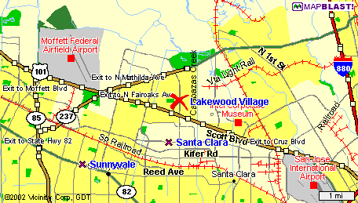 *Lakewood Village position in northern Sunnyvale* | 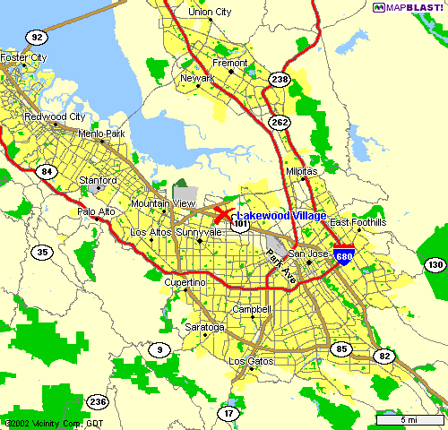 *Central position in the South San Francisco Bay* |

### Preserved Neighborhood Boundaries

- **North:** State Route 237 (South Bay Freeway) and the Tasman light rail corridor.
- **South:** US Highway 101 (Bayshore Freeway).
- **East:** Calabazas Creek and the municipal border with the City of Santa Clara.
- **West:** Lawrence Expressway and surrounding light-industrial business parks.

The subdivision was bisected north-to-south by **Lawrence Expressway**, creating two distinct neighborhood sections: the "Lakewood side" to the west and the "Fairwood side" to the east, connected by Lakehaven Drive and dedicated pedestrian bridges.

---

## Parks and Recreation

The neighborhood was developed with two municipal parks, an aqueduct greenbelt walking path, and proximity to regional bayfront nature preserves.

### Lakewood Park

Located at Lakechime Drive and Silverlake Drive adjacent to Lakewood Elementary School, **Lakewood Park** served as the primary civic gathering space for the tract. Dedicated in September 1964 with a distinctive "Space Age" aerospace design theme, its facilities during the archive era included:

- **The Lakewood Park Building:** Neighborhood civic hall used for LVNA monthly general meetings, candidate forums, volunteer dinners, and municipal workshops.
- **Playgrounds & Picnic Grounds:** Children's play equipment, basketball courts, expansive turf fields, and reservable community barbecue areas.
- **Lakewood Pool:** Historic summer neighborhood swimming facility offering recreational swim hours, swim lessons, and neighborhood pool parties.

| Lakewood Park Gathering Area | Historic Lakewood Park Grounds |
| :---: | :---: |
| [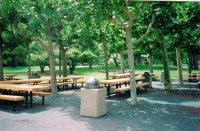](Parks/lakewood-large4.JPG){ .glightbox } *Shaded picnic areas at Lakewood Park* | [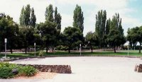](Parks/PBlakewood-lg2.jpg){ .glightbox } *Community park grounds and mature trees* |

### Fairwood Park & The John W. Christian Greenbelt

- **Fairwood Park:** Located on the east side of Lawrence Expressway adjacent to Fairwood Elementary, providing open playfields, children's playground equipment, and walking paths.
- **The John W. Christian Greenbelt:** Landscaped walking corridor established along the Hetch-Hetchy aqueduct right-of-way. It was dedicated by the City of Sunnyvale and LVNA in 2002 to honor neighborhood leader and Sunnyvale Director of Parks and Recreation John W. Christian (1946–1996), who led the development of nearby Sunnyvale Baylands Park and expanded open space and recreational facilities across the city.

| Fairwood Park Equipment | John W. Christian Greenbelt |
| :---: | :---: |
| 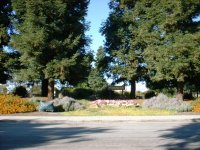 *Fairwood Park play structures* | 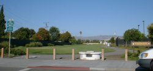 *Landscaped walking path through the greenbelt* |

### Sunnyvale Baylands Park & Nature Reserve

Located less than two miles north along Caribbean Drive, **Baylands Park** encompasses 140 acres of preserved salt marsh wetlands and developed parklands bordering the San Francisco Bay. Opened in the early 1990s, it provided residents with access to the San Francisco Bay Trail, wetlands wildlife observation platforms, and expansive meadows.

| Baylands Wetlands Overlook | Meadowlands Trails |
| :---: | :---: |
| [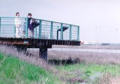](Parks/ovrlk.jpg){ .glightbox } *Wetlands observation overlook* | 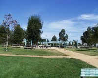 *Baylands nature and walking trails* |

---

## Schools and Education

Throughout the archive period, Lakewood Village youth were served by the **Sunnyvale Elementary School District (SESD)** for kindergarten through 8th grade, and the **Fremont Union High School District (FUHSD)** for grades 9 through 12.

### Neighborhood Elementary Schools

| Lakewood Elementary School | Fairwood Elementary School |
| :---: | :---: |
| 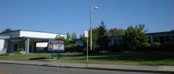 **Lakewood Elementary School** | 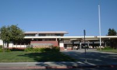 **Fairwood Elementary School** |

- **Lakewood Elementary School:** Built in 1959, Lakewood School is located on the west side of Lawrence Expressway and historically enrolled neighborhood children from Units 1 and 3.
- **Fairwood Elementary School:** Built in 1965 and celebrating its 40th anniversary in 2005, Fairwood School is situated on the east side of Lawrence Expressway, historically serving children from Units 2 and 4.

### Secondary Education

- **Columbia Middle School:** Served neighborhood students for 6th through 8th grades, situated alongside the Columbia Neighborhood Center on Morse Avenue.
- **Fremont High School:** Public high school serving Lakewood Village youth on Fremont Avenue, known for academic, athletic, and performing arts traditions.

---

## Shopping and Local Commerce

### Historic Lakewood Shopping Center

The neighborhood's commercial retail hub was the **Lakewood Shopping Center**, situated at the corner of Lawrence Expressway and Lakehaven Drive.

| Center Overview | Commercial Signage |
| :---: | :---: |
| 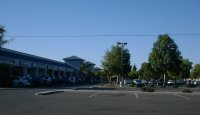 *Commercial storefronts at Lawrence and Lakehaven* | 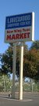 *Lakewood Shopping Center landmark sign* |

- **Subdivision Origins:** Opened in 1959 as "Dick's Lakewood Center," the plaza was anchored for more than four decades by **Dick's Supermarket** until its closure in 2001. The market featured groceries, a local pharmacy with a US Post Office substation, bakery, hardware counter, and the Grog & Vittle Shoppe (Lakewood Lounge).
- **2000s Transition:** Following Dick's closure, the anchor space transitioned to international specialty grocery markets (including New Wing Yuan Market), accompanied by neighborhood restaurants, dry cleaners, auto service shops, and local retail services.

---

## Transportation and Commuting

The 2000s archive documented Lakewood Village's transit connections to major Silicon Valley employment campuses, highway corridors, and commuter rail.

### Regional Highway Network

| Silicon Valley Regional Freeway Network |
| :---: |
| 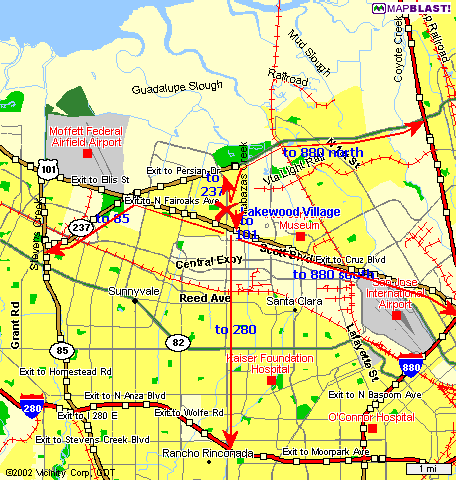 *Highway access connecting Lakewood Village to US-101, CA-237, I-880, I-280, CA-85, and CA-87* |

- **US Highway 101 (Bayshore Freeway):** Direct southern access linking the neighborhood to San Francisco, San Jose International Airport (SJC), and Palo Alto.
- **State Route 237:** Northern perimeter expressway connecting to I-880 in Milpitas and I-280 in Mountain View.
- **Lawrence Expressway:** Key north-south arterial linking the tract to Central Expressway, El Camino Real, and southern Santa Clara County.

### Public Transit as Documented in the 2000s

During the archive era, Lakewood Village was directly served by Santa Clara Valley Transportation Authority (VTA) light rail and bus lines:

- **VTA Light Rail (Vienna Station):** Situated on Tasman Drive near Lawrence Expressway, Vienna Station provided residents with direct light rail access west to downtown Mountain View and east toward Milpitas, with transfers at Baypointe for San Jose International Airport and downtown San Jose.
- **VTA Local Bus Line 55:** Ran through Lakewood Village to provide north-south transit connecting to the Sunnyvale Civic Center, downtown Sunnyvale, and De Anza College.
- **Caltrain Commuter Rail:** Accessible via **Lawrence Station** south of Highway 101, providing passenger rail connections to San Francisco, the Peninsula, San Jose, and Gilroy.
- **Express Commuter Buses:** Express routes (#122, #321, #328, #521) stopped at Lawrence Expressway and Tasman Drive, connecting major aerospace and technology campuses.
- **Trail Corridors:** Calabazas Creek Trail, the John W. Christian Greenbelt, and the Bay Trail network offered dedicated off-street routes for bicycle commuting and recreation.

---

## Historical Housing and Real Estate Snapshot (2002-2008)

!!! info "Historical Real Estate Property Snapshot (2002-2008)"
    These property sale records were compiled from 2002 to 2008 courtesy of longtime neighborhood realtor Virginia Lindstrom's RE/MAX Team. They reflect typical property valuations for Lakewood Village single-family homes during that economic period.

### Active Listings at Time of Archive (Circa 2007-2008)

| Street | Approximate Asking Price | Real Estate Agent Listing |
| :--- | :--- | :--- |
| Lakewood Drive | $519,900 | Open Listing |
| Socorro Avenue | $529,900 | Open Listing |
| Socorro Avenue | $539,000 | Open Listing |
| Velvetlake Drive | $560,000 | Open Listing |
| Torrance Avenue | $575,000 | Open Listing |
| Fairwood Avenue | $599,000 | Open Listing |
| Greenlake Drive | $599,000 | Open Listing |
| Lakewood Drive | $599,000 | Open Listing |
| Greenlake Drive | $599,950 | Open Listing |
| Lakefair Drive | $600,000 | Open Listing |
| Prescott Avenue | $620,000 | Open Listing |
| Blazingwood Drive | $639,950 | Open Listing |
| Sandia Avenue | $649,000 | Open Listing |
| Manzano Way | $650,000 | Open Listing |
| Sandia Avenue | $660,000 | Open Listing |
| Sandia Avenue | $669,000 | Open Listing |
| Prescott Avenue | $669,000 | Open Listing |
| Manzano Way | $685,000 | Open Listing |
| Blazingwood Drive | $750,000 | Open Listing |

### Pending Sales (Circa 2007-2008)

| Street | Listed Asking Price | Status |
| :--- | :--- | :--- |
| Palamos Avenue | $519,000 | Pending Sale |
| Lakewood Drive | $519,000 | Pending Sale |
| Lakehaven Drive | $533,900 | Pending Sale |
| Lakewood Drive | $540,000 | Pending Sale |
| Prescott Avenue | $574,900 | Pending Sale |
| Socorro Avenue | $729,888 | Pending Sale |

### Historical Completed Transactions (2002-2008 Archive)

| Street | Asking Price | Final Recorded Sale Price | Listing Representative |
| :--- | :--- | :--- | :--- |
| Torrance Avenue | $504,900 | $504,900 | Open Listing |
| Manzano Way | $550,000 | $545,000 | Open Listing |
| Socorro Avenue | $589,000 | $570,000 | Virginia Lindstrom RE/MAX Team |

### Mid-Century Architecture & Residential Design References

Built between 1955 and 1958, Lakewood Village tract homes reflect California mid-century modern tract styling, influenced by the contemporary architectural work of Joseph Eichler throughout Sunnyvale:

| Title & Topic | Focus & Scope |
| :--- | :--- |
| **Eichler Homes: Design for Living** | Jerry Ditto et al. Architectural analysis of post-war suburban modernist housing, post-and-beam construction, and indoor-outdoor living. |
| **Eichler: Modernism Rebuilds the American Dream** | Paul Adamson. Retrospective on California tract modernism, open floor plans, and glass curtain walls. |
| **Mid-Century Modern: Furniture and Interiors of the 1950s** | Cara Greenberg. Survey of mid-century aesthetics, furnishings, and materials. |
| **Sunset Western Garden Book** | Guide to landscaping for Northern California microclimates and low-maintenance native plants. |

---

## Environmental and Geologic Setting

Lakewood Village is located in the northern alluvial plain of the Santa Clara Valley bordering the southern edge of the San Francisco Bay wetlands. Historical civic and environmental assessments document the area's seismic, flood, and water quality conditions:

### Regional Seismic & Flood Hazard Assessments

| ABAG Regional Earthquake Shaking Hazard | FEMA Flood Hazard Zone Map |
| :---: | :---: |
| 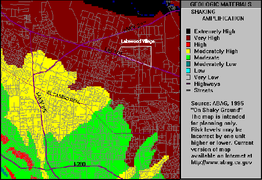 *Association of Bay Area Governments (ABAG) seismic ground-shaking hazard assessment* | 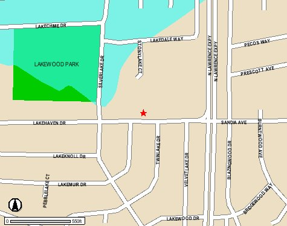 *FEMA flood insurance study map for northern Sunnyvale* |

- **Seismic Shaking Hazard:** Modeled by the Association of Bay Area Governments (ABAG), indicating relative ground shaking hazard scenarios across local alluvial soils between the San Andreas and Hayward faults.
- **Flood Plains:** Lowland reaches of Unit 3 bordering Calabazas Creek lie within designated FEMA flood hazard zones, monitored by the Santa Clara Valley Water District.

### Groundwater Monitoring & Industrial Air Quality

| Regional Groundwater Monitoring Well & Plume Map | Industrial Toxic Release Inventory Map |
| :---: | :---: |
| [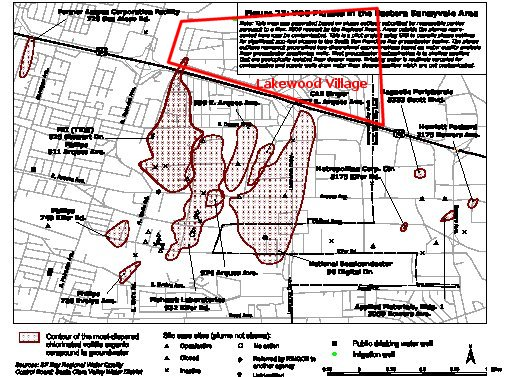](../Resources/Maps/Plume/Fig_23_Local_VOC.pdf) *Regional VOC groundwater monitoring map (click to view technical report PDF)* | 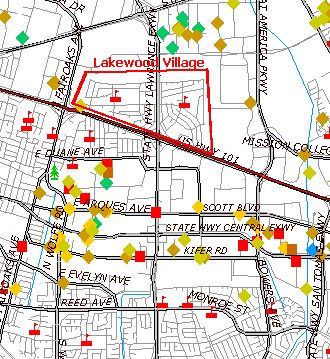 *Industrial reporting facilities near Lakewood Village* |

- **VOC Groundwater Monitoring:** Compiled by the California Regional Water Quality Control Board in 1995, tracking slow-moving volatile organic compound (VOC) plumes in deep aquifer testing wells. [View Technical Study PDF](../Resources/Maps/Plume/Fig_23_Local_VOC.pdf).
- **Toxic Release Inventory (TRI):** [Map Symbol Legend](../Resources/Maps/Toxics/toxic-legend.gif) for industrial monitoring facilities under federal EPA reporting standards.

---

## Political Districts and Representation (Circa 2002)

Preserved boundaries and political representation for Lakewood Village during the 2000s redistricting cycle:

| US Congressional District 14 | California State Senate District 13 | California State Assembly District 22 |
| :---: | :---: | :---: |
| 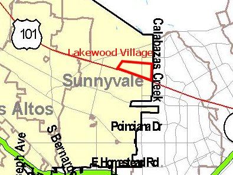 *14th Congressional District* | 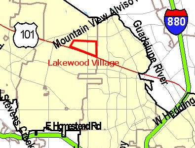 *13th State Senate District* | 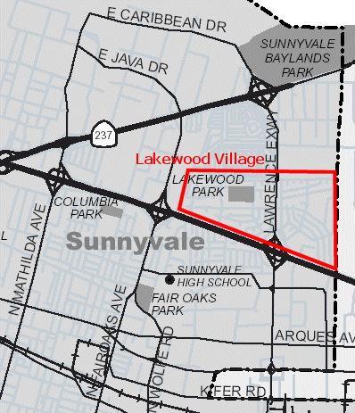 *22nd State Assembly District* |

- **US House of Representatives (14th District):** Represented by Rep. Anna Eshoo. US Senators: Dianne Feinstein and Barbara Boxer.
- **California State Senate (13th District):** Represented by Sen. John Vasconcellos.
- **California State Assembly (22nd District):** Represented by Asm. Elaine Alquist.
