# The Villager: Complete Digital Archive (1958-2026)

!!! note "Archive Navigation"
    This single master archive contains all **442 preserved issues** of *The Villager* and *LVRA Villager* spanning from May 1958 through October 2026. Every issue includes its cover snapshot, publication details, contents summary, interactive digital reader, and original PDF download.
    
    For historical publication policies, contributor guidelines, and advertising rates, visit **[Policies, Guidelines & Advertising](../villager.md)**.

[📜 **Read Historical Policies, Guidelines & Advertising**](../villager.md){ .md-button .md-button--primary }

### Jump to Decade / Year

- **2020s:** [2026](#2026) · [2025](#2025) · [2024](#2024) · [2023](#2023) · [2022](#2022) · [2021](#2021) · [2020](#2020)
- **2010s:** [2019](#2019) · [2017](#2017) · [2016](#2016) · [2015](#2015) · [2014](#2014) · [2013](#2013) · [2012](#2012) · [2011](#2011) · [2010](#2010)
- **2000s:** [2009](#2009) · [2008](#2008) · [2007](#2007) · [2006](#2006) · [2005](#2005) · [2004](#2004) · [2003](#2003) · [2002](#2002) · [2001](#2001)
- **1990s:** [1997](#1997) · [1996](#1996) · [1995](#1995) · [1994](#1994) · [1993](#1993) · [1992](#1992)
- **1970s:** [1971](#1971) · [1970](#1970)
- **1960s:** [1969](#1969) · [1968](#1968) · [1967](#1967) · [1966](#1966) · [1965](#1965) · [1964](#1964) · [1963](#1963) · [1962](#1962) · [1961](#1961) · [1960](#1960)
- **1950s:** [1959](#1959) · [1958](#1958)

---

## 2026
*9 issues preserved · 68 total pages*

| Snapshot | Issue & Details | Highlights / Contents Summary | Links |
| :---: | :--- | :--- | :--- |
| [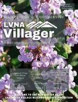{ width="105" }](2026-10.md) | **[October 2026](2026-10.md)** Vol. 69, No. 10 11 pages | VOL. 69 EDITION 10  •  OCTOBER 2026; WELCOME TO THE NEWSLETTER OF THE; LAKEWOOD VILLAGE NEIGHBORHOOD ASSOCIATION; REPRESENTING 1721 HOUSEHOLDS. | [📖 View Reader](2026-10.md) [📥 Download PDF](../Villager_Back_Issues/2026_Villager/2026-10.pdf) |
| [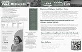{ width="105" }](2026-09.md) | **[September 2026](2026-09.md)** Vol. 69, No. 9 2 pages | VOL. 69 EDITION 9  •  SEPTEMBER 2026; REPRESENTING 1614 HOUSEHOLDS; Important Numbers; Abandoned Vehicles. | [📖 View Reader](2026-09.md) [📥 Download PDF](../Villager_Back_Issues/2026_Villager/2026-09.pdf) |
| [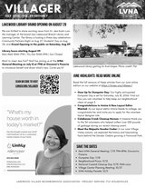{ width="105" }](2026-07.md) | **[July 2026](2026-07.md)** Vol. 69, No. 7 4 pages | Next LVNA General Meeting: 7/15 7PM-8PM, Giovanni's; Dumpster Day: 7/18; Neighborhood Picnic: 9/12; National Coastal Cleanup Day: 9/19, 9AM-noon. | [📖 View Reader](2026-07.md) [📥 Download PDF](../Villager_Back_Issues/2026_Villager/2026-07.pdf) |
| [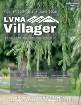{ width="105" }](2026-06.md) | **[June 2026](2026-06.md)** Vol. 69, No. 6 9 pages | VOL. 69 EDITION 6  •  JUNE 2026; WELCOME TO THE NEWSLETTER OF THE; LAKEWOOD VILLAGE NEIGHBORHOOD ASSOCIATION; REPRESENTING 1721 HOUSEHOLDS. | [📖 View Reader](2026-06.md) [📥 Download PDF](../Villager_Back_Issues/2026_Villager/2026-06.pdf) |
| [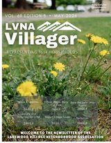{ width="105" }](2026-05.md) | **[May 2026](2026-05.md)** Vol. 69, No. 5 9 pages | VOL. 69 EDITION 5  •  MAY 2026; WELCOME TO THE NEWSLETTER OF THE; LAKEWOOD VILLAGE NEIGHBORHOOD ASSOCIATION; REPRESENTING 1614 HOUSEHOLDS. | [📖 View Reader](2026-05.md) [📥 Download PDF](../Villager_Back_Issues/2026_Villager/2026-05.pdf) |
| [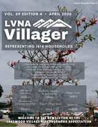{ width="105" }](2026-04.md) | **[April 2026](2026-04.md)** Vol. 69, No. 4 9 pages | VOL. 69 EDITION 4  •  APRIL 2026; WELCOME TO THE NEWSLETTER OF THE; LAKEWOOD VILLAGE NEIGHBORHOOD ASSOCIATION; REPRESENTING 1614 HOUSEHOLDS. | [📖 View Reader](2026-04.md) [📥 Download PDF](../Villager_Back_Issues/2026_Villager/2026-04.pdf) |
| [{ width="105" }](2026-03.md) | **[March 2026](2026-03.md)** Vol. 69, No. 3 8 pages | VOL. 69 EDITION 3  •  MARCH 2026; WELCOME TO THE NEWSLETTER OF THE; LAKEWOOD VILLAGE NEIGHBORHOOD ASSOCIATION; REPRESENTING 1614 HOUSEHOLDS. | [📖 View Reader](2026-03.md) [📥 Download PDF](../Villager_Back_Issues/2026_Villager/2026-03.pdf) |
| [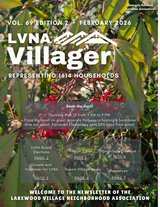{ width="105" }](2026-02.md) | **[February 2026](2026-02.md)** Vol. 69, No. 2 8 pages | VOL. 69 EDITION 2  •  FEBRUARY 2026; WELCOME TO THE NEWSLETTER OF THE; LAKEWOOD VILLAGE NEIGHBORHOOD ASSOCIATION; REPRESENTING 1614 HOUSEHOLDS. | [📖 View Reader](2026-02.md) [📥 Download PDF](../Villager_Back_Issues/2026_Villager/2026-02.pdf) |
| [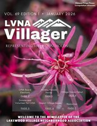{ width="105" }](2026-01.md) | **[January 2026](2026-01.md)** Vol. 69, No. 1 8 pages | VOL. 69 EDITION 1  •  JANUARY 2026; WELCOME TO THE NEWSLETTER OF THE; LAKEWOOD VILLAGE NEIGHBORHOOD ASSOCIATION; REPRESENTING 1614 HOUSEHOLDS. | [📖 View Reader](2026-01.md) [📥 Download PDF](../Villager_Back_Issues/2026_Villager/2026-01.pdf) |

## 2025
*12 issues preserved · 101 total pages*

| Snapshot | Issue & Details | Highlights / Contents Summary | Links |
| :---: | :--- | :--- | :--- |
| [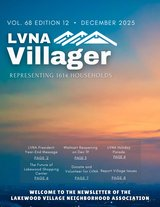{ width="105" }](2025-12.md) | **[December 2025](2025-12.md)** Vol. 68, No. 12 10 pages | VOL. 68 EDITION 12  •  DECEMBER 2025; WELCOME TO THE NEWSLETTER OF THE; LAKEWOOD VILLAGE NEIGHBORHOOD ASSOCIATION; REPRESENTING 1614 HOUSEHOLDS. | [📖 View Reader](2025-12.md) [📥 Download PDF](../Villager_Back_Issues/2025_Villager/2025-12.pdf) |
| [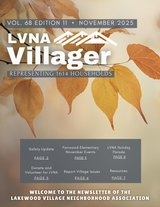{ width="105" }](2025-11.md) | **[November 2025](2025-11.md)** Vol. 68, No. 11 8 pages | VOL. 68 EDITION 11  •  NOVEMBER 2025; WELCOME TO THE NEWSLETTER OF THE; LAKEWOOD VILLAGE NEIGHBORHOOD ASSOCIATION; REPRESENTING 1614 HOUSEHOLDS. | [📖 View Reader](2025-11.md) [📥 Download PDF](../Villager_Back_Issues/2025_Villager/2025-11.pdf) |
| [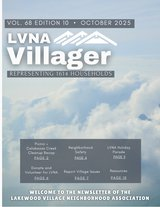{ width="105" }](2025-10.md) | **[October 2025](2025-10.md)** Vol. 68, No. 10 11 pages | VOL. 68 EDITION 10  •  OCTOBER 2025; WELCOME TO THE NEWSLETTER OF THE; LAKEWOOD VILLAGE NEIGHBORHOOD ASSOCIATION; REPRESENTING 1614 HOUSEHOLDS. | [📖 View Reader](2025-10.md) [📥 Download PDF](../Villager_Back_Issues/2025_Villager/2025-10.pdf) |
| [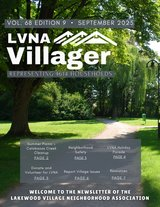{ width="105" }](2025-09.md) | **[September 2025](2025-09.md)** Vol. 68, No. 9 8 pages | VOL. 68 EDITION 9  •  SEPTEMBER 2025; Report Village Issues; LVNA Holiday; Donate and. | [📖 View Reader](2025-09.md) [📥 Download PDF](../Villager_Back_Issues/2025_Villager/2025-09.pdf) |
| [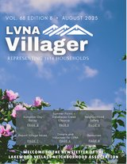{ width="105" }](2025-08.md) | **[August 2025](2025-08.md)** Vol. 68, No. 8 9 pages | VOL. 68 EDITION 8  •  AUGUST 2025; REPRESENTING 1614 HOUSEHOLDS; Dumpster Day; Report Village Issues. | [📖 View Reader](2025-08.md) [📥 Download PDF](../Villager_Back_Issues/2025_Villager/2025-08.pdf) |
| [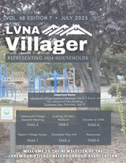{ width="105" }](2025-07.md) | **[July 2025](2025-07.md)** Vol. 68, No. 7 8 pages | VOL. 68 EDITION 7  •  JULY 2025; REPRESENTING 1614 HOUSEHOLDS; Important Dates; Lakewood Village General Meeting: July 9, 7–8 p.m. at. | [📖 View Reader](2025-07.md) [📥 Download PDF](../Villager_Back_Issues/2025_Villager/2025-07.pdf) |
| [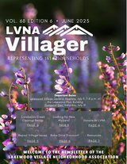{ width="105" }](2025-06.md) | **[June 2025](2025-06.md)** Vol. 68, No. 6 7 pages | REPRESENTING 1614 HOUSEHOLDS; VOL. 68 EDITION 6  •  JUNE 2025; Important Dates; Lakewood Village General Meeting: July 9, 7–8 p.m. at. | [📖 View Reader](2025-06.md) [📥 Download PDF](../Villager_Back_Issues/2025_Villager/2025-06.pdf) |
| [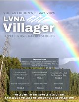{ width="105" }](2025-05.md) | **[May 2025](2025-05.md)** Vol. 68, No. 5 8 pages | REPRESENTING 1614 HOUSEHOLDS; VOL. 68 EDITION 5  •  MAY 2025; Important Dates; Memorial Day Scavenger Hunt starting May 1. | [📖 View Reader](2025-05.md) [📥 Download PDF](../Villager_Back_Issues/2025_Villager/2025-05.pdf) |
| [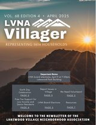{ width="105" }](2025-04.md) | **[April 2025](2025-04.md)** Vol. 68, No. 4 7 pages | REPRESENTING 1614 HOUSEHOLDS; VOL. 68 EDITION 4  •  APRIL 2025; Important Dates; LVNA board elections, April 9 at 7:00pm,. | [📖 View Reader](2025-04.md) [📥 Download PDF](../Villager_Back_Issues/2025_Villager/2025-04.pdf) |
| [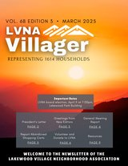{ width="105" }](2025-03.md) | **[March 2025](2025-03.md)** Vol. 68, No. 3 9 pages | REPRESENTING 1614 HOUSEHOLDS; VOL. 68 EDITION 3  •  MARCH 2025; Important Dates; LVNA board election, April 9 at 7:00pm,. | [📖 View Reader](2025-03.md) [📥 Download PDF](../Villager_Back_Issues/2025_Villager/2025-03.pdf) |
| [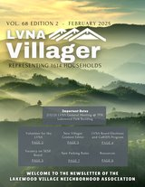{ width="105" }](2025-02.md) | **[February 2025](2025-02.md)** Vol. 68, No. 2 9 pages | REPRESENTING 1614 HOUSEHOLDS; VOL. 68 EDITION 2  •  FEBRUARY 2025; Important Dates; 2/12/25 LVNA General Meeting @ 7PM,. | [📖 View Reader](2025-02.md) [📥 Download PDF](../Villager_Back_Issues/2025_Villager/2025-02.pdf) |
| [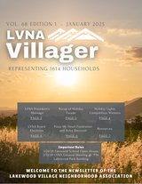{ width="105" }](2025-01.md) | **[January 2025](2025-01.md)** Vol. 68, No. 1 7 pages | REPRESENTING 1614 HOUSEHOLDS; VOL. 68 EDITION 1  •  JANUARY 2025; LVNA President’s; LVNA Board. | [📖 View Reader](2025-01.md) [📥 Download PDF](../Villager_Back_Issues/2025_Villager/2025-01.pdf) |

## 2024
*12 issues preserved · 124 total pages*

| Snapshot | Issue & Details | Highlights / Contents Summary | Links |
| :---: | :--- | :--- | :--- |
| [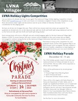{ width="105" }](2024-12.md) | **[December 2024](2024-12.md)** Vol. 67, No. 12 2 pages | VOL. 67 EDITION 12  •  DECEMBER 2024; WELCOME TO THE NEWSLETTER; OF THE LAKEWOOD VILLAGE; NEIGHBORHOOD ASSOCIATION. | [📖 View Reader](2024-12.md) [📥 Download PDF](../Villager_Back_Issues/2024_Villager/2024-12.pdf) |
| [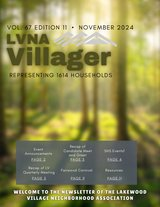{ width="105" }](2024-11.md) | **[November 2024](2024-11.md)** Vol. 67, No. 11 11 pages | REPRESENTING 1614 HOUSEHOLDS; VOL. 67 EDITION 11  •  NOVEMBER 2024; Announcements; Fairwood Carnival. | [📖 View Reader](2024-11.md) [📥 Download PDF](../Villager_Back_Issues/2024_Villager/2024-11.pdf) |
| [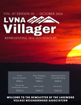{ width="105" }](2024-10.md) | **[October 2024](2024-10.md)** Vol. 67, No. 10 18 pages | REPRESENTING 1614 HOUSEHOLDS; VOL. 67 EDITION 10  •  OCTOBER 2024; Announcements; Kid’s Corner. | [📖 View Reader](2024-10.md) [📥 Download PDF](../Villager_Back_Issues/2024_Villager/2024-10.pdf) |
| [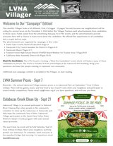{ width="105" }](2024-09.md) | **[September 2024](2024-09.md)** Vol. 67, No. 9 12 pages | VOL. 67 EDITION 9  •  SEPTEMBER 2024; LVNA Summer Picnic - Sept 7; The advertisements are organized by campaign, in this order:; Santa Clara County Board of Education (Page 3). | [📖 View Reader](2024-09.md) [📥 Download PDF](../Villager_Back_Issues/2024_Villager/2024-09.pdf) |
| [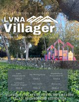{ width="105" }](2024-08.md) | **[August 2024](2024-08.md)** Vol. 67, No. 8 13 pages | VOL. 67 EDITION 8  •  AUGUST 2024; REPRESENTING 1614 HOUSEHOLDS; Announcements; Kid’s Corner. | [📖 View Reader](2024-08.md) [📥 Download PDF](../Villager_Back_Issues/2024_Villager/2024-08.pdf) |
| [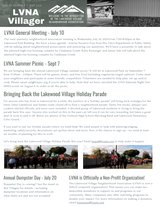{ width="105" }](2024-07.md) | **[July 2024](2024-07.md)** Vol. 67, No. 7 6 pages | VOL. 67 EDITION 7  •  JULY 2024; WELCOME TO THE NEWSLETTER; OF THE LAKEWOOD VILLAGE; NEIGHBORHOOD ASSOCIATION. | [📖 View Reader](2024-07.md) [📥 Download PDF](../Villager_Back_Issues/2024_Villager/2024-07.pdf) |
| [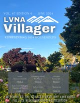{ width="105" }](2024-06.md) | **[June 2024](2024-06.md)** Vol. 67, No. 6 15 pages | VOL. 67 EDITION 6  •  JUNE 2024; REPRESENTING 1614 HOUSEHOLDS; Announcements; Kid’s Corner. | [📖 View Reader](2024-06.md) [📥 Download PDF](../Villager_Back_Issues/2024_Villager/2024-06.pdf) |
| [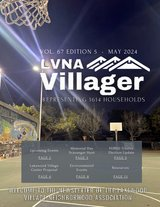{ width="105" }](2024-05.md) | **[May 2024](2024-05.md)** Vol. 67, No. 5 13 pages | VOL. 67 EDITION 5  •  MAY 2024; Upcoming Events; Environmental; FUHSD Trustee. | [📖 View Reader](2024-05.md) [📥 Download PDF](../Villager_Back_Issues/2024_Villager/2024-05.pdf) |
| [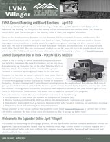{ width="105" }](2024-04.md) | **[April 2024](2024-04.md)** Vol. 67, No. 4 7 pages | LVNA VILLAGER - JULY 2023; LVNA VILLAGER - APRIL 2024; VOL. 67 EDITION 4  •  APRIL 2024; WELCOME TO THE NEWSLETTER. | [📖 View Reader](2024-04.md) [📥 Download PDF](../Villager_Back_Issues/2024_Villager/2024-04.pdf) |
| [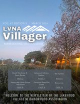{ width="105" }](2024-03.md) | **[March 2024](2024-03.md)** Vol. 67, No. 3 13 pages | VOL. 67 EDITION 3  •  MARCH 2024; REPRESENTING 1614 HOUSEHOLDS; Board Elections &; Event Recap. | [📖 View Reader](2024-03.md) [📥 Download PDF](../Villager_Back_Issues/2024_Villager/2024-03.pdf) |
| [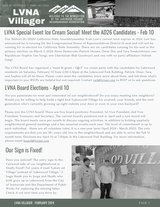{ width="105" }](2024-02.md) | **[February 2024](2024-02.md)** Vol. 67, No. 2 4 pages | VOL. 67 EDITION 2  •  FEBRUARY 2024; Our Sign is Fixed!; Have you noticed? The entry sign to the; Fairwood side of our neighborhood i. | [📖 View Reader](2024-02.md) [📥 Download PDF](../Villager_Back_Issues/2024_Villager/2024-02.pdf) |
| [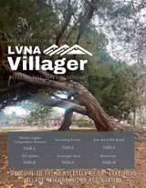{ width="105" }](2024-01.md) | **[January 2024](2024-01.md)** Vol. 67, No. 1 10 pages | Holiday Lights; Competition Winners; Scavenger Hunt; Join the LVNA Board. | [📖 View Reader](2024-01.md) [📥 Download PDF](../Villager_Back_Issues/2024_Villager/2024-01.pdf) |

## 2023
*12 issues preserved · 105 total pages*

| Snapshot | Issue & Details | Highlights / Contents Summary | Links |
| :---: | :--- | :--- | :--- |
| [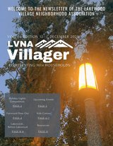{ width="105" }](2023-12.md) | **[December 2023](2023-12.md)** Vol. 66, No. 12 11 pages | VOL. 66 EDITION 12  •  DECEMBER 2023; REPRESENTING 1614 HOUSEHOLDS; Holiday Lights; Competition. | [📖 View Reader](2023-12.md) [📥 Download PDF](../Villager_Back_Issues/2023_Villager/2023-12.pdf) |
| [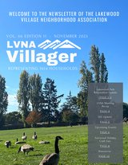{ width="105" }](2023-11.md) | **[November 2023](2023-11.md)** Vol. 66, No. 11 10 pages | VOL. 66 EDITION 11  •  NOVEMBER 2023; REPRESENTING 1614 HOUSEHOLDS; Lakewood Park; Renovation Update. | [📖 View Reader](2023-11.md) [📥 Download PDF](../Villager_Back_Issues/2023_Villager/2023-11.pdf) |
| [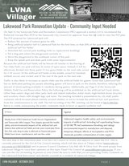{ width="105" }](2023-10.md) | **[October 2023](2023-10.md)** Vol. 66, No. 10 4 pages | VOL. 66 EDITION 10  •  OCTOBER 2023; Mostly from AYSO (American Youth Soccer Organization); safety, and environmental impacts of the artificial turf, and; Dec-Feb, only drop-in play is allowed on Sunnyvale grass. | [📖 View Reader](2023-10.md) [📥 Download PDF](../Villager_Back_Issues/2023_Villager/2023-10.pdf) |
| [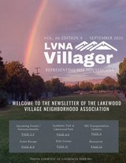{ width="105" }](2023-09.md) | **[September 2023](2023-09.md)** Vol. 66, No. 9 13 pages | VOL. 66 EDITION 9  •  SEPTEMBER 2023; REPRESENTING 1614 HOUSEHOLDS; Upcoming Events /; Announcements. | [📖 View Reader](2023-09.md) [📥 Download PDF](../Villager_Back_Issues/2023_Villager/2023-09.pdf) |
| [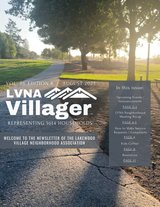{ width="105" }](2023-08.md) | **[August 2023](2023-08.md)** Vol. 66, No. 8 11 pages | VOL. 66 EDITION 8  •  AUGUST 2023; REPRESENTING 1614 HOUSEHOLDS; WELCOME TO THE NEWSLETTER OF THE LAKEWOOD; VILLAGE NEIGHBORHOOD ASSOCIATION. | [📖 View Reader](2023-08.md) [📥 Download PDF](../Villager_Back_Issues/2023_Villager/2023-08.pdf) |
| [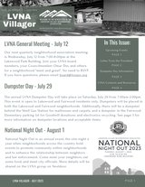{ width="105" }](2023-07.md) | **[July 2023](2023-07.md)** Vol. 66, No. 7 4 pages | Upcoming Events; Letter From the President; Dumpster Day Information; LVNA Contacts and Resources. | [📖 View Reader](2023-07.md) [📥 Download PDF](../Villager_Back_Issues/2023_Villager/2023-07.pdf) |
| [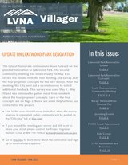{ width="105" }](2023-06.md) | **[June 2023](2023-06.md)** Vol. 66, No. 6 10 pages | VOL. 66 EDITION 6  •  JUNE 2023; In this issue:; Lakewood Park Renovation; UPDATE ON LAKEWOOD PARK RENOVATION. | [📖 View Reader](2023-06.md) [📥 Download PDF](../Villager_Back_Issues/2023_Villager/2023-06.pdf) |
| [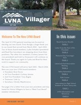{ width="105" }](2023-05.md) | **[May 2023](2023-05.md)** Vol. 66, No. 5 9 pages | VOL. 66 EDITION 5  •  MAY 2023; In this issue:; Board Election Results; Welcome To The New LVNA Board. | [📖 View Reader](2023-05.md) [📥 Download PDF](../Villager_Back_Issues/2023_Villager/2023-05.pdf) |
| [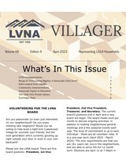{ width="105" }](2023-04.md) | **[April 2023](2023-04.md)** Vol. 66, No. 4 10 pages | Representing 1,614 Households; What’s In This Issue; LVNA Announcements; Recap of “Overcoming Bigotry: A Sunnyvale Unity Event”. | [📖 View Reader](2023-04.md) [📥 Download PDF](../Villager_Back_Issues/2023_Villager/2023-04.pdf) |
| [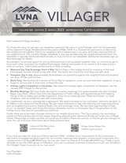{ width="105" }](2023-03.md) | **[March 2023](2023-03.md)** Vol. 66, No. 3 4 pages | VOLUME 66   EDITION 3  MARCH 2023   REPRESENTING 1,614 HOUSEHOLDS; Dear Lakewood Village residents,; See back page for details.; January 2023 Villager for the winners. | [📖 View Reader](2023-03.md) [📥 Download PDF](../Villager_Back_Issues/2023_Villager/2023-03.pdf) |
| [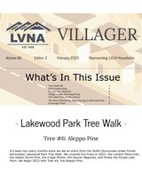{ width="105" }](2023-02.md) | **[February 2023](2023-02.md)** Vol. 66, No. 2 10 pages | February 2023; Representing 1,614 Households; What’s In This Issue; Tree Walk #6. | [📖 View Reader](2023-02.md) [📥 Download PDF](../Villager_Back_Issues/2023_Villager/2023-02.pdf) |
| [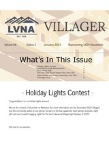{ width="105" }](2023-01.md) | **[January 2023](2023-01.md)** Vol. 66, No. 1 9 pages | Representing 1,614 Households; What’s In This Issue; Holiday Lights Contest; LAKEWOOD PARK RENOVATION. | [📖 View Reader](2023-01.md) [📥 Download PDF](../Villager_Back_Issues/2023_Villager/2023-01.pdf) |

## 2022
*12 issues preserved · 88 total pages*

| Snapshot | Issue & Details | Highlights / Contents Summary | Links |
| :---: | :--- | :--- | :--- |
| [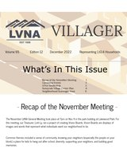{ width="105" }](2022-12.md) | **[December 2022](2022-12.md)** Vol. 65, No. 12 10 pages | Edition 12; December 2022; Representing 1,614 Households; What’s In This Issue. | [📖 View Reader](2022-12.md) [📥 Download PDF](../Villager_Back_Issues/2022_Villager/2022-12.pdf) |
| [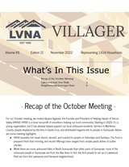{ width="105" }](2022-11.md) | **[November 2022](2022-11.md)** Vol. 65, No. 11 7 pages | Edition 11; November 2022; Representing 1,614 Households; What’s In This Issue. | [📖 View Reader](2022-11.md) [📥 Download PDF](../Villager_Back_Issues/2022_Villager/2022-11.pdf) |
| [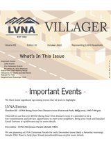{ width="105" }](2022-10.md) | **[October 2022](2022-10.md)** Vol. 65, No. 10 9 pages | Edition 10; Representing 1,614 Households; What’s In This Issue; Important Events. | [📖 View Reader](2022-10.md) [📥 Download PDF](../Villager_Back_Issues/2022_Villager/2022-10.pdf) |
| [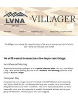{ width="105" }](2022-09.md) | **[September 2022](2022-09.md)** Vol. 65, No. 9 1 pages | September 2022; Representing 1,625 Households; Don’t worry, we’ll be back next month!; We still wanted to mention a few important things:. | [📖 View Reader](2022-09.md) [📥 Download PDF](../Villager_Back_Issues/2022_Villager/2022-09.pdf) |
| [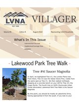{ width="105" }](2022-08.md) | **[August 2022](2022-08.md)** Vol. 65, No. 8 5 pages | August 2022; Representing 1,614 Households; What’s In This Issue; Lakewood Park Tree Walk. | [📖 View Reader](2022-08.md) [📥 Download PDF](../Villager_Back_Issues/2022_Villager/2022-08.pdf) |
| [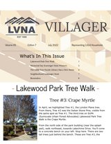{ width="105" }](2022-07.md) | **[July 2022](2022-07.md)** Vol. 65, No. 7 9 pages | Representing 1,614 Households; What’s In This Issue; Lakewood Park Tree Walk; Memorial Day Scavenger Hunt Winners. | [📖 View Reader](2022-07.md) [📥 Download PDF](../Villager_Back_Issues/2022_Villager/2022-07.pdf) |
| [{ width="105" }](2022-06.md) | **[June 2022](2022-06.md)** Vol. 65, No. 6 10 pages | Representing 1,614 Households; What’s In This Issue; Lakewood Park Tree Walk; Meet Your Board Member. | [📖 View Reader](2022-06.md) [📥 Download PDF](../Villager_Back_Issues/2022_Villager/2022-06.pdf) |
| [{ width="105" }](2022-05.md) | **[May 2022](2022-05.md)** Vol. 65, No. 5 7 pages | Representing 1,614 Households; What’s In This Issue; Lakewood Park Tree Walk; Recap of the April General Meeting. | [📖 View Reader](2022-05.md) [📥 Download PDF](../Villager_Back_Issues/2022_Villager/2022-05.pdf) |
| [{ width="105" }](2022-04.md) | **[April 2022](2022-04.md)** Vol. 65, No. 4 7 pages | Representing 1,614 Households; What’s In This Issue; Celebrating Earth Month; Meet Your Board Member. | [📖 View Reader](2022-04.md) [📥 Download PDF](../Villager_Back_Issues/2022_Villager/2022-04.pdf) |
| [{ width="105" }](2022-03.md) | **[March 2022](2022-03.md)** Vol. 65, No. 3 9 pages | lvna elections; lvna meeting recap; THIS ISSUE; VOLUME 65   EDITION 3  MARCH 2022   REPRESENTING 1,614 HOUSEHOLDS. | [📖 View Reader](2022-03.md) [📥 Download PDF](../Villager_Back_Issues/2022_Villager/2022-03.pdf) |
| [{ width="105" }](2022-02.md) | **[February 2022](2022-02.md)** Vol. 65, No. 2 4 pages | january meeting recap; recycling dos and don’ts; monthly lvna meetings; lvna board elections. | [📖 View Reader](2022-02.md) [📥 Download PDF](../Villager_Back_Issues/2022_Villager/2022-02.pdf) |
| [{ width="105" }](2022-01.md) | **[January 2022](2022-01.md)** Vol. 65, No. 1 10 pages | next meeting; volunteering for lvna; lvna meeting recap; THIS ISSUE. | [📖 View Reader](2022-01.md) [📥 Download PDF](../Villager_Back_Issues/2022_Villager/2022-01.pdf) |

## 2021
*12 issues preserved · 97 total pages*

| Snapshot | Issue & Details | Highlights / Contents Summary | Links |
| :---: | :--- | :--- | :--- |
| [{ width="105" }](2021-12.md) | **[December 2021](2021-12.md)** Vol. 64, No. 12 9 pages | next meeting; volunteering for lvna; lvna meeting recap; THIS ISSUE. | [📖 View Reader](2021-12.md) [📥 Download PDF](../Villager_Back_Issues/2021_Villager/2021-12.pdf) |
| [{ width="105" }](2021-11.md) | **[November 2021](2021-11.md)** Vol. 64, No. 11 9 pages | next meeting; lvna meeting recap; THIS ISSUE; Join us for a virtual discussion with Naomy. | [📖 View Reader](2021-11.md) [📥 Download PDF](../Villager_Back_Issues/2021_Villager/2021-11.pdf) |
| [{ width="105" }](2021-10.md) | **[October 2021](2021-10.md)** Vol. 64, No. 10 9 pages | next meeting; free school meals for all; california school children; lvna meeting recap. | [📖 View Reader](2021-10.md) [📥 Download PDF](../Villager_Back_Issues/2021_Villager/2021-10.pdf) |
| [{ width="105" }](2021-09.md) | **[September 2021](2021-09.md)** Vol. 64, No. 09 11 pages | next meeting; recall election; lvna meeting recap; lvna picnic canceled. | [📖 View Reader](2021-09.md) [📥 Download PDF](../Villager_Back_Issues/2021_Villager/2021-09.pdf) |
| [{ width="105" }](2021-08.md) | **[August 2021](2021-08.md)** Vol. 64, No. 08 8 pages | next meeting; lvna picnic; lvna meeting recap; dumpster day recap. | [📖 View Reader](2021-08.md) [📥 Download PDF](../Villager_Back_Issues/2021_Villager/2021-08.pdf) |
| [{ width="105" }](2021-07.md) | **[July 2021](2021-07.md)** Vol. 64, No. 07 8 pages | next meeting; lvna dumpster day; lvna meeting recap; THIS ISSUE. | [📖 View Reader](2021-07.md) [📥 Download PDF](../Villager_Back_Issues/2021_Villager/2021-07.pdf) |
| [{ width="105" }](2021-06.md) | **[June 2021](2021-06.md)** Vol. 64, No. 06 10 pages | next meeting; lvna meeting recap; THIS ISSUE; VOLUME 64   EDITION 06  JUNE 2021   REPRESENTING 1,614 HOUSEHOLDS. | [📖 View Reader](2021-06.md) [📥 Download PDF](../Villager_Back_Issues/2021_Villager/2021-06.pdf) |
| [{ width="105" }](2021-05.md) | **[May 2021](2021-05.md)** Vol. 64, No. 05 9 pages | Vaccination data from:; As of Tuesday, May 4th,; COVID-19 vaccination; Vaccination. | [📖 View Reader](2021-05.md) [📥 Download PDF](../Villager_Back_Issues/2021_Villager/2021-05.pdf) |
| [{ width="105" }](2021-04.md) | **[April 2021](2021-04.md)** Vol. 64, No. 04 8 pages | Join us on April 14th, 7:00 – 8:00 PM, for a virtual; Volunteers (SERV) team. This is the volunteer branch of; Sunnyvale’s Department of Public Safety, both teaching; what you can do to volunteer. Zoom meeting credentials. | [📖 View Reader](2021-04.md) [📥 Download PDF](../Villager_Back_Issues/2021_Villager/2021-04.pdf) |
| [{ width="105" }](2021-03.md) | **[March 2021](2021-03.md)** Vol. 64, No. 03 6 pages | Join us on March 10th, 7:00 – 8:00 PM, for a discussion; first half of the meeting to discuss current topics related; Additionally, LVNA board member elections are this; It’s also not too late to. | [📖 View Reader](2021-03.md) [📥 Download PDF](../Villager_Back_Issues/2021_Villager/2021-03.pdf) |
| [{ width="105" }](2021-02.md) | **[February 2021](2021-02.md)** Vol. 64, No. 02 6 pages | NEXT LVNA MEETING; Otto Lee, Santa Clara County Supervisor, and Diego; Martinez, Board Aide for Otto Lee, will be joining us, via; Zoom, on Wednesday, February 10th, at 7:00 PM, to. | [📖 View Reader](2021-02.md) [📥 Download PDF](../Villager_Back_Issues/2021_Villager/2021-02.pdf) |
| [{ width="105" }](2021-01.md) | **[January 2021](2021-01.md)** Vol. 64, No. 1 4 pages | VILLAGER HISTORY; If you’re new to the neighborhood – Welcome!!! In case; Lakewood Village’s neighborhood newsletter. A new edition; publication! Neighborhood volunteers used to hand-deliver. | [📖 View Reader](2021-01.md) [📥 Download PDF](../Villager_Back_Issues/2021_Villager/2021-01.pdf) |

## 2020
*12 issues preserved · 56 total pages*

| Snapshot | Issue & Details | Highlights / Contents Summary | Links |
| :---: | :--- | :--- | :--- |
| [{ width="105" }](2020-12.md) | **[December 2020](2020-12.md)** Vol. 63, No. 12 6 pages | NEXT LVNA MEETING; HOLIDAY LIGHTS; Our next general meeting will be on Wednesday, December; Public Safety, will be joining us again to discuss what we can do. | [📖 View Reader](2020-12.md) [📥 Download PDF](../Villager_Back_Issues/2020_Villager/2020-12.pdf) |
| [{ width="105" }](2020-11.md) | **[November 2020](2020-11.md)** Vol. 63, No. 11 5 pages | NEXT LVNA MEETING; LVNA MEETING RECAP; Our next general meeting will be on Wednesday, November 11th,; most to you. Zoom meeting credentials will be available 1 hour. | [📖 View Reader](2020-11.md) [📥 Download PDF](../Villager_Back_Issues/2020_Villager/2020-11.pdf) |
| [{ width="105" }](2020-10.md) | **[October 2020](2020-10.md)** Vol. 63, No. 10 6 pages | NEXT LVNA MEETING; COSTUME CONTEST; Our October general meeting will be this Wednesday,; October 14th, at 7:00 PM, via Zoom. Our guest speaker will. | [📖 View Reader](2020-10.md) [📥 Download PDF](../Villager_Back_Issues/2020_Villager/2020-10.pdf) |
| [{ width="105" }](2020-09.md) | **[September 2020](2020-09.md)** Vol. 63, No. 9 6 pages | WE’RE BACK!; MAYORAL CANDIDATES FORUM; A lot has been going on in the background of LVNA, since the; We’ll be hosting the September General Meeting on. | [📖 View Reader](2020-09.md) [📥 Download PDF](../Villager_Back_Issues/2020_Villager/2020-09.pdf) |
| [{ width="105" }](2020-08.md) | **[August 2020](2020-08.md)** Vol. 63, No. 8 4 pages | CRV RECYCLING; Last month, we kicked off a new fundraising activity for our; donating their CRV recyclables. Here’s just a portion of the; crv recycling drive. | [📖 View Reader](2020-08.md) [📥 Download PDF](../Villager_Back_Issues/2020_Villager/2020-08.pdf) |
| [{ width="105" }](2020-07.md) | **[July 2020](2020-07.md)** Vol. 63, No. 7 4 pages | CRV RECYCLING; LVNA wants your California Redemption Value (CRV); recyclables! We’re introducing a new fundraising activity for; Did you know, the average person in the U.S. consumed about. | [📖 View Reader](2020-07.md) [📥 Download PDF](../Villager_Back_Issues/2020_Villager/2020-07.pdf) |
| [{ width="105" }](2020-06.md) | **[June 2020](2020-06.md)** Vol. 63, No. 6 4 pages | WHAT HAVE YOU; BEEN UP TO?; ASSISTANCE; We want to hear from YOU! As many of us have likely. | [📖 View Reader](2020-06.md) [📥 Download PDF](../Villager_Back_Issues/2020_Villager/2020-06.pdf) |
| [{ width="105" }](2020-05.md) | **[May 2020](2020-05.md)** Vol. 63, No. 5 4 pages | SHELTER-IN-PLACE; You’ve likely heard that Santa Clara County, along with; For most, this extension is largely a continuation of; If you haven’t done so already, you are encouraged to. | [📖 View Reader](2020-05.md) [📥 Download PDF](../Villager_Back_Issues/2020_Villager/2020-05.pdf) |
| [{ width="105" }](2020-04.md) | **[April 2020](2020-04.md)** Vol. 63, No. 4 4 pages | HELP & ASSISTANCE; Thank You to all of the neighbors and friends who have; So, THANK YOU!; Sunnyvale Community Services (SCS) is still open to. | [📖 View Reader](2020-04.md) [📥 Download PDF](../Villager_Back_Issues/2020_Villager/2020-04.pdf) |
| [{ width="105" }](2020-03.md) | **[March 2020](2020-03.md)** Vol. 63, No. 3 5 pages | lvna elections; lvna meeting recap; THIS ISSUE; LVNA ELECTIONS. | [📖 View Reader](2020-03.md) [📥 Download PDF](../Villager_Back_Issues/2020_Villager/2020-03.pdf) |
| [{ width="105" }](2020-02.md) | **[February 2020](2020-02.md)** Vol. 63, No. 2 4 pages | lvna elections; lvna meeting recap; THIS ISSUE; MESSAGE FROM. | [📖 View Reader](2020-02.md) [📥 Download PDF](../Villager_Back_Issues/2020_Villager/2020-02.pdf) |
| [{ width="105" }](2020-01.md) | **[January 2020](2020-01.md)** Vol. 63, No. 1 4 pages | lvna elections; THIS ISSUE; NEW YEAR’S; RESOLUTIONS. | [📖 View Reader](2020-01.md) [📥 Download PDF](../Villager_Back_Issues/2020_Villager/2020-01.pdf) |

## 2019
*3 issues preserved · 14 total pages*

| Snapshot | Issue & Details | Highlights / Contents Summary | Links |
| :---: | :--- | :--- | :--- |
| [{ width="105" }](2019-12.md) | **[December 2019](2019-12.md)** Vol. 62, No. 3 4 pages | The Lakewood; Village holiday; Judging will take place the; LVNA houses are automatically. | [📖 View Reader](2019-12.md) [📥 Download PDF](../Villager_Back_Issues/2019_Villager/2019-12.pdf) |
| [{ width="105" }](2019-11.md) | **[November 2019](2019-11.md)** Vol. 62, No. 2 5 pages | Although autumn officially began on September 23rd, you may; have noticed the Lakewood Village trees finally catching up. With; prevent downspout clogs and street drainage problems.; The green bin is your friend when it comes to excess foliage,. | [📖 View Reader](2019-11.md) [📥 Download PDF](../Villager_Back_Issues/2019_Villager/2019-11.pdf) |
| [{ width="105" }](2019-10.md) | **[October 2019](2019-10.md)** Vol. 62, No. 1 5 pages | Board members:; Bev Woidyla; Grace Keng; Tony Bugna. | [📖 View Reader](2019-10.md) [📥 Download PDF](../Villager_Back_Issues/2019_Villager/2019-10.pdf) |

## 2017
*8 issues preserved · 24 total pages*

| Snapshot | Issue & Details | Highlights / Contents Summary | Links |
| :---: | :--- | :--- | :--- |
| [{ width="105" }](2017-09.md) | **[September 2017](2017-09.md)** Vol. 60, No. 9 4 pages | Preserved historical print issue; full scanned facsimile available in reader and download. | [📖 View Reader](2017-09.md) [📥 Download PDF](../Villager_Back_Issues/2017_Villager/2017-09.pdf) |
| [{ width="105" }](2017-08.md) | **[August 2017](2017-08.md)** Vol. 60, No. 8 4 pages | Facebook: Lakewood Village LVNA · LakewoodVillageCA.nextdoor.com; August 2 0 1 7; T H E V I L L A G E R; Celebrate recovery. | [📖 View Reader](2017-08.md) [📥 Download PDF](../Villager_Back_Issues/2017_Villager/2017-08.pdf) |
| [{ width="105" }](2017-07.md) | **[July 2017](2017-07.md)** Vol. 60, No. 7 4 pages | Lakewood Village LVNA · LakewoodVillageCA.nextdoor.com; T H E V I L L A G E R; HONORING AMERICA; SUMMER FUN. | [📖 View Reader](2017-07.md) [📥 Download PDF](../Villager_Back_Issues/2017_Villager/2017-07.pdf) |
| [{ width="105" }](2017-06.md) | **[June 2017](2017-06.md)** Vol. 60, No. 6 4 pages | Preserved historical print issue; full scanned facsimile available in reader and download. | [📖 View Reader](2017-06.md) [📥 Download PDF](../Villager_Back_Issues/2017_Villager/2017-06.pdf) |
| [{ width="105" }](2017-05.md) | **[May 2017](2017-05.md)** Vol. 60, No. 5 2 pages | We,came ts the LyliA; Monthly LVNA Meeting: Wednesday May 1Oth 6:00-7pm; at the Lakewood Park Buildinq:; Meet your Board Members. | [📖 View Reader](2017-05.md) [📥 Download PDF](../Villager_Back_Issues/2017_Villager/2017-05.pdf) |
| [{ width="105" }](2017-04.md) | **[April 2017](2017-04.md)** Vol. 61, No. 2 2 pages | Volume 61  Number 2; Monthly Meeting: April 12 canceled; TASMAN PROJECT; At 6:00 pm at the Lakewood Park Building. | [📖 View Reader](2017-04.md) [📥 Download PDF](../Villager_Back_Issues/2017_Villager/2017-04.pdf) |
| [{ width="105" }](2017-03.md) | **[March 2017](2017-03.md)** Vol. 61, No. 2 2 pages | Volume 61  Number 2; Monthly Meeting: March  8th; At 7:00 pm at the Lakewood Park Building; New Board Election. | [📖 View Reader](2017-03.md) [📥 Download PDF](../Villager_Back_Issues/2017_Villager/2017-03.pdf) |
| [{ width="105" }](2017-02.md) | **[February 2017](2017-02.md)** Vol. 61, No. 1 2 pages | Volume 61  Number 1; Monthly Meeting: March  8th; At 7:00 pm at the Lakewood Park Building; Board Election. | [📖 View Reader](2017-02.md) [📥 Download PDF](../Villager_Back_Issues/2017_Villager/2017-02.pdf) |

## 2016
*12 issues preserved · 68 total pages*

| Snapshot | Issue & Details | Highlights / Contents Summary | Links |
| :---: | :--- | :--- | :--- |
| [{ width="105" }](2016-12.md) | **[December 2016](2016-12.md)** Vol. 60, No. 12 4 pages | Monthly Meeting: December 14th; At 7:00 pm at the Lakewood Park Building; Holiday Desert Pot Luck; Check out our website: www.lvna.net. | [📖 View Reader](2016-12.md) [📥 Download PDF](../Villager_Back_Issues/2016_Villager/2016-12.pdf) |
| [{ width="105" }](2016-11.md) | **[November 2016](2016-11.md)** Vol. 60, No. 11 6 pages | No Monthly Meeting: November 9th; Next meeting December 14th  @ 7:00pm; Holiday Desert Pot Luck; Check out our website: www.lvna.net. | [📖 View Reader](2016-11.md) [📥 Download PDF](../Villager_Back_Issues/2016_Villager/2016-11.pdf) |
| [{ width="105" }](2016-10.md) | **[October 2016](2016-10.md)** Vol. 60, No. 10 6 pages | No Monthly Meeting: October 12th  from 7:00-9:00; City Council Candidate Forum; Check out our website: www.lvna.net; Facebook Group page: Lakewood Village LVNA. | [📖 View Reader](2016-10.md) [📥 Download PDF](../Villager_Back_Issues/2016_Villager/2016-10.pdf) |
| [{ width="105" }](2016-09.md) | **[September 2016](2016-09.md)** Vol. 60, No. 9 6 pages | Volume 60   Number 9; No Monthly Meeting:; LVNA Picnic in September 17th; Lakewood Park Picnic area. | [📖 View Reader](2016-09.md) [📥 Download PDF](../Villager_Back_Issues/2016_Villager/2016-09.pdf) |
| [{ width="105" }](2016-08.md) | **[August 2016](2016-08.md)** Vol. 60, No. 8 6 pages | Volume 60   Number 8; Monthly Meeting: Wednesday, August 10th; At 7:00 pm at the Lakewood Park Building; Topic: LVNA Picnic in September. | [📖 View Reader](2016-08.md) [📥 Download PDF](../Villager_Back_Issues/2016_Villager/2016-08.pdf) |
| [{ width="105" }](2016-07.md) | **[July 2016](2016-07.md)** Vol. 60, No. 7 4 pages | Volume 60   Number 7; Circulation: 1,650              July 2016; Sunnyvale, California          Editor: Phyllis Fowler; Monthly Meeting: Wednesday, July 13th. | [📖 View Reader](2016-07.md) [📥 Download PDF](../Villager_Back_Issues/2016_Villager/2016-07.pdf) |
| [{ width="105" }](2016-06.md) | **[June 2016](2016-06.md)** Vol. 60, No. 6 6 pages | Volume 60   Number 6; Circulation: 1,650              June 2016; Sunnyvale, California          Editor: Phyllis Fowler; Monthly Meeting: Wednesday, June 8th. | [📖 View Reader](2016-06.md) [📥 Download PDF](../Villager_Back_Issues/2016_Villager/2016-06.pdf) |
| [{ width="105" }](2016-05.md) | **[May 2016](2016-05.md)** Vol. 60, No. 4 6 pages | Volume 60   Number 4; Circulation: 1,650              April 2016; Sunnyvale, California          Editor: Phyllis Fowler; No Monthly Meeting—Next Meeting June 8th. | [📖 View Reader](2016-05.md) [📥 Download PDF](../Villager_Back_Issues/2016_Villager/2016-05.pdf) |
| [{ width="105" }](2016-04.md) | **[April 2016](2016-04.md)** Vol. 60, No. 4 6 pages | Volume 60   Number 4; Circulation: 1,650              April 2016; Sunnyvale, California          Editor: Phyllis Fowler; Monthly Meeting Wednesday,  April 13th. | [📖 View Reader](2016-04.md) [📥 Download PDF](../Villager_Back_Issues/2016_Villager/2016-04.pdf) |
| [{ width="105" }](2016-03.md) | **[March 2016](2016-03.md)** Vol. 60, No. 3 6 pages | Volume 60   Number 3; Monthly Meeting Wednesday,  March 9th; At 7:00 pm in the Lakewood Park Building; This month’s Guest:. | [📖 View Reader](2016-03.md) [📥 Download PDF](../Villager_Back_Issues/2016_Villager/2016-03.pdf) |
| [{ width="105" }](2016-02.md) | **[February 2016](2016-02.md)** Vol. 60, No. 2 6 pages | Volume 60   Number 2; Circulation: 1,650                February 2016; Sunnyvale, California          Editor: Phyllis Fowler; Monthly Meeting Wednesday,  February 10th. | [📖 View Reader](2016-02.md) [📥 Download PDF](../Villager_Back_Issues/2016_Villager/2016-02.pdf) |
| [{ width="105" }](2016-01.md) | **[January 2016](2016-01.md)** Vol. 60, No. 1 6 pages | Volume 60   Number 1; Circulation: 1,650                January 2016; Sunnyvale, California          Editor: Phyllis Fowler; Monthly Meeting Wednesday,  January 13th. | [📖 View Reader](2016-01.md) [📥 Download PDF](../Villager_Back_Issues/2016_Villager/2016-01.pdf) |

## 2015
*12 issues preserved · 72 total pages*

| Snapshot | Issue & Details | Highlights / Contents Summary | Links |
| :---: | :--- | :--- | :--- |
| [{ width="105" }](2015-12.md) | **[December 2015](2015-12.md)** Vol. 59, No. 12 6 pages | Sunnyvale, California          Editor: Phyllis Fowler; 24th LVNA Parade is December 5th; Special Guest: Santa Claus!; No December Meeting. | [📖 View Reader](2015-12.md) [📥 Download PDF](../Villager_Back_Issues/2015_Villager/2015-12.pdf) |
| [{ width="105" }](2015-11.md) | **[November 2015](2015-11.md)** Vol. 59, No. 11 6 pages | Sunnyvale, California          Editor: Phyllis Fowler; Monthly Meeting: Wednesday, November 11th; At 7:00 pm at the Lakewood Park Building; Guest: Santa Clara Water District. | [📖 View Reader](2015-11.md) [📥 Download PDF](../Villager_Back_Issues/2015_Villager/2015-11.pdf) |
| [{ width="105" }](2015-10.md) | **[October 2015](2015-10.md)** Vol. 59, No. 10 6 pages | The ltewsletter of ilze Lakewood Yillage NeighhorhoodAssociation; Volume 59 Number 10 Circulation: 1,650; October 2015; Sunnyvale, California Editor: Phyllis Fowler. | [📖 View Reader](2015-10.md) [📥 Download PDF](../Villager_Back_Issues/2015_Villager/2015-10.pdf) |
| [{ width="105" }](2015-09.md) | **[September 2015](2015-09.md)** Vol. 59, No. 9 6 pages | Volume 59   Number 9; Circulation: 1,650            September 2015; Sunnyvale, California          Editor: Phyllis Fowler; Monthly Meeting: Wednesday, September 9th. | [📖 View Reader](2015-09.md) [📥 Download PDF](../Villager_Back_Issues/2015_Villager/2015-09.pdf) |
| [{ width="105" }](2015-08.md) | **[August 2015](2015-08.md)** Vol. 59, No. 8 6 pages | Volume 59   Number 8; Circulation: 1,650            August 2015; Sunnyvale, California          Editor: Phyllis Fowler; No meeting this month. | [📖 View Reader](2015-08.md) [📥 Download PDF](../Villager_Back_Issues/2015_Villager/2015-08.pdf) |
| [{ width="105" }](2015-07.md) | **[July 2015](2015-07.md)** Vol. 59, No. 7 6 pages | Volume 59   Number 7; Circulation: 1,650            July 2015; Sunnyvale, California          Editor: Phyllis Fowler; Monthly Meeting: Wednesday, July 8th. | [📖 View Reader](2015-07.md) [📥 Download PDF](../Villager_Back_Issues/2015_Villager/2015-07.pdf) |
| [{ width="105" }](2015-06.md) | **[June 2015](2015-06.md)** Vol. 59, No. 6 6 pages | Volume 59   Number 6; Circulation: 1,650            June 2015; Sunnyvale, California          Editor: Phyllis Fowler; Monthly Meeting: Wednesday, June 10th. | [📖 View Reader](2015-06.md) [📥 Download PDF](../Villager_Back_Issues/2015_Villager/2015-06.pdf) |
| [{ width="105" }](2015-05.md) | **[May 2015](2015-05.md)** Vol. 59, No. 5 6 pages | Volume 59   Number 5; Circulation: 1,650            May 2015; Sunnyvale, California          Editor: Phyllis Fowler; Monthly Meeting: Wednesday, May 13th. | [📖 View Reader](2015-05.md) [📥 Download PDF](../Villager_Back_Issues/2015_Villager/2015-05.pdf) |
| [{ width="105" }](2015-04.md) | **[April 2015](2015-04.md)** Vol. 59, No. 4 6 pages | Volume 59   Number 4; Circulation: 1,650            April 2015; Sunnyvale, California          Editor: Phyllis Fowler; Monthly Meeting: Wednesday, April 8th. | [📖 View Reader](2015-04.md) [📥 Download PDF](../Villager_Back_Issues/2015_Villager/2015-04.pdf) |
| [{ width="105" }](2015-03.md) | **[March 2015](2015-03.md)** Vol. 59, No. 3 6 pages | By Fred Fowler; March meeting: Election time!; Wekome b the IVIW; Free Tax Assistance. | [📖 View Reader](2015-03.md) [📥 Download PDF](../Villager_Back_Issues/2015_Villager/2015-03.pdf) |
| [{ width="105" }](2015-02.md) | **[February 2015](2015-02.md)** Vol. 58, No. 2 6 pages | The Newslelter of the Lakewaod Yillage Neighhorhood Assaciation; Volume 59 Numtrer 2; Circulation: 1,650; February 2015. | [📖 View Reader](2015-02.md) [📥 Download PDF](../Villager_Back_Issues/2015_Villager/2015-02.pdf) |
| [{ width="105" }](2015-01.md) | **[January 2015](2015-01.md)** Vol. 59, No. 1 6 pages | Wekome to the LVNA; The Newsletter of the Lakewood Wllage Neighborhood Association; Monthly Meeting: Wednesday, January 14th; At 7:00 pm at the Lakewood Park Building. | [📖 View Reader](2015-01.md) [📥 Download PDF](../Villager_Back_Issues/2015_Villager/2015-01.pdf) |

## 2014
*12 issues preserved · 76 total pages*

| Snapshot | Issue & Details | Highlights / Contents Summary | Links |
| :---: | :--- | :--- | :--- |
| [{ width="105" }](2014-12.md) | **[December 2014](2014-12.md)** Vol. 58, No. 12 6 pages | Wehome b the LVNA; The Newsletter of the Lakewood Yillage Neighborhood Association; Volume 58 Number 12; Circulation: 1,650. | [📖 View Reader](2014-12.md) [📥 Download PDF](../Villager_Back_Issues/2014_Villager/2014-12.pdf) |
| [{ width="105" }](2014-11.md) | **[November 2014](2014-11.md)** Vol. 58, No. 11 6 pages | Webome to the LVNA; The Newsletter of the Lakewood Wllage Neighhorhood Association; Volume 58 Number 11; Circulation: 1,650. | [📖 View Reader](2014-11.md) [📥 Download PDF](../Villager_Back_Issues/2014_Villager/2014-11.pdf) |
| [{ width="105" }](2014-10.md) | **[October 2014](2014-10.md)** Vol. 58, No. 10 8 pages | President's Meesase; By Fred Fowler; Next LVNA meeting:; Levi's Stadium lmpacts. | [📖 View Reader](2014-10.md) [📥 Download PDF](../Villager_Back_Issues/2014_Villager/2014-10.pdf) |
| [{ width="105" }](2014-09.md) | **[September 2014](2014-09.md)** Vol. 58, No. 9 6 pages | Volume 58 Number 9; Circulation: 1,650; September 2014 Sunnyvale, California Editor: Phyllis Fowler; Monthly Meeting: Wednesday, September 10th. | [📖 View Reader](2014-09.md) [📥 Download PDF](../Villager_Back_Issues/2014_Villager/2014-09.pdf) |
| [{ width="105" }](2014-08.md) | **[August 2014](2014-08.md)** Vol. 58, No. 8 6 pages | Wekome tu the LVlrlA; The Newsletter of the Lakewood Village Neighborhood Association; Volume 58 Number 8; Circulation: 1,650. | [📖 View Reader](2014-08.md) [📥 Download PDF](../Villager_Back_Issues/2014_Villager/2014-08.pdf) |
| [{ width="105" }](2014-07.md) | **[July 2014](2014-07.md)** Vol. 57, No. 7 8 pages | President's Messaqe; By Fred Fowler; Greetings Neighbors!; On June 24th the City Council. | [📖 View Reader](2014-07.md) [📥 Download PDF](../Villager_Back_Issues/2014_Villager/2014-07.pdf) |
| [{ width="105" }](2014-06.md) | **[June 2014](2014-06.md)** Vol. 58, No. 6 6 pages | Wekome b the LVNA; Dumpster Day Update 2; CNC Classes; Summer Music Series. | [📖 View Reader](2014-06.md) [📥 Download PDF](../Villager_Back_Issues/2014_Villager/2014-06.pdf) |
| [{ width="105" }](2014-05.md) | **[May 2014](2014-05.md)** Vol. 58, No. 5 6 pages | Ilre ffewsletter of the Lakewood Village Neighhorhood Association; Volume 58 Number 5; Circulation: 1,650; Sunnyvale, California. | [📖 View Reader](2014-05.md) [📥 Download PDF](../Villager_Back_Issues/2014_Villager/2014-05.pdf) |
| [{ width="105" }](2014-04.md) | **[April 2014](2014-04.md)** Vol. 58, No. 4 6 pages | Volume 58 Number 4; Circulation: 1,650; Sunnyvale, California; Editor: Phyllis Fowler. | [📖 View Reader](2014-04.md) [📥 Download PDF](../Villager_Back_Issues/2014_Villager/2014-04.pdf) |
| [{ width="105" }](2014-03.md) | **[March 2014](2014-03.md)** Vol. 58, No. 3 6 pages | U IIIdgtEf; Villageir r; Volume 58 Number 3; Circulation: 1,650. | [📖 View Reader](2014-03.md) [📥 Download PDF](../Villager_Back_Issues/2014_Villager/2014-03.pdf) |
| [{ width="105" }](2014-02.md) | **[February 2014](2014-02.md)** Vol. 58, No. 2 6 pages | The Newsletter of the Lakewood Wllage Neighborhood Assaciation; Circulation: 1,650; February 2014; Sunnyvale, California. | [📖 View Reader](2014-02.md) [📥 Download PDF](../Villager_Back_Issues/2014_Villager/2014-02.pdf) |
| [{ width="105" }](2014-01.md) | **[January 2014](2014-01.md)** Vol. 57, No. 1 6 pages | Welcome to the LVNA; INSIDE THIS ISSUE:; CNC Classes; Free LegalClinic. | [📖 View Reader](2014-01.md) [📥 Download PDF](../Villager_Back_Issues/2014_Villager/2014-01.pdf) |

## 2013
*12 issues preserved · 72 total pages*

| Snapshot | Issue & Details | Highlights / Contents Summary | Links |
| :---: | :--- | :--- | :--- |
| [{ width="105" }](2013-12.md) | **[December 2013](2013-12.md)** Vol. 57, No. 12 6 pages | Webome to the LVNA; The Newslelter of the Lakewood Wllage Neighhorhood Association; Volume 57 Number 12; Circulation: 1,650. | [📖 View Reader](2013-12.md) [📥 Download PDF](../Villager_Back_Issues/2013_Villager/2013-12.pdf) |
| [{ width="105" }](2013-11.md) | **[November 2013](2013-11.md)** Vol. 57, No. 11 6 pages | The Newsletter of the Lakewood Yillage Neighborhood Association; Volume 57 Number 11; Circulation: 1,650; November 2013. | [📖 View Reader](2013-11.md) [📥 Download PDF](../Villager_Back_Issues/2013_Villager/2013-11.pdf) |
| [{ width="105" }](2013-10.md) | **[October 2013](2013-10.md)** Vol. 57, No. 10 8 pages | Volume 57   Number 10; Monthly Meeting: Wednesday, October 9th; At 7:00 pm at the Lakewood Park Building; Our guests: Sunnyvale Council Candidate Forum. | [📖 View Reader](2013-10.md) [📥 Download PDF](../Villager_Back_Issues/2013_Villager/2013-10.pdf) |
| [{ width="105" }](2013-09.md) | **[September 2013](2013-09.md)** Vol. 57, No. 9 6 pages | Monthly Meeting: Wednesday, September 11th; At 7:00 pm at the Lakewood Park Building; Our guests: Housing Rehab Program and Sares Regis Corp; LVNA Picnic—September 14th at 11—2pm. | [📖 View Reader](2013-09.md) [📥 Download PDF](../Villager_Back_Issues/2013_Villager/2013-09.pdf) |
| [{ width="105" }](2013-08.md) | **[August 2013](2013-08.md)** Vol. 57, No. 8 6 pages | There is no Monthly Meeting,; Instead Join us Tuesday, August 6th; At 7:00 pm to 8:00pm at the Lakewood Park Building; National Night Out Ice Cream Social. | [📖 View Reader](2013-08.md) [📥 Download PDF](../Villager_Back_Issues/2013_Villager/2013-08.pdf) |
| [{ width="105" }](2013-07.md) | **[July 2013](2013-07.md)** Vol. 57, No. 7 6 pages | Monthly Meeting Wednesday,  July 10th; At 7:00 pm in the Lakewood Park Building; This month our topic is: Dumpster Day Dos & Don’ts; Dumpster Day is July 20th !!!. | [📖 View Reader](2013-07.md) [📥 Download PDF](../Villager_Back_Issues/2013_Villager/2013-07.pdf) |
| [{ width="105" }](2013-06.md) | **[June 2013](2013-06.md)** Vol. 57, No. 6 6 pages | Monthly Meeting Wednesday,  June 12th; At 7:00 pm in the Lakewood Park Building; This month our topics are: Sunnyvale Animal Control; Brainstorming on the Branch Library, Dumpster Day Dos & Don’ts. | [📖 View Reader](2013-06.md) [📥 Download PDF](../Villager_Back_Issues/2013_Villager/2013-06.pdf) |
| [{ width="105" }](2013-05.md) | **[May 2013](2013-05.md)** Vol. 57, No. 5 6 pages | Monthly Meeting Wednesday,  May 15th; At 7:00 pm in the Lakewood Park Building; This month our guest is:; Assistant City Manager Robert Walker. | [📖 View Reader](2013-05.md) [📥 Download PDF](../Villager_Back_Issues/2013_Villager/2013-05.pdf) |
| [{ width="105" }](2013-04.md) | **[April 2013](2013-04.md)** Vol. 57, No. 4 6 pages | Monthly Meeting Wednesday,  April 10th; At 7:00 pm in the Lakewood Park Building; This month our guest is:; Carolyn Lutticken,. | [📖 View Reader](2013-04.md) [📥 Download PDF](../Villager_Back_Issues/2013_Villager/2013-04.pdf) |
| [{ width="105" }](2013-03.md) | **[March 2013](2013-03.md)** Vol. 57, No. 3 6 pages | Monthly Meeting Wednesday,  March 13th; At 7:00 pm in the Lakewood Park Building; This month LVNA Board Elections; This month our guest is Sunnyvale Neighborhood Preservation. | [📖 View Reader](2013-03.md) [📥 Download PDF](../Villager_Back_Issues/2013_Villager/2013-03.pdf) |
| [{ width="105" }](2013-02.md) | **[February 2013](2013-02.md)** Vol. 57, No. 2 6 pages | Monthly Meeting Wednesday,  February 13th; At 7:00 pm in the Lakewood Park Building; This month is Volunteer Appreciation Night!; President’s Column. | [📖 View Reader](2013-02.md) [📥 Download PDF](../Villager_Back_Issues/2013_Villager/2013-02.pdf) |
| [{ width="105" }](2013-01.md) | **[January 2013](2013-01.md)** Vol. 56, No. 1 4 pages | Volume 57 Number I; Circulation: 1,750; January 2013; Sunnyvale, California. | [📖 View Reader](2013-01.md) [📥 Download PDF](../Villager_Back_Issues/2013_Villager/2013-01.pdf) |

## 2012
*12 issues preserved · 72 total pages*

| Snapshot | Issue & Details | Highlights / Contents Summary | Links |
| :---: | :--- | :--- | :--- |
| [{ width="105" }](2012-12.md) | **[December 2012](2012-12.md)** Vol. 56, No. 12 6 pages | There will not be a Monthly Meeting for December; Holiday Lighting Contest December 22nd; President’s Column; Happy Holidays. | [📖 View Reader](2012-12.md) [📥 Download PDF](../Villager_Back_Issues/2012_Villager/2012-12.pdf) |
| [{ width="105" }](2012-11.md) | **[November 2012](2012-11.md)** Vol. 56, No. 11 6 pages | There will not be a Monthly Meeting for November; Lakewood Holiday Parade - December 1st at 11:00am -  2:00pm; Starts at Lakewood School  & Ends at Fairwood Park; Bring an Unwrapped Toy for the Toy Drive!. | [📖 View Reader](2012-11.md) [📥 Download PDF](../Villager_Back_Issues/2012_Villager/2012-11.pdf) |
| [{ width="105" }](2012-10.md) | **[October 2012](2012-10.md)** Vol. 56, No. 10 6 pages | Monthly Meeting Wednesday,  October 10th At 7:00 pm; in the Lakewood Park Building; This month‟s Topics:; Public Safety and Animal Control. | [📖 View Reader](2012-10.md) [📥 Download PDF](../Villager_Back_Issues/2012_Villager/2012-10.pdf) |
| [{ width="105" }](2012-09.md) | **[September 2012](2012-09.md)** Vol. 56, No. 9 6 pages | Monthly Meeting Wednesday,  September 12th At 7:00 pm; in the Lakewood Park Building; This month’s Topics:; A Presentation for the Satellite Library at the Current Pool Site. | [📖 View Reader](2012-09.md) [📥 Download PDF](../Villager_Back_Issues/2012_Villager/2012-09.pdf) |
| [{ width="105" }](2012-08.md) | **[August 2012](2012-08.md)** Vol. 56, No. 8 6 pages | August 2012        Volume 56 Number 8; Sunnyvale, California; Editor: Phyllis Fowler; Monthly Meeting Wednesday,  August 7th At 7:00 pm. | [📖 View Reader](2012-08.md) [📥 Download PDF](../Villager_Back_Issues/2012_Villager/2012-08.pdf) |
| [{ width="105" }](2012-07.md) | **[July 2012](2012-07.md)** Vol. 56, No. 5 6 pages | July 2012        Volume 56 Number 5; Sunnyvale, California; Editor: Phyllis Fowler; This month’s Topics: Day Worker Center, Dumpster Day &. | [📖 View Reader](2012-07.md) [📥 Download PDF](../Villager_Back_Issues/2012_Villager/2012-07.pdf) |
| [{ width="105" }](2012-06.md) | **[June 2012](2012-06.md)** Vol. 56, No. 5 6 pages | May 2012        Volume 56 Number 5; Sunnyvale, California; Editor: Phyllis Fowler; Monthly Meeting Wednesday,  June 13th. | [📖 View Reader](2012-06.md) [📥 Download PDF](../Villager_Back_Issues/2012_Villager/2012-06.pdf) |
| [{ width="105" }](2012-05.md) | **[May 2012](2012-05.md)** Vol. 56, No. 5 6 pages | May 2012        Volume 56 Number 5; Sunnyvale, California; Editor: Phyllis Fowler; Monthly Meeting Wednesday,  May 9th. | [📖 View Reader](2012-05.md) [📥 Download PDF](../Villager_Back_Issues/2012_Villager/2012-05.pdf) |
| [{ width="105" }](2012-04.md) | **[April 2012](2012-04.md)** Vol. 56, No. 4 6 pages | April 2012        Volume 56 Number 4; Sunnyvale, California; Editor: Phyllis Fowler; Monthly Meeting Wednesday,  April 11th. | [📖 View Reader](2012-04.md) [📥 Download PDF](../Villager_Back_Issues/2012_Villager/2012-04.pdf) |
| [{ width="105" }](2012-03.md) | **[March 2012](2012-03.md)** Vol. 56, No. 3 6 pages | March 2012        Volume 56 Number 3; Sunnyvale, California; Editor: Phyllis Fowler; Monthly Meeting Wednesday,  March 14th. | [📖 View Reader](2012-03.md) [📥 Download PDF](../Villager_Back_Issues/2012_Villager/2012-03.pdf) |
| [{ width="105" }](2012-02.md) | **[February 2012](2012-02.md)** Vol. 56, No. 2 4 pages | February 2012        Volume 56 Number 2; Sunnyvale, California; Editor: Phyllis Fowler; Monthly Meeting Wednesday,  February 8th. | [📖 View Reader](2012-02.md) [📥 Download PDF](../Villager_Back_Issues/2012_Villager/2012-02.pdf) |
| [{ width="105" }](2012-01.md) | **[January 2012](2012-01.md)** Vol. 56, No. 1 8 pages | January 2012        Volume 56 Number 1; Sunnyvale, California; Editor: Phyllis Fowler; Monthly Meeting Wednesday,  January 11th. | [📖 View Reader](2012-01.md) [📥 Download PDF](../Villager_Back_Issues/2012_Villager/2012-01.pdf) |

## 2011
*12 issues preserved · 92 total pages*

| Snapshot | Issue & Details | Highlights / Contents Summary | Links |
| :---: | :--- | :--- | :--- |
| [{ width="105" }](2011-12.md) | **[December 2011](2011-12.md)** Vol. 55, No. 12 4 pages | December 2011        Volume 55 Number 12; Sunnyvale, California; Editor: Phyllis Fowler; No December Monthly Meeting. | [📖 View Reader](2011-12.md) [📥 Download PDF](../Villager_Back_Issues/2011_Villager/2011-12.pdf) |
| [{ width="105" }](2011-11.md) | **[November 2011](2011-11.md)** Vol. 55, No. 11 8 pages | November 2011        Volume 55 Number 11; Sunnyvale, California; Editor: Phyllis Fowler; Monthly Meeting Wednesday,  November 9th. | [📖 View Reader](2011-11.md) [📥 Download PDF](../Villager_Back_Issues/2011_Villager/2011-11.pdf) |
| [{ width="105" }](2011-10.md) | **[October 2011](2011-10.md)** Vol. 55, No. 9 8 pages | September 2011        Volume 55 Number 9; Sunnyvale, California; Editor: Phyllis Fowler; Monthly Meeting Wednesday,  October 12th. | [📖 View Reader](2011-10.md) [📥 Download PDF](../Villager_Back_Issues/2011_Villager/2011-10.pdf) |
| [{ width="105" }](2011-09.md) | **[September 2011](2011-09.md)** Vol. 55, No. 9 8 pages | September 2011        Volume 55 Number 9; Sunnyvale, California; Editor: Phyllis Fowler; Monthly Meeting Wednesday,  September 14th. | [📖 View Reader](2011-09.md) [📥 Download PDF](../Villager_Back_Issues/2011_Villager/2011-09.pdf) |
| [{ width="105" }](2011-08.md) | **[August 2011](2011-08.md)** Vol. 55, No. 8 8 pages | August 2011        Volume 55 Number 8; Sunnyvale, California; Editor: Phyllis Fowler; Monthly Meeting Wednesday,  August 10th. | [📖 View Reader](2011-08.md) [📥 Download PDF](../Villager_Back_Issues/2011_Villager/2011-08.pdf) |
| [{ width="105" }](2011-07.md) | **[July 2011](2011-07.md)** Vol. 55, No. 7 8 pages | July2011        Volume 55 Number 7; Sunnyvale, California; Editor: Phyllis Fowler; Dumpster Day is July 16th !!!. | [📖 View Reader](2011-07.md) [📥 Download PDF](../Villager_Back_Issues/2011_Villager/2011-07.pdf) |
| [{ width="105" }](2011-06.md) | **[June 2011](2011-06.md)** Vol. 55, No. 6 8 pages | June 2011        Volume 55 Number 6; Sunnyvale, California; Editor: Phyllis Fowler; Monthly Meeting Wednesday,. | [📖 View Reader](2011-06.md) [📥 Download PDF](../Villager_Back_Issues/2011_Villager/2011-06.pdf) |
| [{ width="105" }](2011-05.md) | **[May 2011](2011-05.md)** Vol. 55, No. 5 8 pages | May 2011        Volume 55 Number 5; Sunnyvale, California; Editor: Phyllis Fowler; Monthly Meeting Wednesday,  May 11th. | [📖 View Reader](2011-05.md) [📥 Download PDF](../Villager_Back_Issues/2011_Villager/2011-05.pdf) |
| [{ width="105" }](2011-04.md) | **[April 2011](2011-04.md)** Vol. 54, No. 4 8 pages | Preserved historical print issue; full scanned facsimile available in reader and download. | [📖 View Reader](2011-04.md) [📥 Download PDF](../Villager_Back_Issues/2011_Villager/2011-04.pdf) |
| [{ width="105" }](2011-03.md) | **[March 2011](2011-03.md)** Vol. 54, No. 3 8 pages | Thanks to the LVNA Advertisers!; This past month I had the occasion to pay visits to most of the; What happened as a result was amazing.; ADVERTISING AS A PUBLIC SERVICE. | [📖 View Reader](2011-03.md) [📥 Download PDF](../Villager_Back_Issues/2011_Villager/2011-03.pdf) |
| [{ width="105" }](2011-02.md) | **[February 2011](2011-02.md)** Vol. 55, No. 2 8 pages | February 2011        Volume 55 Number 2; Sunnyvale, California; Editor: Phyllis Fowler; Monthly Meeting February  9th. | [📖 View Reader](2011-02.md) [📥 Download PDF](../Villager_Back_Issues/2011_Villager/2011-02.pdf) |
| [{ width="105" }](2011-01.md) | **[January 2011](2011-01.md)** Vol. 55, No. 1 8 pages | January 2011        Volume 55 Number 1; Sunnyvale, California; Editor: Phyllis Fowler; Monthly Meeting January 12th. | [📖 View Reader](2011-01.md) [📥 Download PDF](../Villager_Back_Issues/2011_Villager/2011-01.pdf) |

## 2010
*12 issues preserved · 76 total pages*

| Snapshot | Issue & Details | Highlights / Contents Summary | Links |
| :---: | :--- | :--- | :--- |
| [{ width="105" }](2010-12.md) | **[December 2010](2010-12.md)** Vol. 54, No. 12 8 pages | December 2010        Volume 54 Number 12; Sunnyvale, California; Editor: Phyllis Fowler; LVNA Parade is December 4th  at 11:00 am. | [📖 View Reader](2010-12.md) [📥 Download PDF](../Villager_Back_Issues/2010_Villager/2010-12.pdf) |
| [{ width="105" }](2010-11.md) | **[November 2010](2010-11.md)** Vol. 54, No. 11 8 pages | November 2010        Volume 54 Number 11; Sunnyvale, California; Editor: Phyllis Fowler; Monthly Meeting November 10th. | [📖 View Reader](2010-11.md) [📥 Download PDF](../Villager_Back_Issues/2010_Villager/2010-11.pdf) |
| [{ width="105" }](2010-10.md) | **[October 2010](2010-10.md)** Vol. 53, No. 10 6 pages | October 2010        Vol. 54 Num.  10; Sunnyvale, California; Editor Phyllis Fowler; Monthly Meeting October 13th. | [📖 View Reader](2010-10.md) [📥 Download PDF](../Villager_Back_Issues/2010_Villager/2010-10.pdf) |
| [{ width="105" }](2010-09.md) | **[September 2010](2010-09.md)** Vol. 53, No. 9 6 pages | September 2010        Volume 54,; Sunnyvale, California; Editor Phyllis Fowler; Monthly Meeting September 8th. | [📖 View Reader](2010-09.md) [📥 Download PDF](../Villager_Back_Issues/2010_Villager/2010-09.pdf) |
| [{ width="105" }](2010-08.md) | **[August 2010](2010-08.md)** Vol. 53, No. 8 6 pages | August 2010        Volume 53, Number; Sunnyvale, California; Editor Phyllis Fowler; August Monthly Meeting. | [📖 View Reader](2010-08.md) [📥 Download PDF](../Villager_Back_Issues/2010_Villager/2010-08.pdf) |
| [{ width="105" }](2010-07.md) | **[July 2010](2010-07.md)** Vol. 53, No. 7 6 pages | July 2010        Volume 53, Number 7; Sunnyvale, California; Editor Phyllis Fowler; July Monthly Meeting  on Dumpster Day. | [📖 View Reader](2010-07.md) [📥 Download PDF](../Villager_Back_Issues/2010_Villager/2010-07.pdf) |
| [{ width="105" }](2010-06.md) | **[June 2010](2010-06.md)** Vol. 53, No. 6 6 pages | June 2010        Volume 53, Number 6; Sunnyvale, California; Editor Phyllis Fowler; is at 7:00 pm in the Lakewood School Multi-Purpose Room. | [📖 View Reader](2010-06.md) [📥 Download PDF](../Villager_Back_Issues/2010_Villager/2010-06.pdf) |
| [{ width="105" }](2010-05.md) | **[May 2010](2010-05.md)** Vol. 53, No. 5 6 pages | May 2010        Volume 53, Number 5; Sunnyvale, California; Editor Phyllis Fowler; May Monthly Meeting canceled this month. | [📖 View Reader](2010-05.md) [📥 Download PDF](../Villager_Back_Issues/2010_Villager/2010-05.pdf) |
| [{ width="105" }](2010-04.md) | **[April 2010](2010-04.md)** Vol. 53, No. 4 6 pages | April 2010        Volume 53, Number 4; Sunnyvale, California; Editor Phyllis Fowler; Monthly Meeting. | [📖 View Reader](2010-04.md) [📥 Download PDF](../Villager_Back_Issues/2010_Villager/2010-04.pdf) |
| [{ width="105" }](2010-03.md) | **[March 2010](2010-03.md)** Vol. 53, No. 3 6 pages | Volume 53, Number 3; Sunnyvale, California; Annual Election of Officers and Flood Insurance Questions!; Wednesday, March 10th at 7:00 pm  Lakewood Park Building. | [📖 View Reader](2010-03.md) [📥 Download PDF](../Villager_Back_Issues/2010_Villager/2010-03.pdf) |
| [{ width="105" }](2010-02.md) | **[February 2010](2010-02.md)** Vol. 53, No. 2 6 pages | Wekome to the LVNA; The Newsletter of the Lakewaod lliltage Neighborhood Association; Volume 53, Number 2; Sunnyvale, California. | [📖 View Reader](2010-02.md) [📥 Download PDF](../Villager_Back_Issues/2010_Villager/2010-02.pdf) |
| [{ width="105" }](2010-01.md) | **[January 2010](2010-01.md)** Vol. 53, No. 1 6 pages | Welcome fia tfte iUIV{; The fferrsletter of fhe; Volume 53, Number 1; Lalrenrsod Yi I I a ge N ei gbb orhoad lEsociation. | [📖 View Reader](2010-01.md) [📥 Download PDF](../Villager_Back_Issues/2010_Villager/2010-01.pdf) |

## 2009
*11 issues preserved · 67 total pages*

| Snapshot | Issue & Details | Highlights / Contents Summary | Links |
| :---: | :--- | :--- | :--- |
| [{ width="105" }](2009-12.md) | **[December 2009](2009-12.md)** Vol. 52, No. 12 6 pages | Volume 52, Number 12; Sunnyvale, California; December 2009; ******* DECEMBER 5, 11 A.M. - LAKEWOOD VILLAGE PARADE '(******. | [📖 View Reader](2009-12.md) [📥 Download PDF](../Villager_Back_Issues/2009_Villager/2009-12.pdf) |
| [{ width="105" }](2009-11.md) | **[November 2009](2009-11.md)** Vol. 52, No. 11 6 pages | Wekame lv the LVNA; The Newslefter of the Lakewood wltage Neighborhoad Assaciation; Volume 52, Number 11; Sunnyvale, California. | [📖 View Reader](2009-11.md) [📥 Download PDF](../Villager_Back_Issues/2009_Villager/2009-11.pdf) |
| [{ width="105" }](2009-10.md) | **[October 2009](2009-10.md)** Vol. 52, No. 10 6 pages | Preserved historical print issue; full scanned facsimile available in reader and download. | [📖 View Reader](2009-10.md) [📥 Download PDF](../Villager_Back_Issues/2009_Villager/2009-10.pdf) |
| [{ width="105" }](2009-09.md) | **[September 2009](2009-09.md)** Vol. 52, No. 9 6 pages | Volume 52, Number 9; Sunnyvale, Galifornia; September 2009; Discussing Neighborhood lssues,. | [📖 View Reader](2009-09.md) [📥 Download PDF](../Villager_Back_Issues/2009_Villager/2009-09.pdf) |
| [{ width="105" }](2009-08.md) | **[August 2009](2009-08.md)** Vol. 52, No. 8 6 pages | Volume 52, Number 8; Sunnyvale, California; August 2009; * August Meeting to Discuss september {2 picnic Detairs *. | [📖 View Reader](2009-08.md) [📥 Download PDF](../Villager_Back_Issues/2009_Villager/2009-08.pdf) |
| [{ width="105" }](2009-07.md) | **[July 2009](2009-07.md)** Vol. 52, No. 7 6 pages | Sunnyvaleo ealifornia; Volume 52, Nuurber 7; July 8, 7:00 pm; Lakewood Park Building. | [📖 View Reader](2009-07.md) [📥 Download PDF](../Villager_Back_Issues/2009_Villager/2009-07.pdf) |
| [{ width="105" }](2009-05.md) | **[May 2009](2009-05.md)** Vol. 52, No. 5 6 pages | Wekame to the LVNA; Sunnyvale, California; Ihe lYewsletter of the Lakewood Village Neighbarhood Association; Volume 52, Number 5. | [📖 View Reader](2009-05.md) [📥 Download PDF](../Villager_Back_Issues/2009_Villager/2009-05.pdf) |
| [{ width="105" }](2009-04.md) | **[April 2009](2009-04.md)** Vol. 52, No. 4 6 pages | This Issue; illage Crime Statistics; Cleanup Even! Garage Sale . . . . . . 5; Villag_e e- rime Stat.i sties :. | [📖 View Reader](2009-04.md) [📥 Download PDF](../Villager_Back_Issues/2009_Villager/2009-04.pdf) |
| [{ width="105" }](2009-03.md) | **[March 2009](2009-03.md)** Vol. 52, No. 3 7 pages | Volume 52, Number 3; Sunnyvale, California; No Meeting this Month; President's Golumn. | [📖 View Reader](2009-03.md) [📥 Download PDF](../Villager_Back_Issues/2009_Villager/2009-03.pdf) |
| [{ width="105" }](2009-02.md) | **[February 2009](2009-02.md)** Vol. 52, No. 2 6 pages | Itfelcome f,o ffie LtltVA; Sunnyvale, California; Ihe ffewslefter of the Lakewood Village Neighhorhoed Associafion; Volume 52, Number 2. | [📖 View Reader](2009-02.md) [📥 Download PDF](../Villager_Back_Issues/2009_Villager/2009-02.pdf) |
| [{ width="105" }](2009-01.md) | **[January 2009](2009-01.md)** Vol. 52, No. 1 6 pages | Volume 52, Number I; Sunnyvale, Galifornia; January 2009; >kNo Meeting for the Month of January*. | [📖 View Reader](2009-01.md) [📥 Download PDF](../Villager_Back_Issues/2009_Villager/2009-01.pdf) |

## 2008
*12 issues preserved · 74 total pages*

| Snapshot | Issue & Details | Highlights / Contents Summary | Links |
| :---: | :--- | :--- | :--- |
| [{ width="105" }](2008-12.md) | **[December 2008](2008-12.md)** Vol. 51, No. 12 6 pages | Sunnyvale, California; President's Column; Christmas is nearly herel And with Christmas comes the; last two big events of the year; the LVNA Holiday parade. | [📖 View Reader](2008-12.md) [📥 Download PDF](../Villager_Back_Issues/2008_Villager/2008-12.pdf) |
| [{ width="105" }](2008-11.md) | **[November 2008](2008-11.md)** Vol. 51, No. 11 6 pages | Welcome ta the LVNA; IIre ffewsletter of the Lakewood Village Neighborhood Associatian; Volume 51, Number 11; Sunnyvale, California. | [📖 View Reader](2008-11.md) [📥 Download PDF](../Villager_Back_Issues/2008_Villager/2008-11.pdf) |
| [{ width="105" }](2008-10.md) | **[October 2008](2008-10.md)** Vol. 51, No. 10 6 pages | The Newsletter of the Lakewood Vtllage Neighborhood Association; Volume 51, Number 10; Sunnyvale, California; October 2008. | [📖 View Reader](2008-10.md) [📥 Download PDF](../Villager_Back_Issues/2008_Villager/2008-10.pdf) |
| [{ width="105" }](2008-09.md) | **[September 2008](2008-09.md)** Vol. 51, No. 9 6 pages | Welcome to the LVNA; Volume 51, Number 9; The Newsletter of the Lakewood Village Neighhorhood Association; Sunnyvale, Galifornia. | [📖 View Reader](2008-09.md) [📥 Download PDF](../Villager_Back_Issues/2008_Villager/2008-09.pdf) |
| [{ width="105" }](2008-08.md) | **[August 2008](2008-08.md)** Vol. 51, No. 8 6 pages | The Newsletter of the Lakewood Wllage Neighborhood Association; Volume 51, Number 8; Sunnyvale, California; August 2008. | [📖 View Reader](2008-08.md) [📥 Download PDF](../Villager_Back_Issues/2008_Villager/2008-08.pdf) |
| [{ width="105" }](2008-07.md) | **[July 2008](2008-07.md)** Vol. 51, No. 7 6 pages | The Newsletter of the Lakewood Village Neighborhood Association; Volume 51, Number 7; Sunnyvale, California; Next LVNA General Meeting. | [📖 View Reader](2008-07.md) [📥 Download PDF](../Villager_Back_Issues/2008_Villager/2008-07.pdf) |
| [{ width="105" }](2008-06.md) | **[June 2008](2008-06.md)** Vol. 51, No. 6 6 pages | Welcafire td the LVNA; The Newsletter of the Lakewood Wllage Neighborhood A,ssociation; President's Column; At our last couple of Lakewood Village Neighborhood. | [📖 View Reader](2008-06.md) [📥 Download PDF](../Villager_Back_Issues/2008_Villager/2008-06.pdf) |
| [{ width="105" }](2008-05.md) | **[May 2008](2008-05.md)** Vol. 51, No. 5 8 pages | Welcome to the LVNA; Sunnyvale, California; The Newsfetter of the Lakewood Yillage Neighhorhood Association; Volume 51, Number 5. | [📖 View Reader](2008-05.md) [📥 Download PDF](../Villager_Back_Issues/2008_Villager/2008-05.pdf) |
| [{ width="105" }](2008-04.md) | **[April 2008](2008-04.md)** Vol. 51, No. 4 6 pages | The Newsletter of the Lakewood Village Neighhorhood Association; Volume 51, Number 4; Sunnyvale, California; Next LYNA General Meeting. | [📖 View Reader](2008-04.md) [📥 Download PDF](../Villager_Back_Issues/2008_Villager/2008-04.pdf) |
| [{ width="105" }](2008-03.md) | **[March 2008](2008-03.md)** Vol. 51, No. 3 6 pages | In This fssue; President's Column; Fairwood PTG Rummage Sale.; Village Crime Statistics. | [📖 View Reader](2008-03.md) [📥 Download PDF](../Villager_Back_Issues/2008_Villager/2008-03.pdf) |
| [{ width="105" }](2008-02.md) | **[February 2008](2008-02.md)** Vol. 51, No. 2 6 pages | In This Issue; President's Column; Energy Workshop; Fairwood PTG Rummage Sale. | [📖 View Reader](2008-02.md) [📥 Download PDF](../Villager_Back_Issues/2008_Villager/2008-02.pdf) |
| [{ width="105" }](2008-01.md) | **[January 2008](2008-01.md)** Vol. 51, No. 1 6 pages | In This Issue; President's Column; Holiday Lighting Contest Winners.......; L\.NA Positions Now Open... | [📖 View Reader](2008-01.md) [📥 Download PDF](../Villager_Back_Issues/2008_Villager/2008-01.pdf) |

## 2007
*12 issues preserved · 77 total pages*

| Snapshot | Issue & Details | Highlights / Contents Summary | Links |
| :---: | :--- | :--- | :--- |
| [{ width="105" }](2007-12.md) | **[December 2007](2007-12.md)** Vol. 50, No. 12 6 pages | The LVNA Villager, December 2007; Volume 50, Number 12; Sunnyvale, California; December 2007. | [📖 View Reader](2007-12.md) [📥 Download PDF](../Villager_Back_Issues/2007_Villager/2007-12.pdf) |
| [{ width="105" }](2007-11.md) | **[November 2007](2007-11.md)** Vol. 50, No. 11 6 pages | Holiday Parade / Toy Drive announcements; Editor and Walkers needed for the Villager; CFL bulb program from PG&E; Fremont HS band news; Lakewood school news; garden tips. | [📖 View Reader](2007-11.md) [📥 Download PDF](../../2007-11.pdf) |
| [{ width="105" }](2007-10.md) | **[October 2007](2007-10.md)** Vol. 50, No. 10 6 pages | 49ers stadium news; picnic results; MetroFi update; fall cleanup news; garden tips. | [📖 View Reader](2007-10.md) [📥 Download PDF](../../2007-10.pdf) |
| [{ width="105" }](2007-09.md) | **[September 2007](2007-09.md)** Vol. 50, No. 9 8 pages | Picnic news; volunteering opportunities; Fremont HS band news; Neighborhood Preservation guidelines; helmet and dog laws; gardening tips | [📖 View Reader](2007-09.md) [📥 Download PDF](../../2007-09.pdf) |
| [{ width="105" }](2007-08.md) | **[August 2007](2007-08.md)** Vol. 50, No. 8 6 pages | Picnic plans; Library news; construction site information; local school starting dates; Tip-A-Cop charity event; gardening tips | [📖 View Reader](2007-08.md) [📥 Download PDF](../../2007-08.pdf) |
| [{ width="105" }](2007-07.md) | **[July 2007](2007-07.md)** Vol. 50, No. 7 5 pages | Dumpster Day news; summer lunch program for kids; free movie night for kids; Family Fun Swim Sundays | [📖 View Reader](2007-07.md) [📥 Download PDF](../../2007-07.pdf) |
| [{ width="105" }](2007-06.md) | **[June 2007](2007-06.md)** Vol. 50, No. 6 6 pages | Dumpster Day news and information; LV crime statistics; garden tips; baseball news | [📖 View Reader](2007-06.md) [📥 Download PDF](../../2007-06.pdf) |
| [{ width="105" }](2007-05.md) | **[May 2007](2007-05.md)** Vol. 50, No. 5 6 pages | Bingo Night at an upcoming LVNA meeting; Neighborhood Preservation update; Fairwood School news; Cub Scouts news; LV crime statistics; garden tips; baseball news | [📖 View Reader](2007-05.md) [📥 Download PDF](../../2007-05.pdf) |
| [{ width="105" }](2007-04.md) | **[April 2007](2007-04.md)** Vol. 50, No. 4 8 pages | New LVNA President Michael Majchrowicz; Kindergarten registration; unwanted vehicle cleanup program; CitySkills program news; new Fairwood-side *Villager* walker coordinator Beverly Woidyla; mercury fever thermometer exchange program; Spring Cleanup news; Lakewood School Carnival news; Tip-A-Cop breakfast benefit; Health and Safety Fair news; Citywide Garage Sale for Earth Day; updated Code Compliance matrix; garden tips | [📖 View Reader](2007-04.md) [📥 Download PDF](../../2007-04.pdf) |
| [{ width="105" }](2007-03.md) | **[March 2007](2007-03.md)** Vol. 50, No. 3 6 pages | Urgent call for volunteers to be LVNA officers; Lakewood School to be fenced; Rebuilding Together home repair program; County launches 2-1-1 service; SNAP training news; LV crime statistics; garden tips; baseball news | [📖 View Reader](2007-03.md) [📥 Download PDF](../../2007-03.pdf) |
| [{ width="105" }](2007-02.md) | **[February 2007](2007-02.md)** Vol. 50, No. 2 8 pages | Volunteer Thank You Night; What is the LVNA and Why Should I Care?; downtown redevelopment outreach meetings; upcoming LVNA elections; original LV resident Raymond "Pop" Torres passes away; various program news for youth, family, and child resource information, eating disorders, and landlord, tenant, and neighbor problems; Silicon Valley Reads month; LV crime statistics; garden tips | [📖 View Reader](2007-02.md) [📥 Download PDF](../../2007-02.pdf) |
| [{ width="105" }](2007-01.md) | **[January 2007](2007-01.md)** Vol. 50, No. 1 6 pages | Holiday Lighting Contest winners; Fairwood School turns 50 years old; Annual Toy Drive results; Sunnyvale Library programs; hazards of dumping unused medicines; free online homework help available; Pop Warner football results; garden tips; baseball news | [📖 View Reader](2007-01.md) [📥 Download PDF](../../2007-01.pdf) |

## 2006
*12 issues preserved · 83 total pages*

| Snapshot | Issue & Details | Highlights / Contents Summary | Links |
| :---: | :--- | :--- | :--- |
| [{ width="105" }](2006-12.md) | **[December 2006](2006-12.md)** Vol. 49, No. 12 6 pages | Holiday Lighting Contest news; Holiday Parade results; free wireless access borders LV; Halloween display ruined by vandals; LV crime statistics; avoiding auto burglaries; garden tips | [📖 View Reader](2006-12.md) [📥 Download PDF](../Villager_Back_Issues/2006_Villager/2006-12.pdf) |
| [{ width="105" }](2006-11.md) | **[November 2006](2006-11.md)** Vol. 49, No. 11 6 pages | Holiday Parade and Toy Drive news; Sunnyvale Visioning Festival news; Lakewood School news; LV crime statistics; garden tips. | [📖 View Reader](2006-11.md) [📥 Download PDF](../Villager_Back_Issues/2006_Villager/2006-11.pdf) |
| [{ width="105" }](2006-10.md) | **[October 2006](2006-10.md)** Vol. 49, No. 10 6 pages | Holiday Parade plans; Halloween safety tips; school news; Safety Fair news; statewide propositions explained at Library; check on elderly neighbors; garden tips. | [📖 View Reader](2006-10.md) [📥 Download PDF](../Villager_Back_Issues/2006_Villager/2006-10.pdf) |
| [{ width="105" }](2006-09.md) | **[September 2006](2006-09.md)** Vol. 49, No. 9 6 pages | Picnic date change; raffle winner announced; Community Gardens news; youth basketball registration; Lakewood School news; free wireless access at Library; DPS recruiting; garden tips | [📖 View Reader](2006-09.md) [📥 Download PDF](../Villager_Back_Issues/2006_Villager/2006-09.pdf) |
| [{ width="105" }](2006-08.md) | **[August 2006](2006-08.md)** Vol. 49, No. 8 8 pages | Dumpster Day results; Picnic announcement; how 9-1-1 works in Sunnyvale; Fairwood School news; helmets required for kids; active LVNA participant and board member passes away; computer and supplies recycling; upcoming road work on Lawrence and Arques; City news; Sunnyvale mentors wanted; garden tips | [📖 View Reader](2006-08.md) [📥 Download PDF](../Villager_Back_Issues/2006_Villager/2006-08.pdf) |
| [{ width="105" }](2006-07.md) | **[July 2006](2006-07.md)** Vol. 49, No. 7 6 pages | Dumpster Day details; raccoons threat to cats; Calabazas Creek Trail completed; Lakewood Park swimming pool opens; Lakewood park issues; garden tips | [📖 View Reader](2006-07.md) [📥 Download PDF](../Villager_Back_Issues/2006_Villager/2006-07.pdf) |
| [{ width="105" }](2006-06.md) | **[June 2006](2006-06.md)** Vol. 49, No. 6 6 pages | Dumpster Day news; Cingular plans wireless antenna in Lakewood Park; gang activity meeting; electronics recycling; tap water safety; garden tips | [📖 View Reader](2006-06.md) [📥 Download PDF](../Villager_Back_Issues/2006_Villager/2006-06.pdf) |
| [{ width="105" }](2006-05.md) | **[May 2006](2006-05.md)** Vol. 49, No. 5 8 pages | Thank You, Volunteers!; Columbia Music Groups win awards; City news; Kindergarten orientation; garden tips; baseball news | [📖 View Reader](2006-05.md) [📥 Download PDF](../Villager_Back_Issues/2006_Villager/2006-05.pdf) |
| [{ width="105" }](2006-04.md) | **[April 2006](2006-04.md)** Vol. 49, No. 4 6 pages | Election results; extra trash pick-up in April; Healthy Home events; Fairwood School news; Lakewood School news; City news; baseball news; garden tips | [📖 View Reader](2006-04.md) [📥 Download PDF](../Villager_Back_Issues/2006_Villager/2006-04.pdf) |
| [{ width="105" }](2006-03.md) | **[March 2006](2006-03.md)** Vol. 49, No. 3 9 pages | Elections; *Villager* editor shares positive experiences; City news; library news; new hazardous waste rules; program for trouble with landlord, tenant, or neighbor; garden tips; baseball news | [📖 View Reader](2006-03.md) [📥 Download PDF](../Villager_Back_Issues/2006_Villager/2006-03.pdf) |
| [{ width="105" }](2006-02.md) | **[February 2006](2006-02.md)** Vol. 49, No. 2 8 pages | Upcoming LVNA elections; City news; 10 Most Unwanted list; garden tips; baseball news | [📖 View Reader](2006-02.md) [📥 Download PDF](../Villager_Back_Issues/2006_Villager/2006-02.pdf) |
| [{ width="105" }](2006-01.md) | **[January 2006](2006-01.md)** Vol. 49, No. 1 8 pages | Parade Participants thank you; Holiday Lighting Contest winners; Toy Drive report; garden tips; baseball news | [📖 View Reader](2006-01.md) [📥 Download PDF](../Villager_Back_Issues/2006_Villager/2006-01.pdf) |

## 2005
*12 issues preserved · 97 total pages*

| Snapshot | Issue & Details | Highlights / Contents Summary | Links |
| :---: | :--- | :--- | :--- |
| [{ width="105" }](2005-12.md) | **[December 2005](2005-12.md)** Vol. 48, No. 12 9 pages | Holiday Lighting Contest news; Villager ad coordinator and walkers needed; City and Library events; DUI checkpoints; Columbia Neighborhood Center news; garden tips | [📖 View Reader](2005-12.md) [📥 Download PDF](../../2005-12.pdf) |
| [{ width="105" }](2005-11.md) | **[November 2005](2005-11.md)** Vol. 48, No. 11 7 pages | Holiday Parade news; Candidate's Night held jointly with SNAIL; City to offer flu shots to kids; City soliciting volunteers for boards and commisions; garden tips. | [📖 View Reader](2005-11.md) [📥 Download PDF](../../2005-11.pdf) |
| [{ width="105" }](2005-10.md) | **[October 2005](2005-10.md)** Vol. 48, No. 10 9 pages | Holiday Parade plans; Candidates Night to be held jointly with SNAIL; Motorhome residents issue; Picnic results; Hazardous waste disposal options; Newsletter editor wanted; New resident guide; Library news; Halloween safety tips; school news; garden tips. | [📖 View Reader](2005-10.md) [📥 Download PDF](../../2005-10.pdf) |
| [{ width="105" }](2005-09.md) | **[September 2005](2005-09.md)** Vol. 48, No. 9 6 pages | Picnic planning; Free vehicle disposal; DPS pancake breakfast; DPS cal for volunteers; Info On Wheels; garden tips; letters | [📖 View Reader](2005-09.md) [📥 Download PDF](../../2005-09.pdf) |
| [{ width="105" }](2005-08.md) | **[August 2005](2005-08.md)** Vol. 48, No. 8 8 pages | Dumpster Day results; Picnic announcement; Health presentations; LV 50th: Neighborhood association history; Community garden; Neighborly courtesies; Garden tips; letters | [📖 View Reader](2005-08.md) [📥 Download PDF](../../2005-08.pdf) |
| [{ width="105" }](2005-07.md) | **[July 2005](2005-07.md)** Vol. 48, No. 7 8 pages | Dumpster Day details; Community Garden tour; Hazardous waste options; Pocket bikes and scooters safety; Benefit for Special Olympics; Free lunch program; Health clinic; Neighborhood associations meeting; Letters; garden tips; baseball news | [📖 View Reader](2005-07.md) [📥 Download PDF](../../2005-07.pdf) |
| [{ width="105" }](2005-06.md) | **[June 2005](2005-06.md)** Vol. 48, No. 6 6 pages | Dumpster Day news; Lakewood Park Building window restoration; Organic garden tour; Liquidambar tree fruit problem; New online catalog at Library; City news; garden tips | [📖 View Reader](2005-06.md) [📥 Download PDF](../../2005-06.pdf) |
| [{ width="105" }](2005-05.md) | **[May 2005](2005-05.md)** Vol. 48, No. 5 10 pages | SMaRT Station Tour and Earth Day celebration; Free compost; Lakewood School book sale; LV50th: Lakewood Village Amenities; Speeding and tickets; City news; baseball news; garden tips; lots of letters! | [📖 View Reader](2005-05.md) [📥 Download PDF](../../2005-05.pdf) |
| [{ width="105" }](2005-04.md) | **[April 2005](2005-04.md)** Vol. 48, No. 4 8 pages | New day for monthly LVNA General Meetings; Volunteer Appreciation Night; Red Cross Disaster Preparedness Workshop; Lakewood School picnic table update; Farewell to Louann Sprowl; Parking, homeless, traffic issues; City news; baseball news; garden tips | [📖 View Reader](2005-04.md) [📥 Download PDF](../../2005-04.pdf) |
| [{ width="105" }](2005-03.md) | **[March 2005](2005-03.md)** Vol. 48, No. 3 8 pages | Elections; Other volunteer positions; Disaster Preparation; Lakewood School picnic table replacement; LV50th: Building Lakewood Village; school news; garden tips | [📖 View Reader](2005-03.md) [📥 Download PDF](../../2005-03.pdf) |
| [{ width="105" }](2005-02.md) | **[February 2005](2005-02.md)** Vol. 48, No. 2 8 pages | Why do we care?; Quarterly LVNA meetings?; UNSCC also needs volunteers; Community calendar; LV50th: What was here before Lakewood Village; baseball news; garden tips | [📖 View Reader](2005-02.md) [📥 Download PDF](../../2005-02.pdf) |
| [{ width="105" }](2005-01.md) | **[January 2005](2005-01.md)** Vol. 48, No. 1 10 pages | Parade happened; Holiday Lighting Contest winners; Fixing potholes; Vanquishing rats; Columbia Center Committee; Megan's Law database; baseball, garden, and school news. | [📖 View Reader](2005-01.md) [📥 Download PDF](../../2005-01.pdf) |

## 2004
*12 issues preserved · 108 total pages*

| Snapshot | Issue & Details | Highlights / Contents Summary | Links |
| :---: | :--- | :--- | :--- |
| [{ width="105" }](2004-12.md) | **[December 2004](2004-12.md)** Vol. 47, No. 12 6 pages | Holiday Parade is happening; Holiday Lighting contest news; UNSCC news; Sunnyvale Knights win competition; Solve a home burglary; Upcoming public hearings; garden tips | [📖 View Reader](2004-12.md) [📥 Download PDF](../../2004-12.pdf) |
| [{ width="105" }](2004-11.md) | **[November 2004](2004-11.md)** Vol. 47, No. 11 8 pages | Annual Holiday Parade at risk because of City fees; report on UNSCC conference; Lakehaven Traffic Study; Safety in tense situations; Mom's night out; school news; gardening tips. | [📖 View Reader](2004-11.md) [📥 Download PDF](../../2004-11.pdf) |
| [{ width="105" }](2004-10.md) | **[October 2004](2004-10.md)** Vol. 47, No. 10 8 pages | Picnic report; helmet safety; Curbside garbage pickup; RIP "Dooley"; Family Fun Night; Make a Difference Day; school news; gardening tips | [📖 View Reader](2004-10.md) [📥 Download PDF](../../2004-10.pdf) |
| [{ width="105" }](2004-09.md) | **[September 2004](2004-09.md)** Vol. 47, No. 9 8 pages | Annual Picnic; Lakewood Park rededication; Neighborhood Enhancement Program; Silicon Valley Ghost Town; DPS Pancacke Breakfast; Free repair work; Restrictions on construction hours; Make A Difference Day; Low cost health insurance; Fairwood School news; gardening tips | [📖 View Reader](2004-09.md) [📥 Download PDF](../../2004-09.pdf) |
| [{ width="105" }](2004-08.md) | **[August 2004](2004-08.md)** Vol. 47, No. 8 8 pages | Dumpster Day report and Thank You to volunteers; SJ Earthquakes tickets; Community Gardens in Sunnyvale; UNSCC report; Sunnyvale Downtown meetings; gardening tips; baseball news | [📖 View Reader](2004-08.md) [📥 Download PDF](../../2004-08.pdf) |
| [{ width="105" }](2004-07.md) | **[July 2004](2004-07.md)** Vol. 47, No. 7 6 pages | Dumpster Day; National Night Out Ice Cream Social; Keeping hazardous waste out of Dumpsters; gardening tips; baseball news | [📖 View Reader](2004-07.md) [📥 Download PDF](../../2004-07.pdf) |
| [{ width="105" }](2004-06.md) | **[June 2004](2004-06.md)** Vol. 47, No. 6 8 pages | LVNA meeting news (past and upcoming); Oriental cockroach prevention and control; UNSCC report; gardening tips; school news | [📖 View Reader](2004-06.md) [📥 Download PDF](../../2004-06.pdf) |
| [{ width="105" }](2004-05.md) | **[May 2004](2004-05.md)** Vol. 47, No. 5 10 pages | Treasurer position remains open; Sunnyvale Historical Museum; Goats return to Sunnyvale; UNSCC report; Lakewood Village turning 50; gardening tips; school news; baseball news | [📖 View Reader](2004-05.md) [📥 Download PDF](../../2004-05.pdf) |
| [{ width="105" }](2004-04.md) | **[April 2004](2004-04.md)** Vol. 47, No. 4 10 pages | LVNA Board election results; New President's agenda; Monthly gardening column started; Spring clean-up tips; Sunnyvale Night at NASA Mars Center; Sun protection tips; school news; baseball news. | [📖 View Reader](2004-04.md) [📥 Download PDF](../../2004-04.pdf) |
| [{ width="105" }](2004-03.md) | **[March 2004](2004-03.md)** Vol. 47, No. 3 14 pages | Upcoming board elections; Future of the LVNA; Free paint, low-cost loans; Flooding information; Local school news; Rodent problems (cont'd); Baseball news; 4-H information; Where to go and who to call. | [📖 View Reader](2004-03.md) [📥 Download PDF](../../2004-03.pdf) |
| [{ width="105" }](2004-02.md) | **[February 2004](2004-02.md)** Vol. 47, No. 2 12 pages | Wildwood traffic issues; Upcoming LVNA elections; Neighborhood Enhancement Program news; Rodent, wildlife, and insect problems; Local school news; Lakewood Pony Baseball news; High self-esteem children | [📖 View Reader](2004-02.md) [📥 Download PDF](../../2004-02.pdf) |
| [{ width="105" }](2004-01.md) | **[January 2004](2004-01.md)** Vol. 47, No. 1 10 pages | Holiday Lighting Contest winners; Holiday Parade a great success!; "Know Your Neighbors" essay; Lakewood Pony Baseball announcement; Upcoming LVNA nominations; Teen CRASH program; New city contact list | [📖 View Reader](2004-01.md) [📥 Download PDF](../../2004-01.pdf) |

## 2003
*12 issues preserved · 109 total pages*

| Snapshot | Issue & Details | Highlights / Contents Summary | Links |
| :---: | :--- | :--- | :--- |
| [{ width="105" }](2003-12.md) | **[December 2003](2003-12.md)** Vol. 46, No. 12 8 pages | Sunnyvale tree care information; "I remember when" essay; Lakewood Park improvements information; "Died Homeless" essay. | [📖 View Reader](2003-12.md) [📥 Download PDF](../../archive/2003-12.pdf) |
| [{ width="105" }](2003-11.md) | **[November 2003](2003-11.md)** Vol. 46, No. 11 10 pages | Neighborhood enhancement Program Kick-off; Holiday Parade news; Lakewood Village Featured in Sunnyvale Sun; A Real "Cat Burglar"; UNSCC conference report; Lakewood School news; Writing Contest essays | [📖 View Reader](2003-11.md) [📥 Download PDF](../../archive/2003-11.pdf) |
| [{ width="105" }](2003-10.md) | **[October 2003](2003-10.md)** Vol. 46, No. 10 10 pages | Candidates' Night at the LVNA meeting; Picnic report; More about traffic; UNSCC conference; Lakewood School news; Writing Contest essays | [📖 View Reader](2003-10.md) [📥 Download PDF](../../archive/2003-10.pdf) |
| [{ width="105" }](2003-09.md) | **[September 2003](2003-09.md)** Vol. 46, No. 9 10 pages | Picnic news; Dumpster Day report; Traffic issues; Neighborhood Improvement report; Writing Contest essays | [📖 View Reader](2003-09.md) [📥 Download PDF](../../archive/2003-09.pdf) |
| [{ width="105" }](2003-08.md) | **[August 2003](2003-08.md)** Vol. 46, No. 8 11 pages | Writing Contest winners; LVNA Dumpster Day; Downtown Plaza and Design Guidelines hearings; Girl Scout cookies and stuffed toy drive; Local resident in 3-day charity walk; Columbia Neighborhood Center; Old vehicle buy-back program | [📖 View Reader](2003-08.md) [📥 Download PDF](../../archive/2003-08.pdf) |
| [{ width="105" }](2003-07.md) | **[July 2003](2003-07.md)** Vol. 46, No. 7 8 pages | Writing Contest extended; Thank-yous to Lakewood Village; Downtown Plan Hearings; Unemployment resources. | [📖 View Reader](2003-07.md) [📥 Download PDF](../../archive/2003-07.pdf) |
| [{ width="105" }](2003-06.md) | **[June 2003](2003-06.md)** Vol. 46, No. 6 8 pages | Parking issues; Writing Contest continues; LVNA Villager Online begins; Transit Station opens | [📖 View Reader](2003-06.md) [📥 Download PDF](../../archive/2003-06.pdf) |
| [{ width="105" }](2003-05.md) | **[May 2003](2003-05.md)** Vol. 46, No. 5 8 pages | Writing Contest announced; City budget meetings; Pediatric Mobile Health Clinic comes to Lakewood School; Sunnyvale opens Skatepark | [📖 View Reader](2003-05.md) [📥 Download PDF](../../archive/2003-05.pdf) |
| [{ width="105" }](2003-04.md) | **[April 2003](2003-04.md)** Vol. 46, No. 4 8 pages | LVNA Election Results; The LVNA and Villager Survive; Downtown Preservation Activities; City Budget Information; City-wide Garage Sale Update | [📖 View Reader](2003-04.md) [📥 Download PDF](../../archive/2003-04.pdf) |
| [{ width="105" }](2003-03.md) | **[March 2003](2003-03.md)** Vol. 46, No. 3 10 pages | Upcoming LVNA Elections; The end of the LVNA and The Villager?; City Budget Woes | [📖 View Reader](2003-03.md) [📥 Download PDF](../../archive/2003-03.pdf) |
| [{ width="105" }](2003-02.md) | **[February 2003](2003-02.md)** Vol. 46, No. 2 10 pages | Officers and volunteers needed for continued LVNA; Lucky the Dog; "I Remember" essay; Nearby bikeway expansion; Sunnyvale budget cuts. | [📖 View Reader](2003-02.md) [📥 Download PDF](../../archive/2003-02.pdf) |
| [{ width="105" }](2003-01.md) | **[January 2003](2003-01.md)** Vol. 46, No. 1 8 pages | Holiday Lighting Contest winners; Holiday Parade cancelled due to weather; Sunnyvale City Safety; Street Flooding | [📖 View Reader](2003-01.md) [📥 Download PDF](../../archive/2003-01.pdf) |

## 2002
*12 issues preserved · 110 total pages*

| Snapshot | Issue & Details | Highlights / Contents Summary | Links |
| :---: | :--- | :--- | :--- |
| [{ width="105" }](2002-12.md) | **[December 2002](2002-12.md)** Vol. 45, No. 12 8 pages | Holiday Parade news; Holiday Lighting Contest news; Nuisance Animals; Expressway Planning Meeting; new Code Compliance Matrix | [📖 View Reader](2002-12.md) [📥 Download PDF](../../archive/2002-12.pdf) |
| [{ width="105" }](2002-11.md) | **[November 2002](2002-11.md)** Vol. 45, No. 11 10 pages | Possible fire station closure?; Parade and lighting contest news; Municipal Code enforcement activities; Neighborhood and Community Services Division announcement. | [📖 View Reader](2002-11.md) [📥 Download PDF](../../archive/2002-11.pdf) |
| [{ width="105" }](2002-10.md) | **[October 2002](2002-10.md)** Vol. 45, No. 10 10 pages | Picnic report, parade plans; Internet hoaxes and chain letters; Lakewood School news. | [📖 View Reader](2002-10.md) [📥 Download PDF](../../archive/2002-10.pdf) |
| [{ width="105" }](2002-09.md) | **[September 2002](2002-09.md)** Vol. 45, No. 9 10 pages | LVNA.NET announced; Pilot Project update; "Tales from the Village" article. | [📖 View Reader](2002-09.md) [📥 Download PDF](../../archive/2002-09.pdf) |
| [{ width="105" }](2002-08.md) | **[August 2002](2002-08.md)** Vol. 45, No. 8 10 pages | Community standards article; LVNA web site news; City's privacy study; letters about dogs, neighborhood preservation harassment, auto stereo noise, and understaffing in Neighborhood Preservation; vehicle noise codes; 3-day breast cancer walk. | [📖 View Reader](2002-08.md) [📥 Download PDF](../../archive/2002-08.pdf) |
| [{ width="105" }](2002-07.md) | **[July 2002](2002-07.md)** Vol. 45, No. 7 10 pages | Pilot Program survey results; "Right to Be" article; letters about sound wall deterioration and parking issues; Internet access results. | [📖 View Reader](2002-07.md) [📥 Download PDF](../../archive/2002-07.pdf) |
| [{ width="105" }](2002-06.md) | **[June 2002](2002-06.md)** Vol. 45, No. 6 8 pages | City and LVNA to start a neighborhood improvement pilot program; wetlands restoration article; LV resident receives community award; Calabazas trail and bridge plans; traffic issues; John W. Christian Greenbelt dedication; Internet access query. | [📖 View Reader](2002-06.md) [📥 Download PDF](../../archive/2002-06.pdf) |
| [{ width="105" }](2002-05.md) | **[May 2002](2002-05.md)** Vol. 45, No. 5 8 pages | LVNA election results; guest speaker from the county Children's Health Initiative; Fairwood traffic study; municipal codes about weeds. | [📖 View Reader](2002-05.md) [📥 Download PDF](../../archive/2002-05.pdf) |
| [{ width="105" }](2002-04.md) | **[April 2002](2002-04.md)** Vol. 45, No. 4 8 pages | LVNA elections; news about downtown Sunnyvale renovation; Lawrence Expressway update; parking enforcement study update; speed trailer comes to LV. | [📖 View Reader](2002-04.md) [📥 Download PDF](../../archive/2002-04.pdf) |
| [{ width="105" }](2002-03.md) | **[March 2002](2002-03.md)** Vol. 45, No. 3 10 pages | City and County traffic plans; Diversity article; municipal codes about trash receptacles; Parrots article; Family daycare article (part 2 of 2). | [📖 View Reader](2002-03.md) [📥 Download PDF](../../archive/2002-03.pdf) |
| [{ width="105" }](2002-02.md) | **[February 2002](2002-02.md)** Vol. 45, No. 2 10 pages | News from other neighborhood associations; Lakewood Park renovation ideas; LV history project started; Neighborhood Preservation update; Family daycare article (part 1 of 2); Lawrence Expressway planning. | [📖 View Reader](2002-02.md) [📥 Download PDF](../../archive/2002-02.pdf) |
| [{ width="105" }](2002-01.md) | **[January 2002](2002-01.md)** Vol. 45, No. 1 8 pages | New LVNA President's statements; local home wins architectural award; Fremont Pool news. | [📖 View Reader](2002-01.md) [📥 Download PDF](../../archive/2002-01.pdf) |

## 2001
*4 issues preserved · 31 total pages*

| Snapshot | Issue & Details | Highlights / Contents Summary | Links |
| :---: | :--- | :--- | :--- |
| [{ width="105" }](2001-11.md) | **[November 2001](2001-11.md)** Vol. 44, No. 11 7 pages | Do you have any old issues of the LVNA Villager? Look here! | [📖 View Reader](2001-11.md) [📥 Download PDF](../Villager_Back_Issues/pre-2002_Villager/2001-11.pdf) |
| [{ width="105" }](2001-10.md) | **[October 2001](2001-10.md)** Vol. 44, No. 10 7 pages | City council candidate statements. | [📖 View Reader](2001-10.md) [📥 Download PDF](../Villager_Back_Issues/pre-2002_Villager/2001-10.pdf) |
| [{ width="105" }](2001-04.md) | **[April 2001](2001-04.md)** Vol. 44, No. 4 7 pages | News about Dick's Supermarket replacement; LVNA election results. | [📖 View Reader](2001-04.md) [📥 Download PDF](../Villager_Back_Issues/pre-2002_Villager/2001-04.pdf) |
| [{ width="105" }](2001-03.md) | **[March 2001](2001-03.md)** Vol. 44, No. 3 10 pages | News about Dick's Supermarket replacement; Hetch-Hetchy Greenbelt opens. | [📖 View Reader](2001-03.md) [📥 Download PDF](../Villager_Back_Issues/pre-2002_Villager/2001-03.pdf) |

## 1997
*1 issues preserved · 8 total pages*

| Snapshot | Issue & Details | Highlights / Contents Summary | Links |
| :---: | :--- | :--- | :--- |
| [{ width="105" }](1997-04.md) | **[April 1997](1997-04.md)** Vol. 40, No. 4 8 pages | Preserved historical print issue; full scanned facsimile available in reader and download. | [📖 View Reader](1997-04.md) [📥 Download PDF](../Villager_Back_Issues/1997_Villager/1997-04.pdf) |

## 1996
*3 issues preserved · 18 total pages*

| Snapshot | Issue & Details | Highlights / Contents Summary | Links |
| :---: | :--- | :--- | :--- |
| [{ width="105" }](1996-04.md) | **[April 1996](1996-04.md)** Vol. 39, No. 4 6 pages | Preserved historical print issue; full scanned facsimile available in reader and download. | [📖 View Reader](1996-04.md) [📥 Download PDF](../Villager_Back_Issues/1996_Villager/1996-04.pdf) |
| [{ width="105" }](1996-03.md) | **[March 1996](1996-03.md)** Vol. 39, No. 3 6 pages | Preserved historical print issue; full scanned facsimile available in reader and download. | [📖 View Reader](1996-03.md) [📥 Download PDF](../Villager_Back_Issues/1996_Villager/1996-03.pdf) |
| [{ width="105" }](1996-02.md) | **[February 1996](1996-02.md)** Vol. 39, No. 2 6 pages | Preserved historical print issue; full scanned facsimile available in reader and download. | [📖 View Reader](1996-02.md) [📥 Download PDF](../Villager_Back_Issues/1996_Villager/1996-02.pdf) |

## 1995
*2 issues preserved · 10 total pages*

| Snapshot | Issue & Details | Highlights / Contents Summary | Links |
| :---: | :--- | :--- | :--- |
| [{ width="105" }](1995-07.md) | **[July 1995](1995-07.md)** Vol. 38, No. 7 6 pages | Preserved historical print issue; full scanned facsimile available in reader and download. | [📖 View Reader](1995-07.md) [📥 Download PDF](../Villager_Back_Issues/1995_Villager/1995-07.pdf) |
| [{ width="105" }](1995-01.md) | **[January 1995](1995-01.md)** Vol. 38, No. 1 4 pages | Preserved historical print issue; full scanned facsimile available in reader and download. | [📖 View Reader](1995-01.md) [📥 Download PDF](../Villager_Back_Issues/1995_Villager/1995-01.pdf) |

## 1994
*9 issues preserved · 32 total pages*

| Snapshot | Issue & Details | Highlights / Contents Summary | Links |
| :---: | :--- | :--- | :--- |
| [{ width="105" }](1994-12.md) | **[December 1994](1994-12.md)** Vol. 37, No. 12 4 pages | Preserved historical print issue; full scanned facsimile available in reader and download. | [📖 View Reader](1994-12.md) [📥 Download PDF](../Villager_Back_Issues/1994_Villager/1994-12.pdf) |
| [{ width="105" }](1994-10.md) | **[October 1994](1994-10.md)** Vol. 37, No. 10 4 pages | Preserved historical print issue; full scanned facsimile available in reader and download. | [📖 View Reader](1994-10.md) [📥 Download PDF](../Villager_Back_Issues/1994_Villager/1994-10.pdf) |
| [{ width="105" }](1994-09.md) | **[September 1994](1994-09.md)** Vol. 37, No. 9 4 pages | Preserved historical print issue; full scanned facsimile available in reader and download. | [📖 View Reader](1994-09.md) [📥 Download PDF](../Villager_Back_Issues/1994_Villager/1994-09.pdf) |
| [{ width="105" }](1994-08.md) | **[August 1994](1994-08.md)** Vol. 37, No. 8 4 pages | Preserved historical print issue; full scanned facsimile available in reader and download. | [📖 View Reader](1994-08.md) [📥 Download PDF](../Villager_Back_Issues/1994_Villager/1994-08.pdf) |
| [{ width="105" }](1994-07.md) | **[July 1994](1994-07.md)** Vol. 37, No. 7 4 pages | Preserved historical print issue; full scanned facsimile available in reader and download. | [📖 View Reader](1994-07.md) [📥 Download PDF](../Villager_Back_Issues/1994_Villager/1994-07.pdf) |
| [{ width="105" }](1994-06.md) | **[June 1994](1994-06.md)** Vol. 37, No. 6 4 pages | Preserved historical print issue; full scanned facsimile available in reader and download. | [📖 View Reader](1994-06.md) [📥 Download PDF](../Villager_Back_Issues/1994_Villager/1994-06.pdf) |
| [{ width="105" }](1994-04.md) | **[April 1994](1994-04.md)** Vol. 37, No. 4 4 pages | Preserved historical print issue; full scanned facsimile available in reader and download. | [📖 View Reader](1994-04.md) [📥 Download PDF](../Villager_Back_Issues/1994_Villager/1994-04.pdf) |
| [{ width="105" }](1994-03.md) | **[March 1994](1994-03.md)** Vol. 37, No. 3 2 pages | Preserved historical print issue; full scanned facsimile available in reader and download. | [📖 View Reader](1994-03.md) [📥 Download PDF](../Villager_Back_Issues/1994_Villager/1994-03.pdf) |
| [{ width="105" }](1994-01.md) | **[January 1994](1994-01.md)** Vol. 37, No. 1 2 pages | Preserved historical print issue; full scanned facsimile available in reader and download. | [📖 View Reader](1994-01.md) [📥 Download PDF](../Villager_Back_Issues/1994_Villager/1994-01.pdf) |

## 1993
*11 issues preserved · 24 total pages*

| Snapshot | Issue & Details | Highlights / Contents Summary | Links |
| :---: | :--- | :--- | :--- |
| [{ width="105" }](1993-12.md) | **[December 1993](1993-12.md)** Vol. 36, No. 12 2 pages | Preserved monthly print edition of The LVNA Villager. Local neighborhood news, Sunnyvale civic issues, and community announcements. | [📖 View Reader](1993-12.md) [📥 Download PDF](../Villager_Back_Issues/pre-2002_Villager/1993-12.pdf) |
| [{ width="105" }](1993-11.md) | **[November 1993](1993-11.md)** Vol. 36, No. 11 2 pages | Preserved monthly print edition of The LVNA Villager. Local neighborhood news, Sunnyvale civic issues, and community announcements. | [📖 View Reader](1993-11.md) [📥 Download PDF](../Villager_Back_Issues/pre-2002_Villager/1993-11.pdf) |
| [{ width="105" }](1993-10.md) | **[October 1993](1993-10.md)** Vol. 36, No. 10 2 pages | Candidate forum; LVNA Seniors Council | [📖 View Reader](1993-10.md) [📥 Download PDF](../Villager_Back_Issues/pre-2002_Villager/1993-10.pdf) |
| [{ width="105" }](1993-09.md) | **[September 1993](1993-09.md)** Vol. 36, No. 9 2 pages | Filipino-Americans Donate Bus Shelter; Public Safety discussion. | [📖 View Reader](1993-09.md) [📥 Download PDF](../Villager_Back_Issues/pre-2002_Villager/1993-09.pdf) |
| [{ width="105" }](1993-07.md) | **[July 1993](1993-07.md)** Vol. 36, No. 7 2 pages | Community Foundation grant; United Neighborhoods formation | [📖 View Reader](1993-07.md) [📥 Download PDF](../Villager_Back_Issues/pre-2002_Villager/1993-07.pdf) |
| [{ width="105" }](1993-06.md) | **[June 1993](1993-06.md)** Vol. 36, No. 6 2 pages | Mural at Lakewood Park; Neighborhood watch | [📖 View Reader](1993-06.md) [📥 Download PDF](../Villager_Back_Issues/pre-2002_Villager/1993-06.pdf) |
| [{ width="105" }](1993-05.md) | **[May 1993](1993-05.md)** Vol. 36, No. 5 2 pages | Preserved monthly print edition of The LVNA Villager. Local neighborhood news, Sunnyvale civic issues, and community announcements. | [📖 View Reader](1993-05.md) [📥 Download PDF](../Villager_Back_Issues/pre-2002_Villager/1993-05.pdf) |
| [{ width="105" }](1993-04.md) | **[April 1993](1993-04.md)** Vol. 36, No. 4 4 pages | Preserved monthly print edition of The LVNA Villager. Local neighborhood news, Sunnyvale civic issues, and community announcements. | [📖 View Reader](1993-04.md) [📥 Download PDF](../Villager_Back_Issues/pre-2002_Villager/1993-04.pdf) |
| [{ width="105" }](1993-03.md) | **[March 1993](1993-03.md)** Vol. 36, No. 3 2 pages | Preserved monthly print edition of The LVNA Villager. Local neighborhood news, Sunnyvale civic issues, and community announcements. | [📖 View Reader](1993-03.md) [📥 Download PDF](../Villager_Back_Issues/pre-2002_Villager/1993-03.pdf) |
| [{ width="105" }](1993-02.md) | **[February 1993](1993-02.md)** Vol. 36, No. 2 2 pages | Preserved monthly print edition of The LVNA Villager. Local neighborhood news, Sunnyvale civic issues, and community announcements. | [📖 View Reader](1993-02.md) [📥 Download PDF](../Villager_Back_Issues/pre-2002_Villager/1993-02.pdf) |
| [{ width="105" }](1993-01.md) | **[January 1993](1993-01.md)** Vol. 36, No. 1 2 pages | Preserved monthly print edition of The LVNA Villager. Local neighborhood news, Sunnyvale civic issues, and community announcements. | [📖 View Reader](1993-01.md) [📥 Download PDF](../Villager_Back_Issues/pre-2002_Villager/1993-01.pdf) |

## 1992
*8 issues preserved · 16 total pages*

| Snapshot | Issue & Details | Highlights / Contents Summary | Links |
| :---: | :--- | :--- | :--- |
| [{ width="105" }](1992-12.md) | **[December 1992](1992-12.md)** Vol. 35, No. 12 2 pages | Preserved monthly print edition of The LVNA Villager. Local neighborhood news, Sunnyvale civic issues, and community announcements. | [📖 View Reader](1992-12.md) [📥 Download PDF](../Villager_Back_Issues/pre-2002_Villager/1992-12.pdf) |
| [{ width="105" }](1992-11.md) | **[November 1992](1992-11.md)** Vol. 35, No. 11 2 pages | Preserved monthly print edition of The LVNA Villager. Local neighborhood news, Sunnyvale civic issues, and community announcements. | [📖 View Reader](1992-11.md) [📥 Download PDF](../Villager_Back_Issues/pre-2002_Villager/1992-11.pdf) |
| [{ width="105" }](1992-10.md) | **[October 1992](1992-10.md)** Vol. 35, No. 10 2 pages | Preserved monthly print edition of The LVNA Villager. Local neighborhood news, Sunnyvale civic issues, and community announcements. | [📖 View Reader](1992-10.md) [📥 Download PDF](../Villager_Back_Issues/pre-2002_Villager/1992-10.pdf) |
| [{ width="105" }](1992-09.md) | **[September 1992](1992-09.md)** Vol. 35, No. 9 2 pages | Preserved monthly print edition of The LVNA Villager. Local neighborhood news, Sunnyvale civic issues, and community announcements. | [📖 View Reader](1992-09.md) [📥 Download PDF](../Villager_Back_Issues/pre-2002_Villager/1992-09.pdf) |
| [{ width="105" }](1992-08.md) | **[August 1992](1992-08.md)** Vol. 35, No. 8 2 pages | Community Foundation Grant; Apologies for noisy Teen BBQ event | [📖 View Reader](1992-08.md) [📥 Download PDF](../Villager_Back_Issues/pre-2002_Villager/1992-08.pdf) |
| [{ width="105" }](1992-07.md) | **[July 1992](1992-07.md)** Vol. 35, No. 7 2 pages | Environmental Hazards. | [📖 View Reader](1992-07.md) [📥 Download PDF](../Villager_Back_Issues/pre-2002_Villager/1992-07.pdf) |
| [{ width="105" }](1992-06.md) | **[June 1992](1992-06.md)** Vol. 35, No. 6 2 pages | Preserved monthly print edition of The LVNA Villager. Local neighborhood news, Sunnyvale civic issues, and community announcements. | [📖 View Reader](1992-06.md) [📥 Download PDF](../Villager_Back_Issues/pre-2002_Villager/1992-06.pdf) |
| [{ width="105" }](1992-05.md) | **[May 1992](1992-05.md)** Vol. 35, No. 5 2 pages | News about "Cleanup Day", cosponsored by the City of Sunnyvale Partners Program, and the associated Cleanup Day Picnic. | [📖 View Reader](1992-05.md) [📥 Download PDF](../Villager_Back_Issues/pre-2002_Villager/1992-05.pdf) |

## 1971
*5 issues preserved · 40 total pages*

| Snapshot | Issue & Details | Highlights / Contents Summary | Links |
| :---: | :--- | :--- | :--- |
| [{ width="105" }](1971-06.md) | **[June 1971](1971-06.md)** 8 pages | Preserved vintage print edition of The LVRA Villager. Founding-era Lakewood Village Residents Association news, community meetings, and neighborhood developments. | [📖 View Reader](1971-06.md) [📥 Download PDF](../Villager_Back_Issues/More_LVRA_Villager/1971-06.pdf) |
| [{ width="105" }](1971-05.md) | **[May 1971](1971-05.md)** Vol. 15, No. 5 8 pages | Breakdown of how the LVRA's annual dues of $2.50 are used; defeat of proposed slaughterhouse near Lakewood Village. | [📖 View Reader](1971-05.md) [📥 Download PDF](../Villager_Back_Issues/LVRA_Villager/1971-05.pdf) |
| [{ width="105" }](1971-04.md) | **[April 1971](1971-04.md)** 8 pages | Preserved vintage print edition of The LVRA Villager. Founding-era Lakewood Village Residents Association news, community meetings, and neighborhood developments. | [📖 View Reader](1971-04.md) [📥 Download PDF](../Villager_Back_Issues/More_LVRA_Villager/1971-04.pdf) |
| [{ width="105" }](1971-02.md) | **[February 1971](1971-02.md)** 8 pages | Preserved vintage print edition of The LVRA Villager. Founding-era Lakewood Village Residents Association news, community meetings, and neighborhood developments. | [📖 View Reader](1971-02.md) [📥 Download PDF](../Villager_Back_Issues/More_LVRA_Villager/1971-02.pdf) |
| [{ width="105" }](1971-01.md) | **[January 1971](1971-01.md)** 8 pages | Preserved vintage print edition of The LVRA Villager. Founding-era Lakewood Village Residents Association news, community meetings, and neighborhood developments. | [📖 View Reader](1971-01.md) [📥 Download PDF](../Villager_Back_Issues/More_LVRA_Villager/1971-01.pdf) |

## 1970
*12 issues preserved · 96 total pages*

| Snapshot | Issue & Details | Highlights / Contents Summary | Links |
| :---: | :--- | :--- | :--- |
| [{ width="105" }](1970-12.md) | **[December 1970](1970-12.md)** 8 pages | Preserved vintage print edition of The LVRA Villager. Founding-era Lakewood Village Residents Association news, community meetings, and neighborhood developments. | [📖 View Reader](1970-12.md) [📥 Download PDF](../Villager_Back_Issues/More_LVRA_Villager/1970-12.pdf) |
| [{ width="105" }](1970-11.md) | **[November 1970](1970-11.md)** 8 pages | Preserved vintage print edition of The LVRA Villager. Founding-era Lakewood Village Residents Association news, community meetings, and neighborhood developments. | [📖 View Reader](1970-11.md) [📥 Download PDF](../Villager_Back_Issues/More_LVRA_Villager/1970-11.pdf) |
| [{ width="105" }](1970-10.md) | **[October 1970](1970-10.md)** 8 pages | Preserved vintage print edition of The LVRA Villager. Founding-era Lakewood Village Residents Association news, community meetings, and neighborhood developments. | [📖 View Reader](1970-10.md) [📥 Download PDF](../Villager_Back_Issues/More_LVRA_Villager/1970-10.pdf) |
| [{ width="105" }](1970-09.md) | **[September 1970](1970-09.md)** 8 pages | Preserved vintage print edition of The LVRA Villager. Founding-era Lakewood Village Residents Association news, community meetings, and neighborhood developments. | [📖 View Reader](1970-09.md) [📥 Download PDF](../Villager_Back_Issues/More_LVRA_Villager/1970-09.pdf) |
| [{ width="105" }](1970-08.md) | **[August 1970](1970-08.md)** 8 pages | Preserved vintage print edition of The LVRA Villager. Founding-era Lakewood Village Residents Association news, community meetings, and neighborhood developments. | [📖 View Reader](1970-08.md) [📥 Download PDF](../Villager_Back_Issues/More_LVRA_Villager/1970-08.pdf) |
| [{ width="105" }](1970-07.md) | **[July 1970](1970-07.md)** 8 pages | Preserved vintage print edition of The LVRA Villager. Founding-era Lakewood Village Residents Association news, community meetings, and neighborhood developments. | [📖 View Reader](1970-07.md) [📥 Download PDF](../Villager_Back_Issues/More_LVRA_Villager/1970-07.pdf) |
| [{ width="105" }](1970-06.md) | **[June 1970](1970-06.md)** 8 pages | Preserved vintage print edition of The LVRA Villager. Founding-era Lakewood Village Residents Association news, community meetings, and neighborhood developments. | [📖 View Reader](1970-06.md) [📥 Download PDF](../Villager_Back_Issues/More_LVRA_Villager/1970-06.pdf) |
| [{ width="105" }](1970-05.md) | **[May 1970](1970-05.md)** 8 pages | Preserved vintage print edition of The LVRA Villager. Founding-era Lakewood Village Residents Association news, community meetings, and neighborhood developments. | [📖 View Reader](1970-05.md) [📥 Download PDF](../Villager_Back_Issues/More_LVRA_Villager/1970-05.pdf) |
| [{ width="105" }](1970-04.md) | **[April 1970](1970-04.md)** 8 pages | Preserved vintage print edition of The LVRA Villager. Founding-era Lakewood Village Residents Association news, community meetings, and neighborhood developments. | [📖 View Reader](1970-04.md) [📥 Download PDF](../Villager_Back_Issues/More_LVRA_Villager/1970-04.pdf) |
| [{ width="105" }](1970-03.md) | **[March 1970](1970-03.md)** Vol. 14, No. 3 8 pages | Check out the funky 60's era cover-page artwork; juvenile delinquency problems; Library Bookmobile service starts. | [📖 View Reader](1970-03.md) [📥 Download PDF](../Villager_Back_Issues/LVRA_Villager/1970-03.pdf) |
| [{ width="105" }](1970-02.md) | **[February 1970](1970-02.md)** 8 pages | Preserved vintage print edition of The LVRA Villager. Founding-era Lakewood Village Residents Association news, community meetings, and neighborhood developments. | [📖 View Reader](1970-02.md) [📥 Download PDF](../Villager_Back_Issues/More_LVRA_Villager/1970-02.pdf) |
| [{ width="105" }](1970-01.md) | **[January 1970](1970-01.md)** 8 pages | Preserved vintage print edition of The LVRA Villager. Founding-era Lakewood Village Residents Association news, community meetings, and neighborhood developments. | [📖 View Reader](1970-01.md) [📥 Download PDF](../Villager_Back_Issues/More_LVRA_Villager/1970-01.pdf) |

## 1969
*1 issues preserved · 8 total pages*

| Snapshot | Issue & Details | Highlights / Contents Summary | Links |
| :---: | :--- | :--- | :--- |
| [{ width="105" }](1969-09.md) | **[September 1969](1969-09.md)** Vol. 13, No. 9 8 pages | More funky cover-page artwork; reprint of article from San Jose Mercury about how Lakewood Village is improving itself. | [📖 View Reader](1969-09.md) [📥 Download PDF](../Villager_Back_Issues/LVRA_Villager/1969-09.pdf) |

## 1968
*4 issues preserved · 26 total pages*

| Snapshot | Issue & Details | Highlights / Contents Summary | Links |
| :---: | :--- | :--- | :--- |
| [{ width="105" }](1968-11.md) | **[November 1968](1968-11.md)** Vol. 11, No. 11 8 pages | Upcoming national election; LVRA President appointed to two City committees; LVRA Meeting features the Sunnyvale Mayor, a traffic engineer, Library Board member, and candidate for Assembly; news about local GI's in Viet Nam conflict. | [📖 View Reader](1968-11.md) [📥 Download PDF](../Villager_Back_Issues/LVRA_Villager/1968-11.pdf) |
| [{ width="105" }](1968-10.md) | **[October 1968](1968-10.md)** 8 pages | Preserved vintage print edition of The LVRA Villager. Founding-era Lakewood Village Residents Association news, community meetings, and neighborhood developments. | [📖 View Reader](1968-10.md) [📥 Download PDF](../Villager_Back_Issues/More_LVRA_Villager/1968-10.pdf) |
| [{ width="105" }](1968-04.md) | **[April 1968](1968-04.md)** Vol. 11, No. 4 8 pages | Preserved historical print issue; full scanned facsimile available in reader and download. | [📖 View Reader](1968-04.md) [📥 Download PDF](../Villager_Back_Issues/1968_Villager/1968-04.pdf) |
| [{ width="105" }](1968-03.md) | **[March 1968](1968-03.md)** 2 pages | Preserved vintage print edition of The LVRA Villager. Founding-era Lakewood Village Residents Association news, community meetings, and neighborhood developments. | [📖 View Reader](1968-03.md) [📥 Download PDF](../Villager_Back_Issues/More_LVRA_Villager/1968-03.pdf) |

## 1967
*8 issues preserved · 47 total pages*

| Snapshot | Issue & Details | Highlights / Contents Summary | Links |
| :---: | :--- | :--- | :--- |
| [{ width="105" }](1967-12.md) | **[December 1967](1967-12.md)** 6 pages | Preserved vintage print edition of The LVRA Villager. Founding-era Lakewood Village Residents Association news, community meetings, and neighborhood developments. | [📖 View Reader](1967-12.md) [📥 Download PDF](../Villager_Back_Issues/More_LVRA_Villager/1967-12.pdf) |
| [{ width="105" }](1967-11.md) | **[November 1967](1967-11.md)** 4 pages | Preserved vintage print edition of The LVRA Villager. Founding-era Lakewood Village Residents Association news, community meetings, and neighborhood developments. | [📖 View Reader](1967-11.md) [📥 Download PDF](../Villager_Back_Issues/More_LVRA_Villager/1967-11.pdf) |
| [{ width="105" }](1967-10.md) | **[October 1967](1967-10.md)** Vol. 10, No. 10 6 pages | Information and route map for the Lakewood Village Santa Parade (3 times longer than today's parade route); news about LVRA participation and upcoming LVRA elections. | [📖 View Reader](1967-10.md) [📥 Download PDF](../Villager_Back_Issues/LVRA_Villager/1967-10.pdf) |
| [{ width="105" }](1967-09.md) | **[September 1967](1967-09.md)** 6 pages | Preserved vintage print edition of The LVRA Villager. Founding-era Lakewood Village Residents Association news, community meetings, and neighborhood developments. | [📖 View Reader](1967-09.md) [📥 Download PDF](../Villager_Back_Issues/More_LVRA_Villager/1967-09.pdf) |
| [{ width="105" }](1967-08.md) | **[August 1967](1967-08.md)** 4 pages | Preserved vintage print edition of The LVRA Villager. Founding-era Lakewood Village Residents Association news, community meetings, and neighborhood developments. | [📖 View Reader](1967-08.md) [📥 Download PDF](../Villager_Back_Issues/More_LVRA_Villager/1967-08.pdf) |
| [{ width="105" }](1967-05.md) | **[May 1967](1967-05.md)** Vol. 10, No. 5 6 pages | Preserved historical print issue; full scanned facsimile available in reader and download. | [📖 View Reader](1967-05.md) [📥 Download PDF](../Villager_Back_Issues/1967_Villager/1967-05.pdf) |
| [{ width="105" }](1967-04.md) | **[April 1967](1967-04.md)** 13 pages | Preserved vintage print edition of The LVRA Villager. Founding-era Lakewood Village Residents Association news, community meetings, and neighborhood developments. | [📖 View Reader](1967-04.md) [📥 Download PDF](../Villager_Back_Issues/More_LVRA_Villager/1967-04.pdf) |
| [{ width="105" }](1967-03.md) | **[March 1967](1967-03.md)** 2 pages | Preserved vintage print edition of The LVRA Villager. Founding-era Lakewood Village Residents Association news, community meetings, and neighborhood developments. | [📖 View Reader](1967-03.md) [📥 Download PDF](../Villager_Back_Issues/More_LVRA_Villager/1967-03.pdf) |

## 1966
*12 issues preserved · 114 total pages*

| Snapshot | Issue & Details | Highlights / Contents Summary | Links |
| :---: | :--- | :--- | :--- |
| [{ width="105" }](1966-12.md) | **[December 1966](1966-12.md)** 10 pages | Preserved vintage print edition of The LVRA Villager. Founding-era Lakewood Village Residents Association news, community meetings, and neighborhood developments. | [📖 View Reader](1966-12.md) [📥 Download PDF](../Villager_Back_Issues/More_LVRA_Villager/1966-12.pdf) |
| [{ width="105" }](1966-11.md) | **[November 1966](1966-11.md)** 10 pages | Preserved vintage print edition of The LVRA Villager. Founding-era Lakewood Village Residents Association news, community meetings, and neighborhood developments. | [📖 View Reader](1966-11.md) [📥 Download PDF](../Villager_Back_Issues/More_LVRA_Villager/1966-11.pdf) |
| [{ width="105" }](1966-10.md) | **[October 1966](1966-10.md)** 8 pages | Preserved vintage print edition of The LVRA Villager. Founding-era Lakewood Village Residents Association news, community meetings, and neighborhood developments. | [📖 View Reader](1966-10.md) [📥 Download PDF](../Villager_Back_Issues/More_LVRA_Villager/1966-10.pdf) |
| [{ width="105" }](1966-09.md) | **[September 1966](1966-09.md)** 6 pages | Preserved vintage print edition of The LVRA Villager. Founding-era Lakewood Village Residents Association news, community meetings, and neighborhood developments. | [📖 View Reader](1966-09.md) [📥 Download PDF](../Villager_Back_Issues/More_LVRA_Villager/1966-09.pdf) |
| [{ width="105" }](1966-08.md) | **[August 1966](1966-08.md)** 8 pages | Preserved vintage print edition of The LVRA Villager. Founding-era Lakewood Village Residents Association news, community meetings, and neighborhood developments. | [📖 View Reader](1966-08.md) [📥 Download PDF](../Villager_Back_Issues/More_LVRA_Villager/1966-08.pdf) |
| [{ width="105" }](1966-07.md) | **[July 1966](1966-07.md)** 10 pages | Preserved vintage print edition of The LVRA Villager. Founding-era Lakewood Village Residents Association news, community meetings, and neighborhood developments. | [📖 View Reader](1966-07.md) [📥 Download PDF](../Villager_Back_Issues/More_LVRA_Villager/1966-07.pdf) |
| [{ width="105" }](1966-06.md) | **[June 1966](1966-06.md)** Vol. 9, No. 6 12 pages | Summer activities news; new youth programs; plans for Western Days; political ad for "Ronald Reagan for Governor"; Fairwood Library opens; "Kid's Kolum". | [📖 View Reader](1966-06.md) [📥 Download PDF](../Villager_Back_Issues/LVRA_Villager/1966-06.pdf) |
| [{ width="105" }](1966-05.md) | **[May 1966](1966-05.md)** 11 pages | Preserved vintage print edition of The LVRA Villager. Founding-era Lakewood Village Residents Association news, community meetings, and neighborhood developments. | [📖 View Reader](1966-05.md) [📥 Download PDF](../Villager_Back_Issues/More_LVRA_Villager/1966-05.pdf) |
| [{ width="105" }](1966-04.md) | **[April 1966](1966-04.md)** 12 pages | Preserved vintage print edition of The LVRA Villager. Founding-era Lakewood Village Residents Association news, community meetings, and neighborhood developments. | [📖 View Reader](1966-04.md) [📥 Download PDF](../Villager_Back_Issues/More_LVRA_Villager/1966-04.pdf) |
| [{ width="105" }](1966-03.md) | **[March 1966](1966-03.md)** 12 pages | Preserved vintage print edition of The LVRA Villager. Founding-era Lakewood Village Residents Association news, community meetings, and neighborhood developments. | [📖 View Reader](1966-03.md) [📥 Download PDF](../Villager_Back_Issues/More_LVRA_Villager/1966-03.pdf) |
| [{ width="105" }](1966-02.md) | **[February 1966](1966-02.md)** 12 pages | Preserved vintage print edition of The LVRA Villager. Founding-era Lakewood Village Residents Association news, community meetings, and neighborhood developments. | [📖 View Reader](1966-02.md) [📥 Download PDF](../Villager_Back_Issues/More_LVRA_Villager/1966-02.pdf) |
| [{ width="105" }](1966-01.md) | **[January 1966](1966-01.md)** 3 pages | Preserved vintage print edition of The LVRA Villager. Founding-era Lakewood Village Residents Association news, community meetings, and neighborhood developments. | [📖 View Reader](1966-01.md) [📥 Download PDF](../Villager_Back_Issues/More_LVRA_Villager/1966-01.pdf) |

## 1965
*12 issues preserved · 120 total pages*

| Snapshot | Issue & Details | Highlights / Contents Summary | Links |
| :---: | :--- | :--- | :--- |
| [{ width="105" }](1965-12.md) | **[December 1965](1965-12.md)** 8 pages | Preserved vintage print edition of The LVRA Villager. Founding-era Lakewood Village Residents Association news, community meetings, and neighborhood developments. | [📖 View Reader](1965-12.md) [📥 Download PDF](../Villager_Back_Issues/More_LVRA_Villager/1965-12.pdf) |
| [{ width="105" }](1965-11.md) | **[November 1965](1965-11.md)** 10 pages | Preserved vintage print edition of The LVRA Villager. Founding-era Lakewood Village Residents Association news, community meetings, and neighborhood developments. | [📖 View Reader](1965-11.md) [📥 Download PDF](../Villager_Back_Issues/More_LVRA_Villager/1965-11.pdf) |
| [{ width="105" }](1965-10.md) | **[October 1965](1965-10.md)** 10 pages | Preserved vintage print edition of The LVRA Villager. Founding-era Lakewood Village Residents Association news, community meetings, and neighborhood developments. | [📖 View Reader](1965-10.md) [📥 Download PDF](../Villager_Back_Issues/More_LVRA_Villager/1965-10.pdf) |
| [{ width="105" }](1965-09.md) | **[September 1965](1965-09.md)** Vol. 8, No. 9 8 pages | Juvenile delinquency problem; Lakewood Village Merchants Association report; Christmas Lighting Contest news. | [📖 View Reader](1965-09.md) [📥 Download PDF](../Villager_Back_Issues/LVRA_Villager/1965-09.pdf) |
| [{ width="105" }](1965-08.md) | **[August 1965](1965-08.md)** 8 pages | Preserved vintage print edition of The LVRA Villager. Founding-era Lakewood Village Residents Association news, community meetings, and neighborhood developments. | [📖 View Reader](1965-08.md) [📥 Download PDF](../Villager_Back_Issues/More_LVRA_Villager/1965-08.pdf) |
| [{ width="105" }](1965-07.md) | **[July 1965](1965-07.md)** 8 pages | Preserved vintage print edition of The LVRA Villager. Founding-era Lakewood Village Residents Association news, community meetings, and neighborhood developments. | [📖 View Reader](1965-07.md) [📥 Download PDF](../Villager_Back_Issues/More_LVRA_Villager/1965-07.pdf) |
| [{ width="105" }](1965-06.md) | **[June 1965](1965-06.md)** 12 pages | Preserved vintage print edition of The LVRA Villager. Founding-era Lakewood Village Residents Association news, community meetings, and neighborhood developments. | [📖 View Reader](1965-06.md) [📥 Download PDF](../Villager_Back_Issues/More_LVRA_Villager/1965-06.pdf) |
| [{ width="105" }](1965-05.md) | **[May 1965](1965-05.md)** 8 pages | Preserved vintage print edition of The LVRA Villager. Founding-era Lakewood Village Residents Association news, community meetings, and neighborhood developments. | [📖 View Reader](1965-05.md) [📥 Download PDF](../Villager_Back_Issues/More_LVRA_Villager/1965-05.pdf) |
| [{ width="105" }](1965-04.md) | **[April 1965](1965-04.md)** 12 pages | Preserved vintage print edition of The LVRA Villager. Founding-era Lakewood Village Residents Association news, community meetings, and neighborhood developments. | [📖 View Reader](1965-04.md) [📥 Download PDF](../Villager_Back_Issues/More_LVRA_Villager/1965-04.pdf) |
| [{ width="105" }](1965-03.md) | **[March 1965](1965-03.md)** 10 pages | Preserved vintage print edition of The LVRA Villager. Founding-era Lakewood Village Residents Association news, community meetings, and neighborhood developments. | [📖 View Reader](1965-03.md) [📥 Download PDF](../Villager_Back_Issues/More_LVRA_Villager/1965-03.pdf) |
| [{ width="105" }](1965-02.md) | **[February 1965](1965-02.md)** 14 pages | Preserved vintage print edition of The LVRA Villager. Founding-era Lakewood Village Residents Association news, community meetings, and neighborhood developments. | [📖 View Reader](1965-02.md) [📥 Download PDF](../Villager_Back_Issues/More_LVRA_Villager/1965-02.pdf) |
| [{ width="105" }](1965-01.md) | **[January 1965](1965-01.md)** 12 pages | Preserved vintage print edition of The LVRA Villager. Founding-era Lakewood Village Residents Association news, community meetings, and neighborhood developments. | [📖 View Reader](1965-01.md) [📥 Download PDF](../Villager_Back_Issues/More_LVRA_Villager/1965-01.pdf) |

## 1964
*12 issues preserved · 118 total pages*

| Snapshot | Issue & Details | Highlights / Contents Summary | Links |
| :---: | :--- | :--- | :--- |
| [{ width="105" }](1964-12.md) | **[December 1964](1964-12.md)** 14 pages | Preserved vintage print edition of The LVRA Villager. Founding-era Lakewood Village Residents Association news, community meetings, and neighborhood developments. | [📖 View Reader](1964-12.md) [📥 Download PDF](../Villager_Back_Issues/More_LVRA_Villager/1964-12.pdf) |
| [{ width="105" }](1964-11.md) | **[November 1964](1964-11.md)** 14 pages | Preserved vintage print edition of The LVRA Villager. Founding-era Lakewood Village Residents Association news, community meetings, and neighborhood developments. | [📖 View Reader](1964-11.md) [📥 Download PDF](../Villager_Back_Issues/More_LVRA_Villager/1964-11.pdf) |
| [{ width="105" }](1964-10.md) | **[October 1964](1964-10.md)** 10 pages | Preserved vintage print edition of The LVRA Villager. Founding-era Lakewood Village Residents Association news, community meetings, and neighborhood developments. | [📖 View Reader](1964-10.md) [📥 Download PDF](../Villager_Back_Issues/More_LVRA_Villager/1964-10.pdf) |
| [{ width="105" }](1964-09.md) | **[September 1964](1964-09.md)** Vol. 7, No. 9 10 pages | Lakewood Park dedication; information about child safety, prompted by the death of local child who had been playing with matches. | [📖 View Reader](1964-09.md) [📥 Download PDF](../Villager_Back_Issues/LVRA_Villager/1964-09.pdf) |
| [{ width="105" }](1964-08.md) | **[August 1964](1964-08.md)** 8 pages | Preserved vintage print edition of The LVRA Villager. Founding-era Lakewood Village Residents Association news, community meetings, and neighborhood developments. | [📖 View Reader](1964-08.md) [📥 Download PDF](../Villager_Back_Issues/More_LVRA_Villager/1964-08.pdf) |
| [{ width="105" }](1964-07.md) | **[July 1964](1964-07.md)** 8 pages | Preserved vintage print edition of The LVRA Villager. Founding-era Lakewood Village Residents Association news, community meetings, and neighborhood developments. | [📖 View Reader](1964-07.md) [📥 Download PDF](../Villager_Back_Issues/More_LVRA_Villager/1964-07.pdf) |
| [{ width="105" }](1964-06.md) | **[June 1964](1964-06.md)** 8 pages | Preserved vintage print edition of The LVRA Villager. Founding-era Lakewood Village Residents Association news, community meetings, and neighborhood developments. | [📖 View Reader](1964-06.md) [📥 Download PDF](../Villager_Back_Issues/More_LVRA_Villager/1964-06.pdf) |
| [{ width="105" }](1964-05.md) | **[May 1964](1964-05.md)** 8 pages | Preserved vintage print edition of The LVRA Villager. Founding-era Lakewood Village Residents Association news, community meetings, and neighborhood developments. | [📖 View Reader](1964-05.md) [📥 Download PDF](../Villager_Back_Issues/More_LVRA_Villager/1964-05.pdf) |
| [{ width="105" }](1964-04.md) | **[April 1964](1964-04.md)** 10 pages | Preserved vintage print edition of The LVRA Villager. Founding-era Lakewood Village Residents Association news, community meetings, and neighborhood developments. | [📖 View Reader](1964-04.md) [📥 Download PDF](../Villager_Back_Issues/More_LVRA_Villager/1964-04.pdf) |
| [{ width="105" }](1964-03.md) | **[March 1964](1964-03.md)** 10 pages | Preserved vintage print edition of The LVRA Villager. Founding-era Lakewood Village Residents Association news, community meetings, and neighborhood developments. | [📖 View Reader](1964-03.md) [📥 Download PDF](../Villager_Back_Issues/More_LVRA_Villager/1964-03.pdf) |
| [{ width="105" }](1964-02.md) | **[February 1964](1964-02.md)** 8 pages | Preserved vintage print edition of The LVRA Villager. Founding-era Lakewood Village Residents Association news, community meetings, and neighborhood developments. | [📖 View Reader](1964-02.md) [📥 Download PDF](../Villager_Back_Issues/More_LVRA_Villager/1964-02.pdf) |
| [{ width="105" }](1964-01.md) | **[January 1964](1964-01.md)** 10 pages | Preserved vintage print edition of The LVRA Villager. Founding-era Lakewood Village Residents Association news, community meetings, and neighborhood developments. | [📖 View Reader](1964-01.md) [📥 Download PDF](../Villager_Back_Issues/More_LVRA_Villager/1964-01.pdf) |

## 1963
*12 issues preserved · 149 total pages*

| Snapshot | Issue & Details | Highlights / Contents Summary | Links |
| :---: | :--- | :--- | :--- |
| [{ width="105" }](1963-12.md) | **[December 1963](1963-12.md)** 12 pages | Preserved vintage print edition of The LVRA Villager. Founding-era Lakewood Village Residents Association news, community meetings, and neighborhood developments. | [📖 View Reader](1963-12.md) [📥 Download PDF](../Villager_Back_Issues/More_LVRA_Villager/1963-12.pdf) |
| [{ width="105" }](1963-11.md) | **[November 1963](1963-11.md)** 14 pages | Preserved vintage print edition of The LVRA Villager. Founding-era Lakewood Village Residents Association news, community meetings, and neighborhood developments. | [📖 View Reader](1963-11.md) [📥 Download PDF](../Villager_Back_Issues/More_LVRA_Villager/1963-11.pdf) |
| [{ width="105" }](1963-10.md) | **[October 1963](1963-10.md)** 14 pages | Preserved vintage print edition of The LVRA Villager. Founding-era Lakewood Village Residents Association news, community meetings, and neighborhood developments. | [📖 View Reader](1963-10.md) [📥 Download PDF](../Villager_Back_Issues/More_LVRA_Villager/1963-10.pdf) |
| [{ width="105" }](1963-09.md) | **[September 1963](1963-09.md)** 10 pages | Preserved vintage print edition of The LVRA Villager. Founding-era Lakewood Village Residents Association news, community meetings, and neighborhood developments. | [📖 View Reader](1963-09.md) [📥 Download PDF](../Villager_Back_Issues/More_LVRA_Villager/1963-09.pdf) |
| [{ width="105" }](1963-08.md) | **[August 1963](1963-08.md)** 14 pages | Preserved vintage print edition of The LVRA Villager. Founding-era Lakewood Village Residents Association news, community meetings, and neighborhood developments. | [📖 View Reader](1963-08.md) [📥 Download PDF](../Villager_Back_Issues/More_LVRA_Villager/1963-08.pdf) |
| [{ width="105" }](1963-07.md) | **[July 1963](1963-07.md)** 16 pages | Preserved vintage print edition of The LVRA Villager. Founding-era Lakewood Village Residents Association news, community meetings, and neighborhood developments. | [📖 View Reader](1963-07.md) [📥 Download PDF](../Villager_Back_Issues/More_LVRA_Villager/1963-07.pdf) |
| [{ width="105" }](1963-06.md) | **[June 1963](1963-06.md)** 11 pages | Preserved vintage print edition of The LVRA Villager. Founding-era Lakewood Village Residents Association news, community meetings, and neighborhood developments. | [📖 View Reader](1963-06.md) [📥 Download PDF](../Villager_Back_Issues/More_LVRA_Villager/1963-06.pdf) |
| [{ width="105" }](1963-05.md) | **[May 1963](1963-05.md)** 10 pages | Preserved vintage print edition of The LVRA Villager. Founding-era Lakewood Village Residents Association news, community meetings, and neighborhood developments. | [📖 View Reader](1963-05.md) [📥 Download PDF](../Villager_Back_Issues/More_LVRA_Villager/1963-05.pdf) |
| [{ width="105" }](1963-04.md) | **[April 1963](1963-04.md)** Vol. 6, No. 4 20 pages | New LVRA officials; Fire Station #6 dedication; preparation for H-Bomb attack (!); school tax increase issue. | [📖 View Reader](1963-04.md) [📥 Download PDF](../Villager_Back_Issues/LVRA_Villager/1963-04.pdf) |
| [{ width="105" }](1963-03.md) | **[March 1963](1963-03.md)** 10 pages | Preserved vintage print edition of The LVRA Villager. Founding-era Lakewood Village Residents Association news, community meetings, and neighborhood developments. | [📖 View Reader](1963-03.md) [📥 Download PDF](../Villager_Back_Issues/More_LVRA_Villager/1963-03.pdf) |
| [{ width="105" }](1963-02.md) | **[February 1963](1963-02.md)** 10 pages | Preserved vintage print edition of The LVRA Villager. Founding-era Lakewood Village Residents Association news, community meetings, and neighborhood developments. | [📖 View Reader](1963-02.md) [📥 Download PDF](../Villager_Back_Issues/More_LVRA_Villager/1963-02.pdf) |
| [{ width="105" }](1963-01.md) | **[January 1963](1963-01.md)** 8 pages | Preserved vintage print edition of The LVRA Villager. Founding-era Lakewood Village Residents Association news, community meetings, and neighborhood developments. | [📖 View Reader](1963-01.md) [📥 Download PDF](../Villager_Back_Issues/More_LVRA_Villager/1963-01.pdf) |

## 1962
*12 issues preserved · 174 total pages*

| Snapshot | Issue & Details | Highlights / Contents Summary | Links |
| :---: | :--- | :--- | :--- |
| [{ width="105" }](1962-12.md) | **[December 1962](1962-12.md)** 16 pages | Preserved vintage print edition of The LVRA Villager. Founding-era Lakewood Village Residents Association news, community meetings, and neighborhood developments. | [📖 View Reader](1962-12.md) [📥 Download PDF](../Villager_Back_Issues/More_LVRA_Villager/1962-12.pdf) |
| [{ width="105" }](1962-11.md) | **[November 1962](1962-11.md)** 16 pages | Preserved vintage print edition of The LVRA Villager. Founding-era Lakewood Village Residents Association news, community meetings, and neighborhood developments. | [📖 View Reader](1962-11.md) [📥 Download PDF](../Villager_Back_Issues/More_LVRA_Villager/1962-11.pdf) |
| [{ width="105" }](1962-10.md) | **[October 1962](1962-10.md)** Vol. 5, No. 10 11 pages | Fire Station #6 construction started; school enrollment statistics; polio vaccine event; 9 new homes under construction on former property of Methodist Church. | [📖 View Reader](1962-10.md) [📥 Download PDF](../Villager_Back_Issues/LVRA_Villager/1962-10.pdf) |
| [{ width="105" }](1962-09.md) | **[September 1962](1962-09.md)** 12 pages | Preserved vintage print edition of The LVRA Villager. Founding-era Lakewood Village Residents Association news, community meetings, and neighborhood developments. | [📖 View Reader](1962-09.md) [📥 Download PDF](../Villager_Back_Issues/More_LVRA_Villager/1962-09.pdf) |
| [{ width="105" }](1962-08.md) | **[August 1962](1962-08.md)** Vol. 5, No. 8 14 pages | Lakewood Park news; map showing locations of Fire Stations #5 and #6; roads issues; teen activities. | [📖 View Reader](1962-08.md) [📥 Download PDF](../Villager_Back_Issues/LVRA_Villager/1962-08.pdf) |
| [{ width="105" }](1962-07.md) | **[July 1962](1962-07.md)** 12 pages | Preserved vintage print edition of The LVRA Villager. Founding-era Lakewood Village Residents Association news, community meetings, and neighborhood developments. | [📖 View Reader](1962-07.md) [📥 Download PDF](../Villager_Back_Issues/More_LVRA_Villager/1962-07.pdf) |
| [{ width="105" }](1962-06.md) | **[June 1962](1962-06.md)** 20 pages | Preserved vintage print edition of The LVRA Villager. Founding-era Lakewood Village Residents Association news, community meetings, and neighborhood developments. | [📖 View Reader](1962-06.md) [📥 Download PDF](../Villager_Back_Issues/More_LVRA_Villager/1962-06.pdf) |
| [{ width="105" }](1962-05.md) | **[May 1962](1962-05.md)** Vol. 5, No. 5 20 pages | Fire Station #6 decision; Delta Rexall Drugs opens; LVRA by-laws change proposal. | [📖 View Reader](1962-05.md) [📥 Download PDF](../Villager_Back_Issues/LVRA_Villager/1962-05.pdf) |
| [{ width="105" }](1962-04.md) | **[April 1962](1962-04.md)** Vol. 5, No. 4 16 pages | News about Santa Clara County Federation of Homeowners Associations formation; Fire Station news; Mel's Beauty Salon opens. | [📖 View Reader](1962-04.md) [📥 Download PDF](../Villager_Back_Issues/LVRA_Villager/1962-04.pdf) |
| [{ width="105" }](1962-03.md) | **[March 1962](1962-03.md)** Vol. 5, No. 3 16 pages | Bayside School opens; report of first Bowling Night; Fire Station news. | [📖 View Reader](1962-03.md) [📥 Download PDF](../Villager_Back_Issues/LVRA_Villager/1962-03.pdf) |
| [{ width="105" }](1962-02.md) | **[February 1962](1962-02.md)** 9 pages | Preserved vintage print edition of The LVRA Villager. Founding-era Lakewood Village Residents Association news, community meetings, and neighborhood developments. | [📖 View Reader](1962-02.md) [📥 Download PDF](../Villager_Back_Issues/More_LVRA_Villager/1962-02.pdf) |
| [{ width="105" }](1962-01.md) | **[January 1962](1962-01.md)** 12 pages | Preserved vintage print edition of The LVRA Villager. Founding-era Lakewood Village Residents Association news, community meetings, and neighborhood developments. | [📖 View Reader](1962-01.md) [📥 Download PDF](../Villager_Back_Issues/More_LVRA_Villager/1962-01.pdf) |

## 1961
*12 issues preserved · 140 total pages*

| Snapshot | Issue & Details | Highlights / Contents Summary | Links |
| :---: | :--- | :--- | :--- |
| [{ width="105" }](1961-12.md) | **[December 1961](1961-12.md)** Vol. 4, No. 12 16 pages | Preserved historical print issue; full scanned facsimile available in reader and download. | [📖 View Reader](1961-12.md) [📥 Download PDF](../Villager_Back_Issues/1961_Villager/1961-12.pdf) |
| [{ width="105" }](1961-11.md) | **[November 1961](1961-11.md)** Vol. 4, No. 11 16 pages | Preserved historical print issue; full scanned facsimile available in reader and download. | [📖 View Reader](1961-11.md) [📥 Download PDF](../Villager_Back_Issues/1961_Villager/1961-11.pdf) |
| [{ width="105" }](1961-10.md) | **[October 1961](1961-10.md)** Vol. 4, No. 10 12 pages | Preserved historical print issue; full scanned facsimile available in reader and download. | [📖 View Reader](1961-10.md) [📥 Download PDF](../Villager_Back_Issues/1961_Villager/1961-10.pdf) |
| [{ width="105" }](1961-09.md) | **[September 1961](1961-09.md)** Vol. 4, No. 9 12 pages | Preserved historical print issue; full scanned facsimile available in reader and download. | [📖 View Reader](1961-09.md) [📥 Download PDF](../Villager_Back_Issues/1961_Villager/1961-09.pdf) |
| [{ width="105" }](1961-08.md) | **[August 1961](1961-08.md)** Vol. 4, No. 8 16 pages | Preserved historical print issue; full scanned facsimile available in reader and download. | [📖 View Reader](1961-08.md) [📥 Download PDF](../Villager_Back_Issues/1961_Villager/1961-08.pdf) |
| [{ width="105" }](1961-07.md) | **[July 1961](1961-07.md)** Vol. 4, No. 7 8 pages | Preserved historical print issue; full scanned facsimile available in reader and download. | [📖 View Reader](1961-07.md) [📥 Download PDF](../Villager_Back_Issues/1961_Villager/1961-07.pdf) |
| [{ width="105" }](1961-06.md) | **[June 1961](1961-06.md)** Vol. 4, No. 6 12 pages | Preserved historical print issue; full scanned facsimile available in reader and download. | [📖 View Reader](1961-06.md) [📥 Download PDF](../Villager_Back_Issues/1961_Villager/1961-06.pdf) |
| [{ width="105" }](1961-05.md) | **[May 1961](1961-05.md)** Vol. 4, No. 5 12 pages | Preserved historical print issue; full scanned facsimile available in reader and download. | [📖 View Reader](1961-05.md) [📥 Download PDF](../Villager_Back_Issues/1961_Villager/1961-05.pdf) |
| [{ width="105" }](1961-04.md) | **[April 1961](1961-04.md)** Vol. 4, No. 4 12 pages | Preserved historical print issue; full scanned facsimile available in reader and download. | [📖 View Reader](1961-04.md) [📥 Download PDF](../Villager_Back_Issues/1961_Villager/1961-04.pdf) |
| [{ width="105" }](1961-03.md) | **[March 1961](1961-03.md)** Vol. 4, No. 3 8 pages | Preserved historical print issue; full scanned facsimile available in reader and download. | [📖 View Reader](1961-03.md) [📥 Download PDF](../Villager_Back_Issues/1961_Villager/1961-03.pdf) |
| [{ width="105" }](1961-02.md) | **[February 1961](1961-02.md)** Vol. 4, No. 2 8 pages | Preserved historical print issue; full scanned facsimile available in reader and download. | [📖 View Reader](1961-02.md) [📥 Download PDF](../Villager_Back_Issues/1961_Villager/1961-02.pdf) |
| [{ width="105" }](1961-01.md) | **[January 1961](1961-01.md)** Vol. 4, No. 1 8 pages | Preserved historical print issue; full scanned facsimile available in reader and download. | [📖 View Reader](1961-01.md) [📥 Download PDF](../Villager_Back_Issues/1961_Villager/1961-01.pdf) |

## 1960
*12 issues preserved · 110 total pages*

| Snapshot | Issue & Details | Highlights / Contents Summary | Links |
| :---: | :--- | :--- | :--- |
| [{ width="105" }](1960-12.md) | **[December 1960](1960-12.md)** 10 pages | Preserved vintage print edition of The LVRA Villager. Founding-era Lakewood Village Residents Association news, community meetings, and neighborhood developments. | [📖 View Reader](1960-12.md) [📥 Download PDF](../Villager_Back_Issues/More_LVRA_Villager/1960-12.pdf) |
| [{ width="105" }](1960-11.md) | **[November 1960](1960-11.md)** 12 pages | Preserved vintage print edition of The LVRA Villager. Founding-era Lakewood Village Residents Association news, community meetings, and neighborhood developments. | [📖 View Reader](1960-11.md) [📥 Download PDF](../Villager_Back_Issues/More_LVRA_Villager/1960-11.pdf) |
| [{ width="105" }](1960-10.md) | **[October 1960](1960-10.md)** 8 pages | Preserved vintage print edition of The LVRA Villager. Founding-era Lakewood Village Residents Association news, community meetings, and neighborhood developments. | [📖 View Reader](1960-10.md) [📥 Download PDF](../Villager_Back_Issues/More_LVRA_Villager/1960-10.pdf) |
| [{ width="105" }](1960-09.md) | **[September 1960](1960-09.md)** 8 pages | Preserved vintage print edition of The LVRA Villager. Founding-era Lakewood Village Residents Association news, community meetings, and neighborhood developments. | [📖 View Reader](1960-09.md) [📥 Download PDF](../Villager_Back_Issues/More_LVRA_Villager/1960-09.pdf) |
| [{ width="105" }](1960-08.md) | **[August 1960](1960-08.md)** 8 pages | Preserved vintage print edition of The LVRA Villager. Founding-era Lakewood Village Residents Association news, community meetings, and neighborhood developments. | [📖 View Reader](1960-08.md) [📥 Download PDF](../Villager_Back_Issues/More_LVRA_Villager/1960-08.pdf) |
| [{ width="105" }](1960-07.md) | **[July 1960](1960-07.md)** 8 pages | Preserved vintage print edition of The LVRA Villager. Founding-era Lakewood Village Residents Association news, community meetings, and neighborhood developments. | [📖 View Reader](1960-07.md) [📥 Download PDF](../Villager_Back_Issues/More_LVRA_Villager/1960-07.pdf) |
| [{ width="105" }](1960-06.md) | **[June 1960](1960-06.md)** 8 pages | Preserved vintage print edition of The LVRA Villager. Founding-era Lakewood Village Residents Association news, community meetings, and neighborhood developments. | [📖 View Reader](1960-06.md) [📥 Download PDF](../Villager_Back_Issues/More_LVRA_Villager/1960-06.pdf) |
| [{ width="105" }](1960-05.md) | **[May 1960](1960-05.md)** 8 pages | Preserved vintage print edition of The LVRA Villager. Founding-era Lakewood Village Residents Association news, community meetings, and neighborhood developments. | [📖 View Reader](1960-05.md) [📥 Download PDF](../Villager_Back_Issues/More_LVRA_Villager/1960-05.pdf) |
| [{ width="105" }](1960-04.md) | **[April 1960](1960-04.md)** Vol. 3, No. 4 16 pages | Groundbreaking for "Lakewood Country Club"; LVRA Annual Report | [📖 View Reader](1960-04.md) [📥 Download PDF](../Villager_Back_Issues/LVRA_Villager/1960-04.pdf) |
| [{ width="105" }](1960-03.md) | **[March 1960](1960-03.md)** 8 pages | Preserved vintage print edition of The LVRA Villager. Founding-era Lakewood Village Residents Association news, community meetings, and neighborhood developments. | [📖 View Reader](1960-03.md) [📥 Download PDF](../Villager_Back_Issues/More_LVRA_Villager/1960-03.pdf) |
| [{ width="105" }](1960-02.md) | **[February 1960](1960-02.md)** 8 pages | Preserved vintage print edition of The LVRA Villager. Founding-era Lakewood Village Residents Association news, community meetings, and neighborhood developments. | [📖 View Reader](1960-02.md) [📥 Download PDF](../Villager_Back_Issues/More_LVRA_Villager/1960-02.pdf) |
| [{ width="105" }](1960-01.md) | **[January 1960](1960-01.md)** 8 pages | Preserved vintage print edition of The LVRA Villager. Founding-era Lakewood Village Residents Association news, community meetings, and neighborhood developments. | [📖 View Reader](1960-01.md) [📥 Download PDF](../Villager_Back_Issues/More_LVRA_Villager/1960-01.pdf) |

## 1959
*12 issues preserved · 116 total pages*

| Snapshot | Issue & Details | Highlights / Contents Summary | Links |
| :---: | :--- | :--- | :--- |
| [{ width="105" }](1959-12.md) | **[December 1959](1959-12.md)** 8 pages | Preserved vintage print edition of The LVRA Villager. Founding-era Lakewood Village Residents Association news, community meetings, and neighborhood developments. | [📖 View Reader](1959-12.md) [📥 Download PDF](../Villager_Back_Issues/More_LVRA_Villager/1959-12.pdf) |
| [{ width="105" }](1959-11.md) | **[November 1959](1959-11.md)** 8 pages | Preserved vintage print edition of The LVRA Villager. Founding-era Lakewood Village Residents Association news, community meetings, and neighborhood developments. | [📖 View Reader](1959-11.md) [📥 Download PDF](../Villager_Back_Issues/More_LVRA_Villager/1959-11.pdf) |
| [{ width="105" }](1959-10.md) | **[October 1959](1959-10.md)** 8 pages | Preserved vintage print edition of The LVRA Villager. Founding-era Lakewood Village Residents Association news, community meetings, and neighborhood developments. | [📖 View Reader](1959-10.md) [📥 Download PDF](../Villager_Back_Issues/More_LVRA_Villager/1959-10.pdf) |
| [{ width="105" }](1959-09.md) | **[September 1959](1959-09.md)** 8 pages | Preserved vintage print edition of The LVRA Villager. Founding-era Lakewood Village Residents Association news, community meetings, and neighborhood developments. | [📖 View Reader](1959-09.md) [📥 Download PDF](../Villager_Back_Issues/More_LVRA_Villager/1959-09.pdf) |
| [{ width="105" }](1959-08.md) | **[August 1959](1959-08.md)** 12 pages | Preserved vintage print edition of The LVRA Villager. Founding-era Lakewood Village Residents Association news, community meetings, and neighborhood developments. | [📖 View Reader](1959-08.md) [📥 Download PDF](../Villager_Back_Issues/More_LVRA_Villager/1959-08.pdf) |
| [{ width="105" }](1959-07.md) | **[July 1959](1959-07.md)** 10 pages | Preserved vintage print edition of The LVRA Villager. Founding-era Lakewood Village Residents Association news, community meetings, and neighborhood developments. | [📖 View Reader](1959-07.md) [📥 Download PDF](../Villager_Back_Issues/More_LVRA_Villager/1959-07.pdf) |
| [{ width="105" }](1959-06.md) | **[June 1959](1959-06.md)** 10 pages | Preserved vintage print edition of The LVRA Villager. Founding-era Lakewood Village Residents Association news, community meetings, and neighborhood developments. | [📖 View Reader](1959-06.md) [📥 Download PDF](../Villager_Back_Issues/More_LVRA_Villager/1959-06.pdf) |
| [{ width="105" }](1959-05.md) | **[May 1959](1959-05.md)** Vol. 2, No. 5 12 pages | Groundbreaking for Dick's Lakewood Shopping Center; meeting to incorporate the LVRA; announcement about plans for the Lakewood Village Aquatic Club | [📖 View Reader](1959-05.md) [📥 Download PDF](../Villager_Back_Issues/LVRA_Villager/1959-05.pdf) |
| [{ width="105" }](1959-04.md) | **[April 1959](1959-04.md)** 16 pages | Preserved vintage print edition of The LVRA Villager. Founding-era Lakewood Village Residents Association news, community meetings, and neighborhood developments. | [📖 View Reader](1959-04.md) [📥 Download PDF](../Villager_Back_Issues/More_LVRA_Villager/1959-04.pdf) |
| [{ width="105" }](1959-03.md) | **[March 1959](1959-03.md)** 8 pages | Preserved vintage print edition of The LVRA Villager. Founding-era Lakewood Village Residents Association news, community meetings, and neighborhood developments. | [📖 View Reader](1959-03.md) [📥 Download PDF](../Villager_Back_Issues/More_LVRA_Villager/1959-03.pdf) |
| [{ width="105" }](1959-02.md) | **[February 1959](1959-02.md)** 8 pages | Preserved vintage print edition of The LVRA Villager. Founding-era Lakewood Village Residents Association news, community meetings, and neighborhood developments. | [📖 View Reader](1959-02.md) [📥 Download PDF](../Villager_Back_Issues/More_LVRA_Villager/1959-02.pdf) |
| [{ width="105" }](1959-01.md) | **[January 1959](1959-01.md)** 8 pages | Preserved vintage print edition of The LVRA Villager. Founding-era Lakewood Village Residents Association news, community meetings, and neighborhood developments. | [📖 View Reader](1959-01.md) [📥 Download PDF](../Villager_Back_Issues/More_LVRA_Villager/1959-01.pdf) |

## 1958
*7 issues preserved · 26 total pages*

| Snapshot | Issue & Details | Highlights / Contents Summary | Links |
| :---: | :--- | :--- | :--- |
| [{ width="105" }](1958-12.md) | **[December 1958](1958-12.md)** 6 pages | Preserved vintage print edition of The LVRA Villager. Founding-era Lakewood Village Residents Association news, community meetings, and neighborhood developments. | [📖 View Reader](1958-12.md) [📥 Download PDF](../Villager_Back_Issues/More_LVRA_Villager/1958-12.pdf) |
| [{ width="105" }](1958-11.md) | **[November 1958](1958-11.md)** 4 pages | Preserved vintage print edition of The LVRA Villager. Founding-era Lakewood Village Residents Association news, community meetings, and neighborhood developments. | [📖 View Reader](1958-11.md) [📥 Download PDF](../Villager_Back_Issues/More_LVRA_Villager/1958-11.pdf) |
| [{ width="105" }](1958-10.md) | **[October 1958](1958-10.md)** 4 pages | Preserved vintage print edition of The LVRA Villager. Founding-era Lakewood Village Residents Association news, community meetings, and neighborhood developments. | [📖 View Reader](1958-10.md) [📥 Download PDF](../Villager_Back_Issues/More_LVRA_Villager/1958-10.pdf) |
| [{ width="105" }](1958-09.md) | **[September 1958](1958-09.md)** 4 pages | Preserved vintage print edition of The LVRA Villager. Founding-era Lakewood Village Residents Association news, community meetings, and neighborhood developments. | [📖 View Reader](1958-09.md) [📥 Download PDF](../Villager_Back_Issues/More_LVRA_Villager/1958-09.pdf) |
| [{ width="105" }](1958-08.md) | **[August 1958](1958-08.md)** 4 pages | Preserved vintage print edition of The LVRA Villager. Founding-era Lakewood Village Residents Association news, community meetings, and neighborhood developments. | [📖 View Reader](1958-08.md) [📥 Download PDF](../Villager_Back_Issues/More_LVRA_Villager/1958-08.pdf) |
| [{ width="105" }](1958-06.md) | **[June 1958](1958-06.md)** 2 pages | Preserved vintage print edition of The LVRA Villager. Founding-era Lakewood Village Residents Association news, community meetings, and neighborhood developments. | [📖 View Reader](1958-06.md) [📥 Download PDF](../Villager_Back_Issues/More_LVRA_Villager/1958-06.pdf) |
| [{ width="105" }](1958-05.md) | **[May 1958](1958-05.md)** Vol. 1, No. 2 2 pages | LVRA activities and staff; street cleaning started; plans for gas station and supermarket; school tax increase information. | [📖 View Reader](1958-05.md) [📥 Download PDF](../Villager_Back_Issues/LVRA_Villager/1958-05.pdf) |

