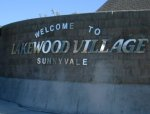

# Lakewood Village Historical Archive (1958-2008)

!!! note "About this Archive"
    This digital archive preserves 50 years of neighborhood publications, community photographs, civic records, and local history from the Lakewood Village Neighborhood Association (LVNA) in Sunnyvale, California. Originally curated by resident webmaster Brian Smithson from 2002 to 2008 and preserved in the [Cobwebs: LVNA](https://www.grot.com/Cobwebs/LVNA/index.html) archive, it has been digitized and made fully searchable for current and future residents.
    
    The LVNA continues actively serving the neighborhood today. For current association leadership, modern community announcements, and recent issues of *The Villager*, visit the official website: **[https://lvnasv.org](https://lvnasv.org)**.

[🌐 **Visit Modern LVNA Website (lvnasv.org)**](https://lvnasv.org){ .md-button .md-button--primary }

| Welcome to Lakewood Village |
| :---: |
|  *Lakehaven Drive entrance to Lakewood Village in northern Sunnyvale, California* |

## Neighborhood Overview

Lakewood Village is a distinctive mid-century neighborhood in northern Sunnyvale, California, bounded by Lawrence Expressway, Highway 237, and the Tasman corridor:

- **Construction Era:** Built between 1955 and 1958 across four development units.
- **Historic Association:** The Lakewood Village Residents Association (LVRA) was established in 1958, succeeded by the modern LVNA.
- **Door-to-Door Newsletters:** *The Villager* has been published and delivered by volunteer neighborhood "walkers" since May 1958.
- **Community Gathering Places:** Centered around Lakewood Park, the Lakewood Park Building, Lakewood Elementary, and Fairwood Elementary.

---

## Explore the Collections

-   📰 **[The Villager](Villager/Issues/index.md)**

    ---

    Browse over six decades of *The Villager* and vintage *LVRA Villager* newsletters. Search across 442 preserved issues (1958–2026) with digital transcripts and embedded PDF readers.

-   🏡 **[Neighborhood History](LV/History/history.md)**

    ---

    Explore the origins of Lakewood Village from agricultural orchards and the post-WWII Santa Clara Valley Airport through its 1950s subdivision construction.

-   🎪 **[Activities & Events](Activities/activities.md)**

    ---

    View historical photo albums and records from the annual Lakewood Park Summer Picnics, Holiday Parades, and neighborhood Lighting Contests.

-   🏛️ **[The LVNA](LVNA/lvna.md)**

    ---

    Review original association bylaws, founding records from the 1958 LVRA to the LVNA, meeting minutes, and civic advocacy archives.

-   🗺️ **[Community Resources](Resources/resources.md)**

    ---

    Access preserved Sunnyvale municipal service directories, civic and school web links, and the original LVNA.NET digital archive colophon.

Use the search bar at the top of the page to search across all articles, street names, and newsletter transcripts.
